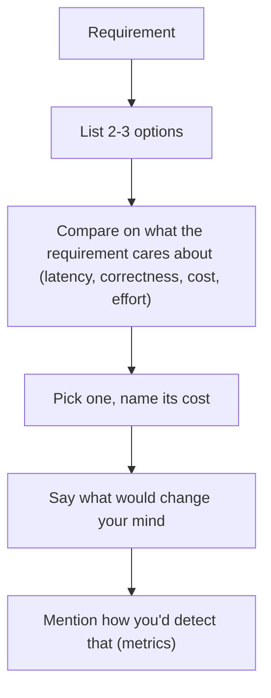

# Making and Defending Trade-offs

There is no perfect design, and interviewers know it. What they score is whether each choice is **tied to a requirement**, whether you **name what it costs**, and whether you can say **what would change your mind**.

---

## A simple way to state any decision

> "Because **[requirement]**, I'll use **[choice]**. It costs us **[downside]**, which is acceptable because **[reason]**. If **[condition changes]**, I'd switch to **[alternative]**."

Example:
> "Because reads outnumber writes 100 to 1 and the feed may lag by a few seconds, I'll precompute feeds on write. That costs extra writes for users with many followers, which is fine for 99% of accounts. For accounts over 100K followers I'd pull their posts at read time instead."

---

## The trade-offs that come up again and again

| Trade-off | Lean one way when... | Lean the other way when... |
|---|---|---|
| Consistency vs availability | Money, inventory, unique names | Feeds, likes, presence, analytics |
| Latency vs consistency | User-facing reads | Writes that must never be lost |
| Push vs pull (fan-out) | Reads dominate, fan-out small | Huge fan-out, many inactive readers |
| SQL vs NoSQL | Transactions, joins, evolving queries | Huge scale on known key-based access |
| Normalize vs denormalize | Write-heavy, data changes often | Read-heavy, joins cross shards |
| Sync vs async | Caller needs the result now | Slow, retryable or side-effect work |
| Exact vs approximate | Billing, money | Counts for display, trends, uniques |
| Batch vs stream | Answer can wait, needs full history | Freshness in seconds matters |
| Cache vs always read source | Read-heavy, staleness OK | Correctness-critical reads |
| Build vs buy | Core differentiator, special needs | Commodity infrastructure, small team |
| Monolith vs microservices | Small team, early product | Many teams, independent scaling and deploys |
| Strong vs eventual ordering | Ledger, chat within a conversation | Unrelated events across users |
| Cost vs performance | Low traffic, internal tools | Latency directly affects revenue |

---

## Signals of a strong answer
- Uses numbers from the estimate ("120K reads/s, one Postgres can't serve that, so cache").
- Admits the downside before the interviewer points it out.
- Picks different answers for different parts of the system (strong consistency for payments, eventual for likes).
- Prefers the simpler option until a requirement forces the complex one.

## Signals of a weak answer
- "We'll use Kafka" with no reason.
- Claiming a choice has no downside.
- Designing for 100x the stated scale.
- Changing the design every time the interviewer asks a question, instead of reasoning about it.

---

## Practice prompts
1. Cache-aside or write-through for a user profile service?
2. Cassandra or Postgres for chat messages?
3. Exactly-once or at-least-once with dedupe for a notification system?
4. Global strong consistency or home-region writes for a social app?
5. Precomputed or on-the-fly recommendations?

For each: state the requirement, two options, the cost of your pick, and the condition that would flip it.

**Related:** [Interview framework](23-interview-framework.md) · [Cheat sheet](00-interview-cheat-sheet-and-problem-patterns.md) · [CAP and consistency](08-cap-pacelc-and-consistency-models.md)
