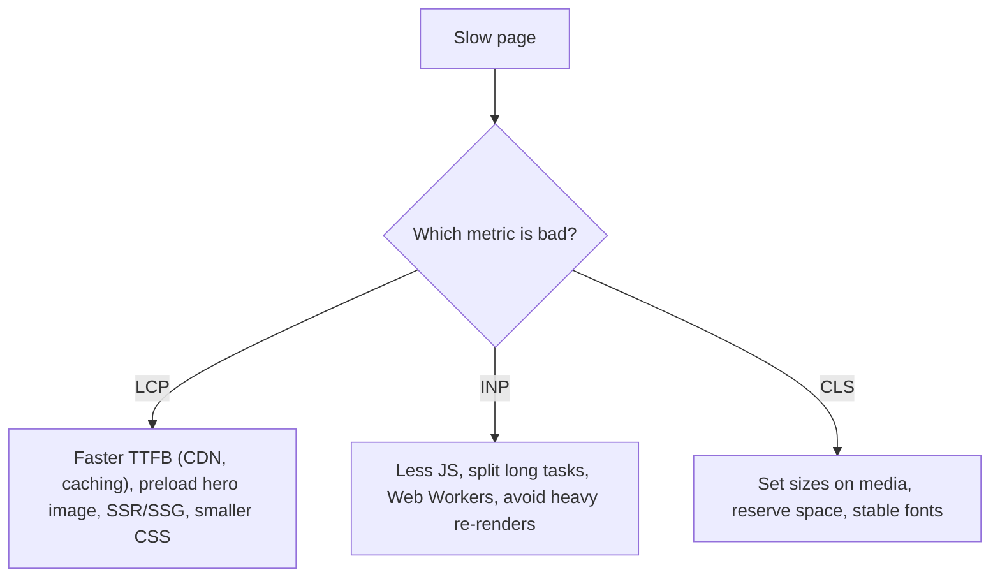

# Front-End Performance

Pages have to load and respond fast on real phones over real networks, not just on a developer laptop. The core ideas: render something useful early, ship less JavaScript, load what's needed when it's needed, and reserve space so nothing jumps around.

---

## What to measure (Core Web Vitals)

| Metric | Measures | Good target |
|---|---|---|
| **LCP** (Largest Contentful Paint) | When the main content (hero image, headline) is visible | < 2.5 s |
| **INP** (Interaction to Next Paint) | How quickly the page responds to taps and clicks | < 200 ms |
| **CLS** (Cumulative Layout Shift) | How much content jumps around while loading | < 0.1 |
| TTFB (Time to First Byte) | Server + network time before anything arrives | < 0.8 s |

Measure with real-user monitoring (field data from actual devices), not just lab tools like Lighthouse, and look at the 75th percentile on mobile.

---

## The critical rendering path

Anything that blocks this path (big CSS files, synchronous scripts in the head, slow server responses) delays what the user sees.

---

## Rendering strategies

| Strategy | How | Good for | Watch out for |
|---|---|---|---|
| CSR (client-side rendering) | Empty HTML, JS builds the page | Dashboards behind login | Slow first load, poor SEO |
| SSR (server-side rendering) | Server sends full HTML per request, JS hydrates it | Personalized pages that need SEO | Server cost, TTFB, hydration cost |
| SSG (static generation) | HTML built at deploy time, served from CDN | Docs, blogs, marketing | Content changes need rebuilds |
| ISR / stale-while-revalidate | Static pages regenerated in the background | Product pages, catalogs | Brief staleness |
| Streaming SSR / islands | Send HTML in chunks; hydrate only interactive parts | Large pages with a few interactive widgets | Framework support |

---

## Techniques that matter most

**Ship less JavaScript**
- Code splitting per route; lazy load heavy widgets (charts, editors) when needed.
- Tree shaking, remove unused dependencies, check bundle size in CI.
- Move heavy computation to Web Workers so the main thread stays free for input (better INP).

**Load the important things first**
- Preload the LCP image and key fonts; `fetchpriority="high"` on the hero image.
- `defer` or `async` non-critical scripts; inline only small critical CSS.
- Lazy load below-the-fold images (`loading="lazy"`), but never the LCP image.

**Make every byte cheaper**
- Serve from a CDN with HTTP/2 or HTTP/3, Brotli compression, long cache lifetimes for hashed file names.
- Responsive images (`srcset`), modern formats (AVIF/WebP), correct dimensions.

**Avoid layout shift**
- Always set width and height (or aspect ratio) for images, videos, ads and embeds.
- Reserve space for content that loads later; use `font-display: swap` with matched fallback fonts.

**Keep interactions fast**
- Break long tasks (> 50 ms) into chunks; debounce input handlers.
- Virtualize long lists (render only visible rows).
- Optimistic UI: show the result immediately, reconcile with the server after.

---

## Performance budgets
Set limits per page (for example: JS < 170 KB compressed, LCP < 2.5 s on a mid-range phone over 4G) and fail the build when they're exceeded. Without a budget, pages slowly get heavier with every feature.

---

## Interview Q&A

**Q: The product page has a 5 s LCP on mobile. Where do you start?**
A: Find the LCP element. Usually it's the hero image: serve it from a CDN in a modern format at the right size, preload it, render the page on the server or statically, and cut render-blocking CSS and JS.

**Q: SSR or CSR for an e-commerce site?**
A: SSR or static generation for product and category pages (SEO, fast first paint, CDN-cacheable), CSR for the logged-in account area.

**Q: How do you keep a 10,000-item list smooth?**
A: Virtualize it (render only the visible rows plus a buffer), paginate data fetching, and keep row components cheap to re-render.

**Related:** [Front-end state](34-front-end-state.md) · [CDN](../03-problems/52-cdn.md) · [Caching](07-caching-deep-dive.md)
