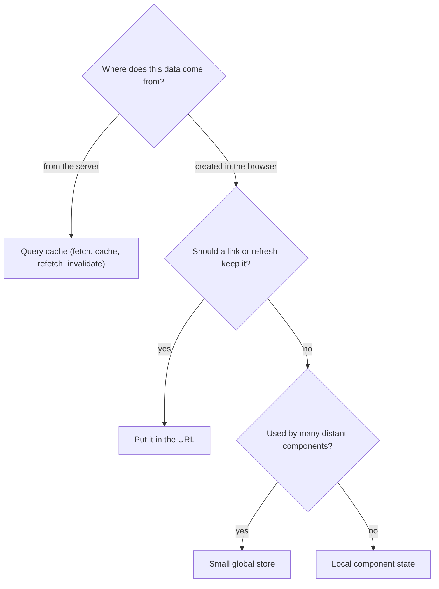
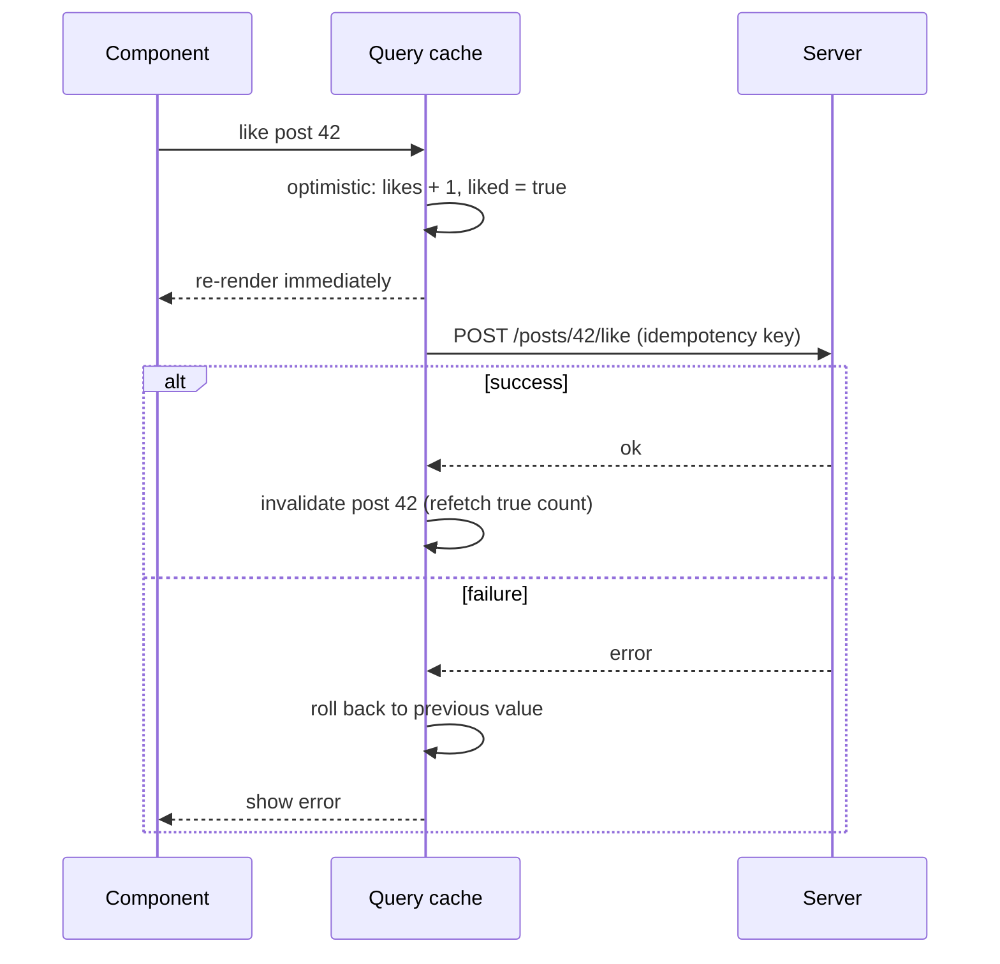

# Front-End State

Most front-end bugs come from state living in two places and drifting apart. The rule: **give every piece of state one owner**. Server data lives in a query cache, shareable state lives in the URL, and everything else stays in the component that uses it.

---

## Kinds of state and where they belong

| Kind | Examples | Owner |
|---|---|---|
| Server state | User profile, list of orders, feed items | Query cache (TanStack Query, SWR, Apollo, RTK Query) |
| URL state | Current page, filters, sort order, selected tab, search text | The URL (path and query string) |
| Local UI state | Is the dropdown open, input value while typing | The component (`useState`) |
| Shared client state | Theme, logged-in user, shopping cart before checkout | A small global store or context (Zustand, Redux, context) |
| Form state | Field values, validation errors, dirty flags | Form library or local state until submit |
| Persistent client state | Drafts, offline queue, preferences | localStorage / IndexedDB |

---

## Server state is a cache, not a store
Copying API responses into a global store means you now own caching, staleness, deduplication and refetching by hand. A query cache does that for you:
- **Caching by key** (`["orders", userId, page]`), so two components asking for the same data share one request.
- **Stale-while-revalidate:** show cached data instantly, refetch in the background.
- **Invalidation:** after a mutation, invalidate the affected keys so they refetch.
- **Optimistic updates:** update the cache before the server confirms, roll back on error.
- **Pagination and infinite scroll** helpers with cursors.

---

## URL as state
- Filters, sort, page and search text in the URL make views shareable and bookmarkable, and the back button works.
- Read state from the URL on load; update the URL instead of a separate variable (avoid keeping both in sync).

## Real-time updates
- WebSocket or SSE messages should update the **query cache** (patch the item or invalidate the key), not a parallel copy.
- Track a last-seen cursor or version so you can fill gaps after reconnecting.
- Share one socket across browser tabs (SharedWorker or BroadcastChannel) to avoid N connections per user.

## Common mistakes
- Derived data stored as state (store `items`, compute `count`; don't store both).
- The same server data held in two stores that drift apart.
- Global store used for everything, so every change re-renders half the app.
- Responses arriving out of order (fast typing in a search box): cancel stale requests or ignore responses for old inputs.

---

## Interview Q&A

**Q: Where would you keep the filters on a product listing page?**
A: In the URL, so the view can be shared and refreshed; the product list itself comes from the query cache keyed by those filters.

**Q: How do you make "like" feel instant but stay correct?**
A: Optimistic update in the query cache, send the request with an idempotency key, roll back on failure and refetch the true count on success.

**Q: How do you stop search results from showing an older query's answer?**
A: Abort the previous request when a new keystroke fires, or tag each response with its query and ignore ones that don't match the current input.

**Related:** [Front-end performance](33-front-end-performance.md) · [API design](02-api-design.md) · [Networking: real-time options](01-networking-basics.md)
