# System Design Patterns — Recognize the Shape, Reuse the Solution

> Almost every interview problem is a combination of a handful of recurring patterns. Learn these 20 and most "new" problems become assembly work. Each pattern lists **the problem it solves, the solution, a diagram, when to use it, pitfalls, and where it appears** in this repo.

| # | Pattern | Use it when... |
|---|---|---|
| 1 | [Cache-aside read path](#1-cache-aside-read-path) | Reads ≫ writes, same data read repeatedly |
| 2 | [Fan-out on write / read / hybrid](#2-fan-out-on-write-vs-read-hybrid) | One producer, many consumers of its content (feeds) |
| 3 | [Async work via queue + workers](#3-async-work-queue--workers) | Slow, bursty, or retryable work |
| 4 | [Pre-signed direct upload + processing pipeline](#4-pre-signed-direct-upload--processing-pipeline) | Large files (media, documents) |
| 5 | [Transactional outbox + CDC](#5-transactional-outbox--cdc) | DB write must reliably produce an event |
| 6 | [Saga (orchestrated)](#6-saga-orchestrated) | Business transaction across services |
| 7 | [Idempotency key](#7-idempotency-key) | Any retried write (payments, orders, messages) |
| 8 | [Reserve / hold with TTL then confirm](#8-reserve--hold-with-ttl-then-confirm) | Limited inventory: seats, rooms, stock |
| 9 | [Conditional update / optimistic concurrency](#9-conditional-update--optimistic-concurrency) | Concurrent writers on the same record |
| 10 | [Virtual waiting room / admission control](#10-virtual-waiting-room--admission-control) | Flash crowds |
| 11 | [Sharded / batched counters](#11-sharded--batched-counters) | Hot counters (likes, views) |
| 12 | [Stream windowed aggregation](#12-stream-windowed-aggregation) | Real-time counts, top-K, metrics |
| 13 | [Geo cell index](#13-geo-cell-index) | "Near me", matching by location |
| 14 | [Pub/Sub fan-out to live connections](#14-pubsub-fan-out-to-live-connections) | Chat, live locations, notifications |
| 15 | [Two-stage retrieval & ranking](#15-two-stage-retrieval--ranking) | Search, recommendations, ads |
| 16 | [CQRS read models](#16-cqrs-read-models) | Read shapes differ from write shape |
| 17 | [Event sourcing + snapshots](#17-event-sourcing--snapshots) | Auditable state (ledgers, exchanges) |
| 18 | [Leader election + fencing](#18-leader-election--fencing) | Exactly one active worker/coordinator |
| 19 | [Scatter–gather](#19-scattergather) | Query over sharded data |
| 20 | [Circuit breaker + bulkhead + retry with backoff](#20-circuit-breaker--bulkhead--retry-with-backoff) | Unreliable dependencies |
| 21 | [Rate limiting / token bucket](#21-rate-limiting--token-bucket) | Protect services from overload & abuse |
| 22 | [Write-ahead log + LSM storage](#22-write-ahead-log--lsm-storage) | Very high write throughput storage |
| 23 | [Consistent hashing / logical partitions](#23-consistent-hashing--logical-partitions) | Distributing keys over changing nodes |
| 24 | [Cell-based architecture](#24-cell-based-architecture) | Reduce blast radius at huge scale |

---

## 1. Cache-aside read path
**Problem:** DB can't serve all reads fast enough. **Solution:** check cache first; on miss read DB and populate; on write update DB then **delete** cache key.
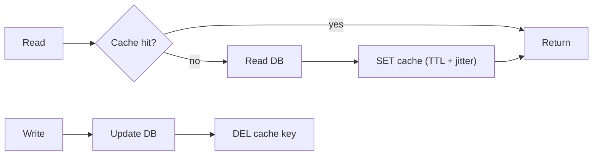
**Pitfalls:** stampede on hot-key expiry (single-flight lock), penetration (Bloom filter / negative cache), stale data window. **Seen in:** [URL shortener](../03-problems/05-url-shortener.md), [News feed](../03-problems/08-news-feed-system.md), almost everything.

## 2. Fan-out on write vs read (hybrid)
**Problem:** deliver one author's content to many followers' feeds.
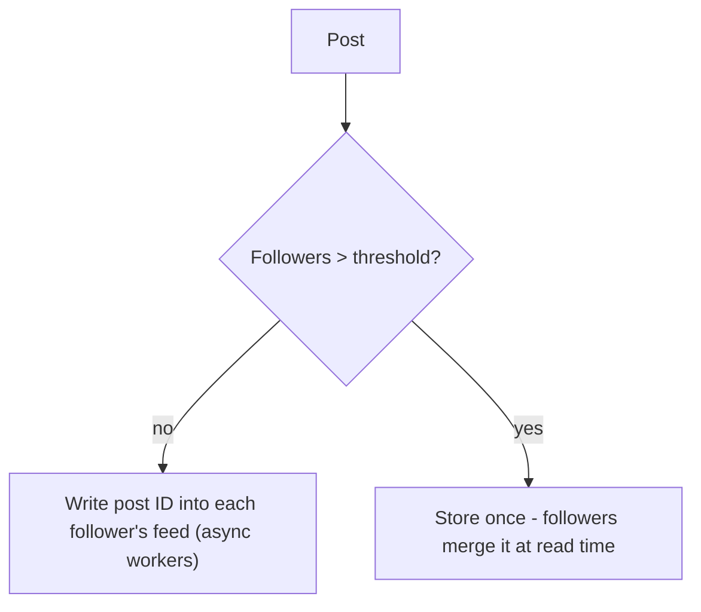
**Use:** feeds, timelines, inbox-style notifications. **Pitfall:** celebrity problem, inactive users. **Seen in:** [News feed](../03-problems/08-news-feed-system.md), [Twitter](../03-problems/26-twitter.md), [Instagram](../03-problems/27-instagram.md).

## 3. Async work: queue + workers
**Problem:** slow or spiky work blocks requests. **Solution:** API persists intent, enqueues a job, returns 202; workers process with retries; DLQ for poison messages.
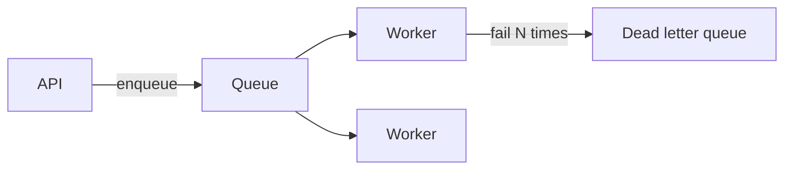
**Pitfalls:** at-least-once → idempotent workers; monitor queue lag; autoscale on lag. **Seen in:** [Notifications](../03-problems/07-notification-system.md), [YouTube](../03-problems/11-youtube.md), [Code judge](../03-problems/37-online-code-judge.md), [Webhooks](../03-problems/47-webhook-delivery-service.md).

## 4. Pre-signed direct upload + processing pipeline
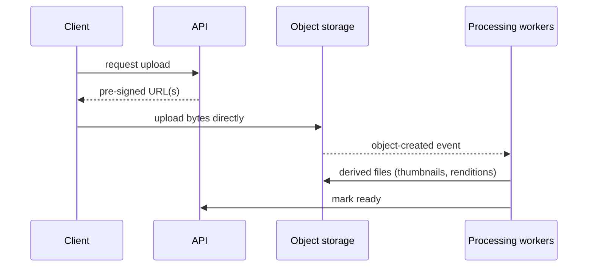
**Use:** media, documents, backups. **Seen in:** [YouTube](../03-problems/11-youtube.md), [Instagram](../03-problems/27-instagram.md), [Google Drive](../03-problems/12-google-drive.md).

## 5. Transactional outbox + CDC
**Problem:** "write DB then publish event" can half-fail. **Solution:** write the event into an `outbox` table in the same transaction; a relay/CDC publishes it.

**Seen in:** [Distributed transactions](../01-fundamentals/10-distributed-transactions-2pc-saga-outbox.md), [Webhooks](../03-problems/47-webhook-delivery-service.md), [E-commerce](../03-problems/38-ecommerce-flash-sale.md).

## 6. Saga (orchestrated)
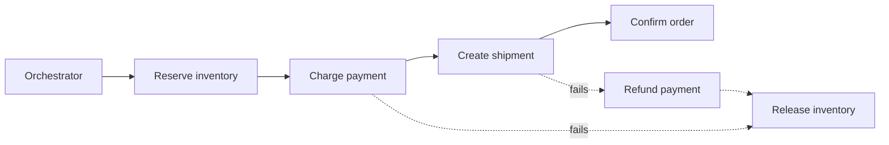
**Use:** multi-service workflows without 2PC. **Pitfalls:** no isolation (use pending states), compensations must be idempotent. **Seen in:** [Food delivery](../03-problems/30-food-delivery.md), [E-commerce](../03-problems/38-ecommerce-flash-sale.md), [Digital wallet](../03-problems/24-digital-wallet.md).

## 7. Idempotency key
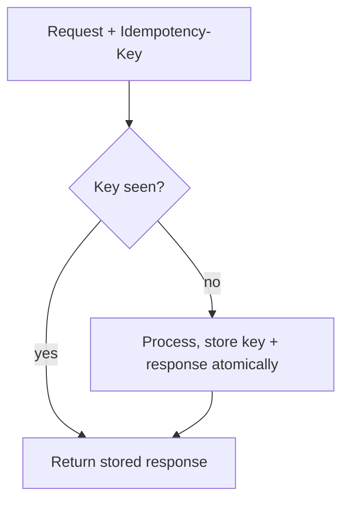
**Seen in:** [Payments](../03-problems/23-payment-system.md), [Hotel reservation](../03-problems/19-hotel-reservation.md), [Chat](../03-problems/09-chat-system.md) (client message IDs).

## 8. Reserve / hold with TTL then confirm
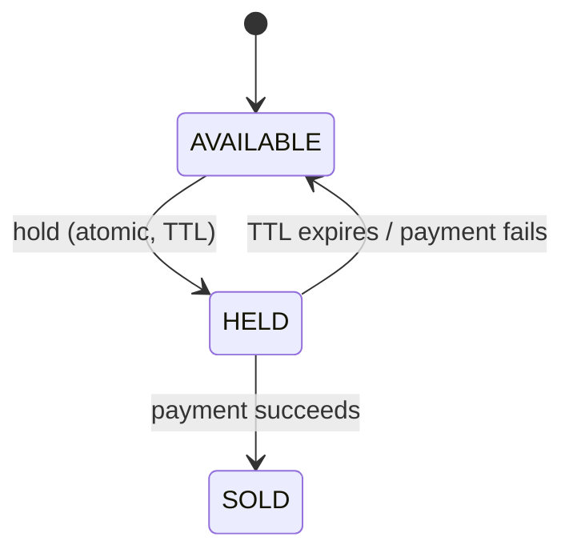
**Seen in:** [Ticketmaster](../03-problems/29-ticketmaster.md), [Airbnb](../03-problems/51-airbnb.md), [Flash sale](../03-problems/38-ecommerce-flash-sale.md).

## 9. Conditional update / optimistic concurrency
`UPDATE t SET x = :new, version = version + 1 WHERE id = :id AND version = :old` → 0 rows = someone else won → retry or fail. Also `WHERE qty >= :n`, DynamoDB condition expressions, Redis `SET NX`. **Seen in:** [Hotel](../03-problems/19-hotel-reservation.md), [Uber](../03-problems/28-uber.md) (driver lock), [Auction](../03-problems/60-online-auction.md).

## 10. Virtual waiting room / admission control
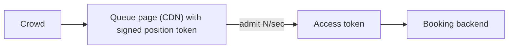
**Seen in:** [Ticketmaster](../03-problems/29-ticketmaster.md), [Flash sale](../03-problems/38-ecommerce-flash-sale.md).

## 11. Sharded / batched counters
Split a hot counter into N sub-keys or pre-aggregate increments for a few seconds before writing `+n`. **Seen in:** [Distributed counter](../03-problems/42-distributed-counter.md), [Reddit](../03-problems/49-reddit.md).

## 12. Stream windowed aggregation
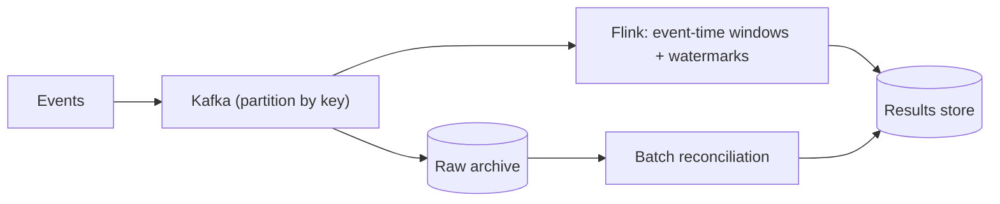
**Seen in:** [Ad clicks](../03-problems/18-ad-click-aggregation.md), [Top-K](../03-problems/34-top-k-heavy-hitters.md), [Metrics](../03-problems/17-metrics-monitoring-alerting.md).

## 13. Geo cell index
Map positions to cells (geohash / quadtree / S2 / H3); query the cell + neighbours; keep moving objects in memory with TTL. **Seen in:** [Proximity](../03-problems/13-proximity-service.md), [Nearby friends](../03-problems/14-nearby-friends.md), [Uber](../03-problems/28-uber.md), [Food delivery](../03-problems/30-food-delivery.md).

## 14. Pub/Sub fan-out to live connections
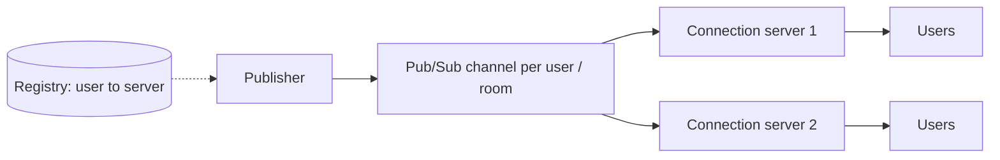
**Seen in:** [Chat](../03-problems/09-chat-system.md), [Slack](../03-problems/58-slack.md), [Nearby friends](../03-problems/14-nearby-friends.md), [Live streaming chat](../03-problems/40-live-streaming.md).

## 15. Two-stage retrieval & ranking
Cheap high-recall candidate generation (inverted index / ANN / rules) → expensive precise ranking on a few hundred → business re-ranking. **Seen in:** [Web search](../03-problems/36-web-search-engine.md), [Recommendations](../03-problems/43-recommendation-system.md), [Ad serving](../03-problems/57-ad-serving-rtb.md).

## 16. CQRS read models
Write model normalized in SQL; events/CDC build denormalized read models (search index, cache, materialized views). **Seen in:** [E-commerce](../03-problems/38-ecommerce-flash-sale.md), [Airbnb](../03-problems/51-airbnb.md).

## 17. Event sourcing + snapshots
Append-only events are the truth; state = replay; snapshots bound replay. **Seen in:** [Digital wallet](../03-problems/24-digital-wallet.md), [Stock exchange](../03-problems/25-stock-exchange.md), [Google Docs](../03-problems/35-google-docs.md) (op log).

## 18. Leader election + fencing
Lease from etcd/ZooKeeper; leader renews; token increases on each grant; storage rejects stale tokens. **Seen in:** [Lock service](../03-problems/44-distributed-lock-service.md), [Job scheduler](../03-problems/32-distributed-job-scheduler.md).

## 19. Scatter–gather
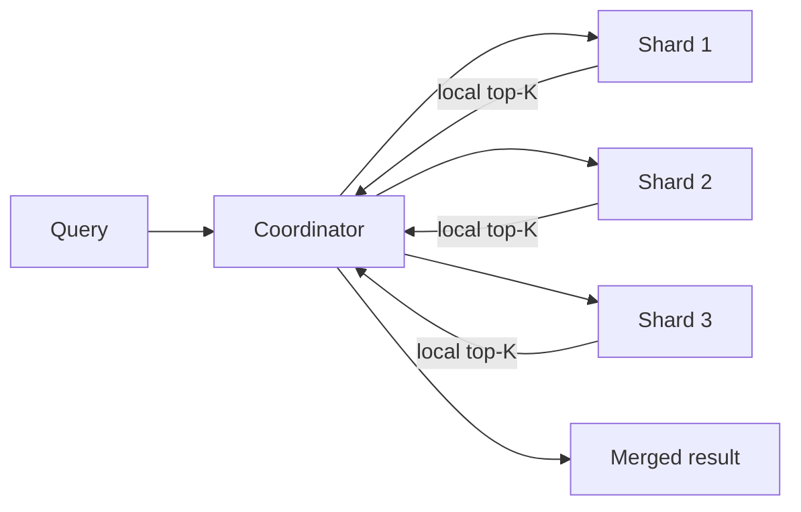
**Pitfall:** tail latency → hedged requests, timeouts, partial results. **Seen in:** [Web search](../03-problems/36-web-search-engine.md), [Leaderboard](../03-problems/22-gaming-leaderboard.md).

## 20. Circuit breaker + bulkhead + retry with backoff
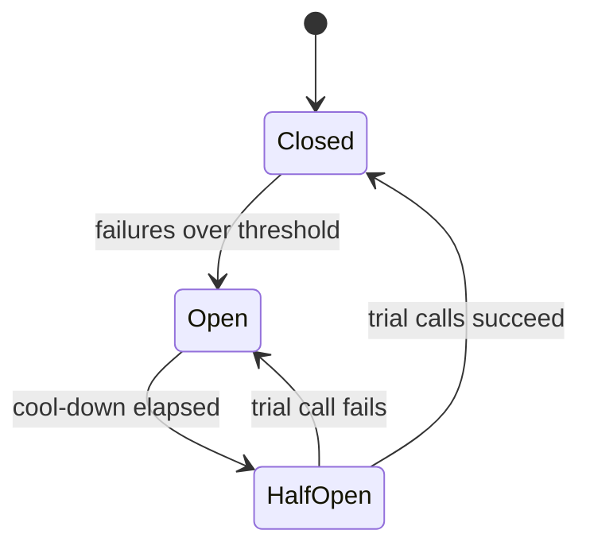
Retries use exponential backoff + jitter and a retry budget; bulkheads give each dependency its own pool. **Seen in:** [Reliability patterns](../01-fundamentals/13-reliability-and-resilience-patterns.md), [Webhooks](../03-problems/47-webhook-delivery-service.md).

## 21. Rate limiting / token bucket
Per-key buckets in Redis with atomic Lua; 429 + Retry-After. **Seen in:** [Rate limiter](../03-problems/01-rate-limiter.md).

## 22. Write-ahead log + LSM storage
Commit log → memtable → SSTables → compaction; Bloom filters for reads. **Seen in:** [Key-value store](../03-problems/03-key-value-store.md), [Message queue](../03-problems/16-distributed-message-queue.md).

## 23. Consistent hashing / logical partitions
Adding a node moves ~1/N keys; virtual nodes for balance. **Seen in:** [Consistent hashing](../03-problems/02-consistent-hashing.md), [Distributed cache](../03-problems/31-distributed-cache.md), [CDN](../03-problems/52-cdn.md).

## 24. Cell-based architecture
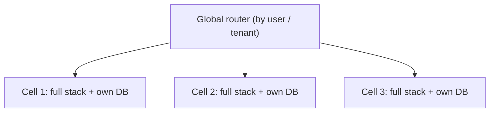
A bug or overload in one cell affects only its users. **Seen in:** [Architecture patterns](../01-fundamentals/12-architecture-patterns-microservices-cqrs-event-sourcing.md), [Uber](../03-problems/28-uber.md) (per-city partitioning).

---

## Problem → patterns quick map
| Problem | Patterns |
|---|---|
| URL shortener / Pastebin | 1, 7, 23 |
| News feed / Twitter / Instagram | 1, 2, 3, 4, 11, 12 |
| Chat / Slack | 7, 14, 22 |
| Uber / Food delivery | 6, 9, 13, 14 |
| Ticketmaster / Hotel / Airbnb / Flash sale | 7, 8, 9, 10 |
| Payments / Wallet / Exchange | 5, 6, 7, 17, 18 |
| Ad clicks / Top-K / Metrics / Counters | 11, 12 |
| Search / Recommendations / Ads | 15, 16, 19 |
| KV store / Cache / Queue / S3 | 18, 22, 23 |
