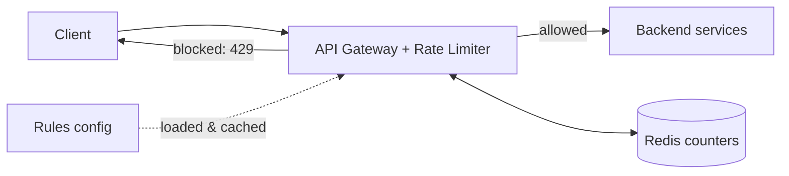
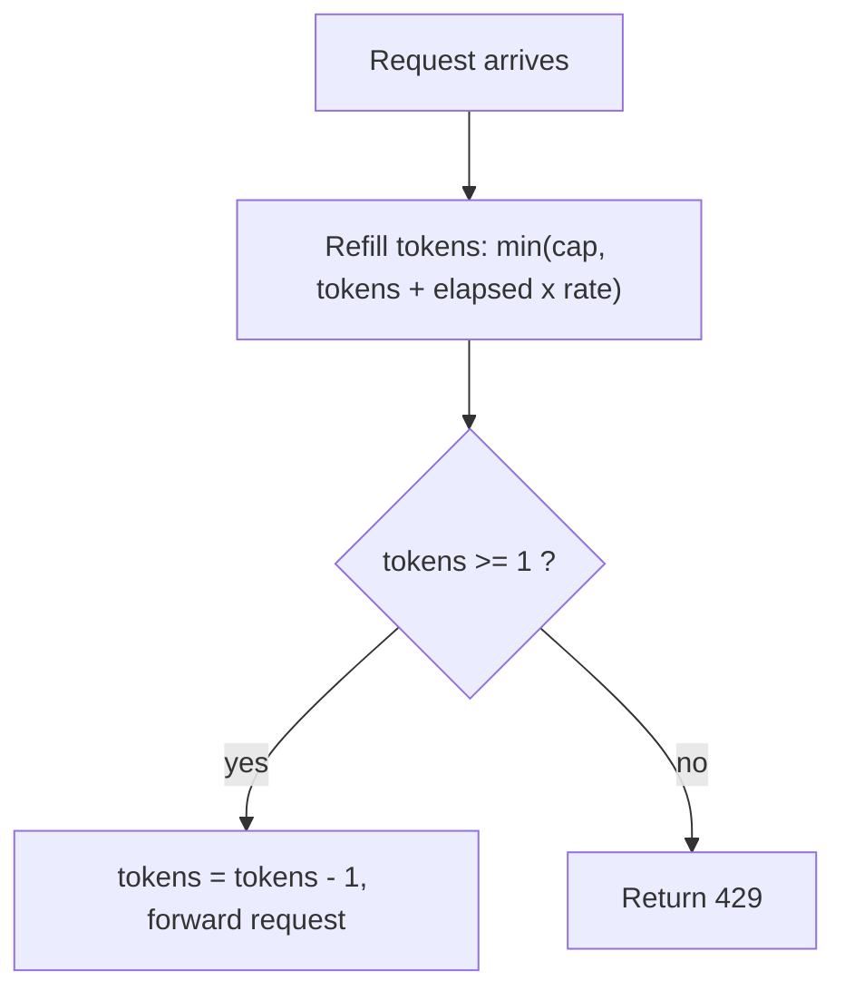
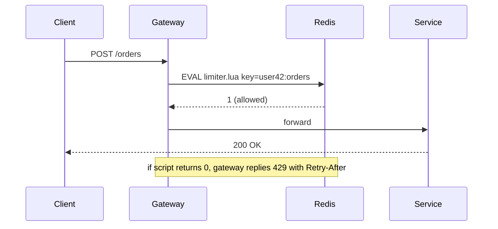

# 01 · Design a Rate Limiter

> **Category:** Infrastructure · **Difficulty:** ⭐⭐ · **Patterns:** token bucket, sliding window, atomic counters in Redis, API gateway middleware

---

## 1. TL;DR
Put a rate-limiting middleware (usually inside the API gateway) in front of your services. For each request, build a key such as `user:42:POST /orders`, look up its counter in **Redis**, run an algorithm (**token bucket** or **sliding window counter**) atomically with a **Lua script**, and either forward the request or return **HTTP 429** with `Retry-After`. Rules live in config files and are cached in memory.

---

## 2. Requirements

| Functional | Non-functional |
|---|---|
| Limit requests per user / IP / API key / endpoint | Adds < 1–2 ms latency |
| Multiple rules (e.g., 5 logins/min, 1000 API calls/hour) | Works across many servers (distributed) |
| Tell clients they're throttled (429 + headers) | Highly available; a limiter failure must not take the API down |
| Rules changeable without redeploy | Low memory per key |

**Why rate-limit?** Stop abuse & DoS, protect downstream services, control cost of paid third-party APIs, enforce pricing tiers.

---

## 3. Where should it live?



| Option | Verdict |
|---|---|
| Client side | ❌ Untrustworthy — clients can be modified |
| Inside each service | ✅ Full control, but duplicated logic |
| **Gateway / middleware** | ✅ Usual choice with microservices; one place to manage |
| Managed (Cloudflare, AWS API Gateway) | ✅ When you don't want to build it |

---

## 4. Algorithms

### 4.1 Token bucket (most popular)
A bucket holds up to **capacity** tokens and is refilled at **rate** tokens/sec. Each request takes one token; empty bucket → reject.



```python
def allow(key, capacity=10, rate=5):          # 5 tokens/sec, bursts of 10
    tokens, last = redis.hmget(key, "tokens", "ts") or (capacity, now())
    tokens = min(capacity, tokens + (now() - last) * rate)
    if tokens < 1:
        redis.hset(key, {"tokens": tokens, "ts": now()}); return False
    redis.hset(key, {"tokens": tokens - 1, "ts": now()}); return True
```
✅ Allows short bursts, O(1) memory. Used by Amazon & Stripe.

### 4.2 Leaky bucket
Requests enter a FIFO queue drained at a fixed rate. ✅ Smooth constant output. ❌ Bursts fill the queue and new requests wait/drop.

### 4.3 Fixed window counter
Counter per time window (`key:2026-11-25T10:31`). ✅ Simplest. ❌ **Boundary burst**: limit 100/min → 100 at 10:30:59 + 100 at 10:31:00 = 200 in one second.

### 4.4 Sliding window log
Store each request timestamp in a sorted set; drop timestamps older than the window; count. ✅ Exact. ❌ Memory = one entry per request.

### 4.5 Sliding window counter (best default for high volume)
`estimate = current_window_count + previous_window_count × (1 − elapsed_fraction_of_current_window)`
Example: limit 100/min, previous minute 80, current 30, 25% into current minute → `30 + 80 × 0.75 = 90` → allowed.

| Algorithm | Memory | Accuracy | Bursts |
|---|---|---|---|
| Token bucket | O(1) | Good | Allowed up to capacity |
| Leaky bucket | O(queue) | Good | Smoothed |
| Fixed window | O(1) | Edge spikes | Up to 2× |
| Sliding log | O(n) | Exact | No |
| Sliding counter | O(1) | ~99.99% | Smoothed |

---

## 5. Distributed implementation

**Problem:** with 50 gateway servers, local counters would allow 50× the limit. → Use a **central Redis** (sharded by key).

**Race condition:** two servers read `count=99`, both write `100` → 101 requests pass. → Make check-and-increment **atomic** with a Lua script:
```lua
local c = redis.call("INCR", KEYS[1])
if c == 1 then redis.call("EXPIRE", KEYS[1], ARGV[2]) end
return c <= tonumber(ARGV[1]) and 1 or 0
```



**Throttled response**
```
HTTP/1.1 429 Too Many Requests
X-RateLimit-Limit: 100
X-RateLimit-Remaining: 0
Retry-After: 27
```

**Rules config**
```yaml
- key: login            # per IP
  unit: minute
  requests_per_unit: 5
- key: api_call         # per API key
  unit: hour
  requests_per_unit: 1000
```

---

## 6. Deep-dive topics
- **Multi-region:** keep counters per region (local Redis) and accept slight over-admission, or sync asynchronously. Global exact limits cost cross-region latency.
- **Fail open vs fail closed:** if Redis is down, usually **fail open** (allow) to protect availability; fail closed for security-critical limits (login attempts).
- **Hot keys:** a single abusive API key hammering one Redis shard → local pre-check (in-memory token bucket) before Redis.
- **Layered limits:** coarse per-IP limits at CDN/edge (cheap, stops floods) + fine per-user/endpoint limits at gateway.
- **Soft vs hard limits:** soft = allow short overage, hard = strict.
- **Queue instead of drop:** for important writes (orders), enqueue excess requests for later processing.

---

## 7. Failure modes
| Failure | Mitigation |
|---|---|
| Redis down | Fail open + local fallback limiter; Redis replicas |
| Clock skew between servers | Use Redis server time (`TIME`) inside script |
| Config pushed with mistake | Validate, canary rollout of rules |
| Shared IPs (NAT, offices) | Prefer user/API-key limits over IP |

---

## 8. Interview Q&A
**Q: Token bucket vs sliding window — which do you pick?**
A: Token bucket when short bursts are acceptable (most public APIs); sliding window counter when you want smooth, accurate limits with O(1) memory.

**Q: How do you avoid the race between reading and incrementing the counter?**
A: Atomic `INCR` or a Lua script executed inside Redis — Redis runs scripts single-threaded so check+update is atomic.

**Q: The limiter adds a network hop to Redis on every request. Can you avoid it?**
A: Batch/approximate: each gateway keeps a local token bucket with a share of the global quota and syncs with Redis every few hundred ms. Trades accuracy for latency.

**Q: How do clients know when to retry?**
A: `Retry-After` and `X-RateLimit-*` headers; clients use exponential backoff with jitter.

---

**Related:** [Reliability patterns](../01-fundamentals/13-reliability-and-resilience-patterns.md) · [API design](../01-fundamentals/02-api-design.md) · [Distributed cache](31-distributed-cache.md)
