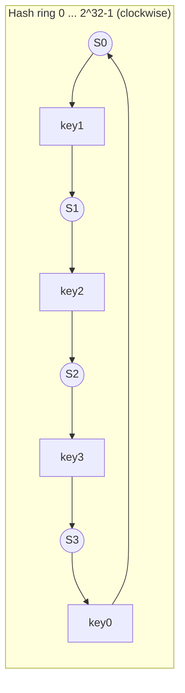
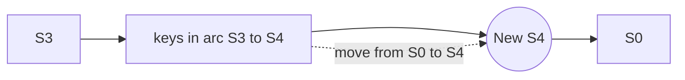

# 02 · Design Consistent Hashing

| Category | Difficulty | Key ideas |
|---|---|---|
| Infrastructure building block | Medium | hash ring, virtual nodes, minimal data movement |

---

## Summary
Placing keys with `server = hash(key) % N` reshuffles almost every key when N changes. **Consistent hashing** places both servers and keys on a circular hash space; a key belongs to the **first server clockwise**. Adding/removing a server moves only the keys in one arc (~1/N of keys). **Virtual nodes** (many points per server) even out the load.

---

## The problem with modulo hashing

| key hash | `% 4` (4 servers) | `% 3` (server 3 died) |
|---|---|---|
| 18358617 | 1 | 0 |
| 26143584 | 0 | 0 |
| 18131146 | 2 | 1 |
| 35863496 | 0 | 2 |

Most keys change servers -> for a cache cluster this means a **mass cache miss** that floods the database.

---

## How the ring works


- Hash servers (by name/IP) onto the ring.
- Hash each key onto the ring and walk **clockwise** to the first server: key1 -> S1, key2 -> S2, key3 -> S3, key0 -> S0.

### Adding a server

Only keys between the new server and its counter-clockwise neighbour move.

### Removing a server
Only the removed server's keys move - to the next server clockwise.

---

## Virtual nodes
With few servers, arcs are uneven -> some servers own much more of the ring. Give each server **V virtual positions** (`S1#0, S1#1, ... S1#199`).

| Virtual nodes per server | Std-dev of load (approx.) |
|---|---|
| 1 | very high (50%+) |
| 100 | ~10% |
| 200 | ~5% |

Extra benefits: weight powerful servers with more vnodes; when a server dies its load spreads across **many** servers instead of one neighbour.

---

## Implementation
```python
import bisect, hashlib

class Ring:
    def __init__(self, vnodes=150):
        self.vnodes, self.points, self.owner = vnodes, [], {}

    def _h(self, s):
        return int(hashlib.md5(s.encode()).hexdigest(), 16)

    def add(self, server):
        for i in range(self.vnodes):
            p = self._h(f"{server}#{i}")
            self.owner[p] = server
            bisect.insort(self.points, p)

    def remove(self, server):
        for i in range(self.vnodes):
            p = self._h(f"{server}#{i}")
            self.points.remove(p); del self.owner[p]

    def lookup(self, key):
        idx = bisect.bisect(self.points, self._h(key)) % len(self.points)
        return self.owner[self.points[idx]]
```
Lookup = binary search -> O(log(N·V)).

---

## Replication on the ring
For replication factor 3, walk clockwise and take the first **3 distinct physical servers** (skip vnodes of servers already chosen; ideally in different racks/AZs). This is exactly how Dynamo and Cassandra place replicas.

---

## Alternatives
| Technique | How | When |
|---|---|---|
| Rendezvous (HRW) hashing | Score every server with `hash(key, server)`, pick max | Small N, simple, perfect balance |
| Jump consistent hash | O(1) math function key -> bucket | Numbered shards that only grow/shrink at the end |
| Fixed hash slots | key -> one of 16,384 slots -> slot table -> node | Redis Cluster; rebalancing = moving slots |
| Maglev | Precomputed lookup table | Load balancers needing very fast lookups |

---

## Where it's used
Dynamo/DynamoDB, Cassandra, Riak, Memcached clients (Ketama), Discord (guild routing), Akamai CDN, Google Maglev, Envoy ring-hash load balancing.

---

## Interview Q&A
**Q: What fraction of keys moves when adding the (N+1)th server?**
A: About `1/(N+1)` on average.

**Q: Why not just use more shards than servers with modulo?**
A: You can - "fixed logical partitions" (e.g., 1024 partitions mapped to servers) is another valid approach; it's what Kafka, Elasticsearch and Redis Cluster do.

**Q: How do clients learn the ring?**
A: Gossip among nodes (Cassandra), a coordination service (ZooKeeper/etcd), or a routing proxy.

**Q: Does consistent hashing solve hot keys?**
A: No - it balances *key ranges*, not *traffic per key*. Hot keys need caching, replication or key splitting.

---

**Related:** [Partitioning & sharding](../01-fundamentals/06-partitioning-and-sharding.md) · [Key-value store](03-key-value-store.md) · [Distributed cache](31-distributed-cache.md)
