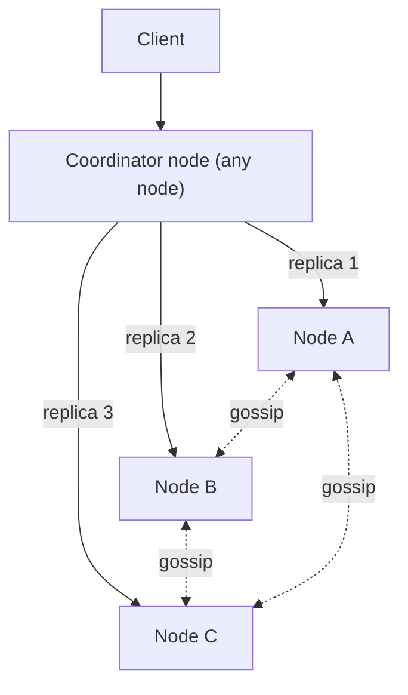
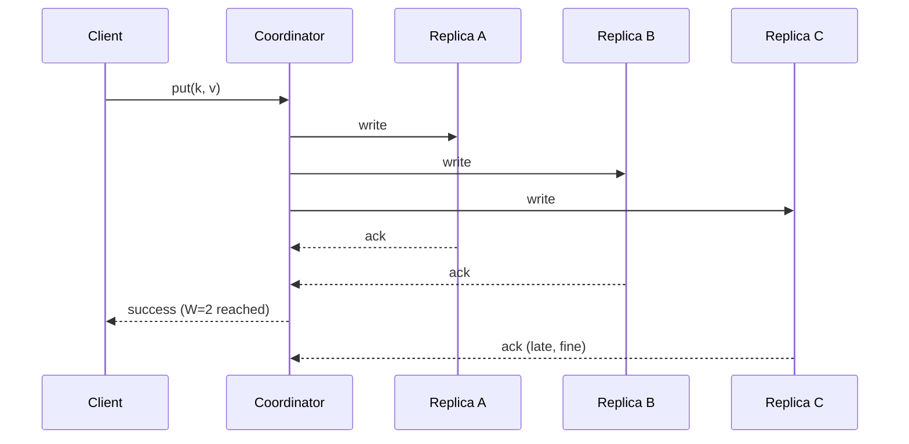
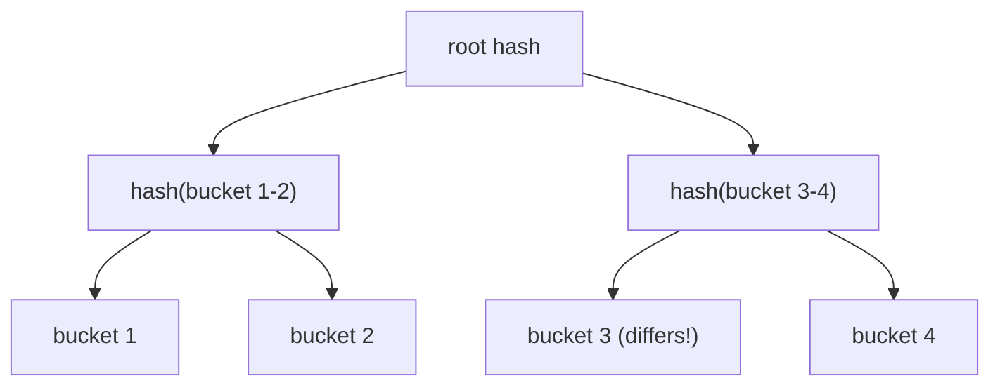
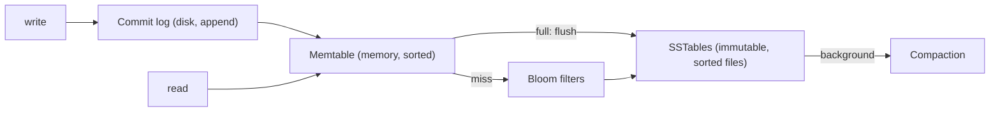

# 03 · Design a Distributed Key-Value Store (Dynamo / Cassandra style)

| Category | Difficulty | Key ideas |
|---|---|---|
| Storage infrastructure | Hard | consistent hashing, replication, quorum, vector clocks, gossip, hinted handoff, Merkle trees, LSM tree |

---

## Summary
Partition keys over a **consistent-hash ring**, replicate each key to **N** nodes, and use tunable **quorums** (W writes, R reads). Detect failures with **gossip**, survive temporary failures with **sloppy quorum + hinted handoff**, repair permanent divergence with **Merkle-tree anti-entropy**, and resolve concurrent writes with **vector clocks** (or last-write-wins). Each node stores data in an **LSM tree** (commit log -> memtable -> SSTables).

---

## Requirements
| Functional | Non-functional |
|---|---|
| `put(key, value)`, `get(key)` | Values small (< 10 KB) |
| | Store huge data sets (TBs-PBs) |
| | **High availability** (AP) - writes accepted during failures |
| | Automatic scaling (add/remove nodes) |
| | Tunable consistency, low latency |

Single-server version: an in-memory hash map + compression + spill cold data to disk. Doesn't scale beyond one machine -> distribute.

---

## CAP choice
Network partitions are unavoidable, so choose:
- **CP** (e.g., HBase, etcd): reject writes when replicas can't agree -> banking-style correctness.
- **AP** (Dynamo, Cassandra): keep accepting reads/writes, reconcile later -> shopping carts, sessions, social data.

This design is **AP with tunable consistency**.

---

## Architecture

Every node has the same role (no single master): it can coordinate requests, store data, and gossip membership.

---

## Core components

### Partitioning
Consistent hashing with virtual nodes -> even spread, minimal movement when scaling (see [02](02-consistent-hashing.md)).

### Replication
Walk clockwise from the key's position and store on the next **N distinct physical nodes** (N = 3 typical), placed across racks/data centers.

### Quorum consistency
| Setting | Meaning |
|---|---|
| N | number of replicas |
| W | replicas that must ack a write |
| R | replicas that must answer a read |

- `W + R > N` -> read set overlaps write set -> you read the latest acknowledged write.
- `W = 1, R = 1` -> fastest, eventual.
- `R = 1, W = N` -> fast reads; `W = 1, R = N` -> fast writes.
- Typical: `N=3, W=2, R=2`.

### Conflict resolution with vector clocks
Each version carries `[(node, counter), ...]`.
- Version X is an **ancestor** of Y if every counter in X ≤ the one in Y -> keep Y.
- Otherwise they are **siblings (conflict)** -> return both; the client merges and writes back.

Example: `D1[(Sx,1)] -> D2[(Sx,2)]`, then concurrent `D3[(Sx,2),(Sy,1)]` and `D4[(Sx,2),(Sz,1)]` -> conflict -> client merges -> `D5[(Sx,3),(Sy,1),(Sz,1)]`.
Downsides: client complexity, vector growth (trim old entries). Many systems (Cassandra) use simpler **last-write-wins** timestamps instead.

### Failure detection - gossip
Each node keeps a membership list with heartbeat counters, periodically sends it to a few random nodes. If a node's heartbeat hasn't increased for a while, others mark it down. Info spreads in O(log N) rounds without a central monitor.

### Temporary failures - sloppy quorum + hinted handoff
If replica A is down, write to the next healthy node D with a **hint** "this belongs to A". When A recovers, D hands the data back. Keeps writes available.

### Permanent failures - anti-entropy with Merkle trees
Each replica builds a hash tree over key ranges. Compare roots; descend only into mismatching branches -> sync only the differing buckets.

### Data-center outage
Replicate across multiple DCs; clients fail over to another DC.

---

## Storage engine (per node): LSM tree

- **Write:** append to commit log (durability) -> insert into memtable -> flush to SSTable when full. Sequential I/O = very fast writes.
- **Read:** memtable -> (cache) -> Bloom filter tells which SSTables might contain the key -> read them newest-first.
- **Compaction:** merges SSTables, discards overwritten values & tombstones.

---

## Summary of techniques
| Goal | Technique |
|---|---|
| Store big data | Consistent hashing |
| High availability reads | Replication, multiple DCs |
| Highly available writes | Sloppy quorum, hinted handoff, vector clocks |
| Partitioning | Consistent hashing + vnodes |
| Incremental scalability | Consistent hashing |
| Heterogeneity | Vnodes proportional to capacity |
| Tunable consistency | Quorum (N, W, R) |
| Temporary failures | Hinted handoff |
| Permanent failures | Merkle trees |
| DC outage | Cross-DC replication |

---

## Interview Q&A
**Q: Why can a quorum system still return stale data?**
A: Sloppy quorums (hints on non-home nodes), concurrent writes, and read-repair delays; `W+R>N` holds only for the home replicas.

**Q: LWW vs vector clocks?**
A: LWW is simple but silently drops one of two concurrent writes and depends on clocks; vector clocks detect conflicts but push merging to the client.

**Q: Why LSM and not B-tree?**
A: Write-heavy workloads: sequential appends beat random in-place updates; Bloom filters keep reads acceptable.

**Q: How do you add a node?**
A: It joins the ring (gossip), takes ownership of vnode ranges, streams those ranges from existing replicas, then starts serving.

---

**Related:** [CAP & consistency](../01-fundamentals/08-cap-pacelc-and-consistency-models.md) · [Replication](../01-fundamentals/05-replication.md) · [Clocks](../01-fundamentals/20-time-clocks-and-ordering.md) · [Databases](../01-fundamentals/04-databases-sql-vs-nosql-acid-indexing.md)
