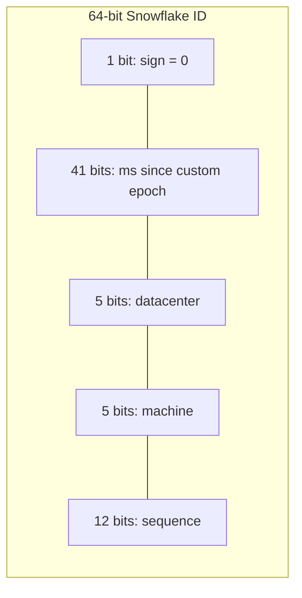
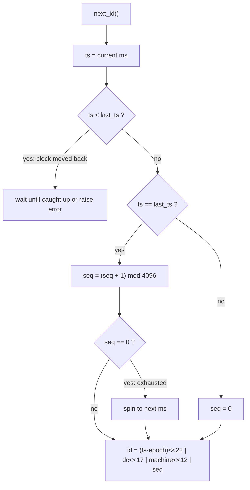

# 04 · Design a Unique ID Generator for Distributed Systems

> **Category:** Infrastructure building block · **Difficulty:** ⭐⭐ · **Patterns:** Snowflake IDs, coordination-free generation, clock handling

---

## 1. TL;DR
Generate **64-bit, time-sortable** IDs on every server **without coordination** using the **Snowflake** layout: `timestamp (41 bits) | datacenter (5) | machine (5) | sequence (12)`. Each machine can mint 4,096 IDs per millisecond. Guard against clocks moving backwards and assign machine IDs safely (config or etcd/ZooKeeper leases).

---

## 2. Requirements
| Requirement | Value |
|---|---|
| Unique | Globally, forever |
| Type | Numeric, fits in 64 bits |
| Ordering | Roughly increasing with time (sortable by creation) |
| Throughput | 10,000+ IDs/sec |
| Availability | No single point of failure |

---

## 3. Options compared

| Approach | How | ✅ | ❌ |
|---|---|---|---|
| DB auto-increment, multi-master | Each of k DBs increments by k (1, k+1, 2k+1…) | Simple numbers | Not time-ordered across DBs, hard to add/remove servers |
| UUID v4 | 128-bit random per server | No coordination | 128 bits, not sortable, poor index locality |
| Ticket server | One DB hands out IDs (`REPLACE INTO tickets…`) | Numeric, simple | SPOF / bottleneck (mitigate with 2 servers odd/even) |
| **Snowflake** | Bit-packed timestamp + machine + sequence | 64-bit, sortable, no coordination, fast | Depends on clocks; machine-ID management |



---

## 4. Capacity math
- 41-bit milliseconds → 2⁴¹ ms ≈ **69 years** after the custom epoch.
- 5 + 5 bits → 32 DCs × 32 machines = **1,024 generators**.
- 12-bit sequence → **4,096 IDs/ms/machine** ≈ 4M/s per machine.

---

## 5. Generation algorithm



```python
def next_id():
    global last_ts, seq
    ts = now_ms()
    if ts < last_ts:
        raise ClockMovedBackwards(last_ts - ts)
    if ts == last_ts:
        seq = (seq + 1) & 0xFFF
        if seq == 0:
            while ts <= last_ts:
                ts = now_ms()
    else:
        seq = 0
    last_ts = ts
    return ((ts - EPOCH) << 22) | (DC_ID << 17) | (MACHINE_ID << 12) | seq
```

---

## 6. Deep dives
- **Clock sync:** NTP keeps clocks close; Snowflake IDs are *k-sorted* (roughly ordered) across machines, strictly ordered per machine.
- **Clock going backwards:** refuse/wait, or keep a small "backwards tolerance" by borrowing from the sequence.
- **Machine ID assignment:** static config is error-prone with autoscaling → lease an ID from ZooKeeper/etcd (ephemeral node) at startup.
- **Tuning bit widths:** low-QPS systems can trade sequence bits for more timestamp/machine bits.
- **High availability:** the generator is a library inside each service (no network call) or a small replicated service.

### Modern alternatives
| Scheme | Size | Sortable | Notes |
|---|---|---|---|
| UUID v7 | 128 | ✅ | Time-ordered UUID; great default for DB primary keys |
| ULID | 128 | ✅ | Lexicographically sortable string |
| Instagram style | 64 | ✅ | time + shard id + per-shard sequence generated in Postgres |
| Segment allocation (Leaf) | 64 | ✅ | Servers fetch ID ranges (e.g., 1,000) from a DB |

---

## 7. Interview Q&A
**Q: Why not UUID?** 128 bits doesn't fit the requirement, random UUIDs aren't time-sortable and fragment B-tree indexes.

**Q: Can two machines generate the same ID?** Only if they share a machine ID or a clock goes backwards — prevented by leased machine IDs and the backwards-clock check.

**Q: Why are sortable IDs useful?** Cursor pagination (`WHERE id < cursor`), sorting feeds by ID instead of a timestamp index, append-friendly B-tree inserts.

**Q: Security concern?** Sequential-looking IDs leak volume and allow enumeration — don't expose them where that matters.

---

**Related:** [Clocks & ordering](../01-fundamentals/20-time-clocks-and-ordering.md) · [URL shortener](05-url-shortener.md) · [Twitter](26-twitter.md)
