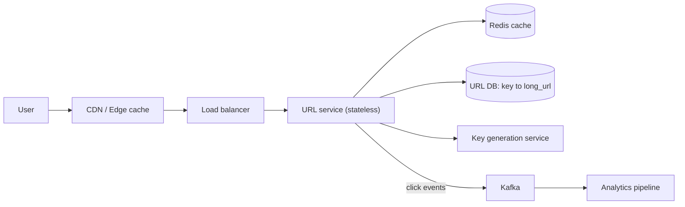
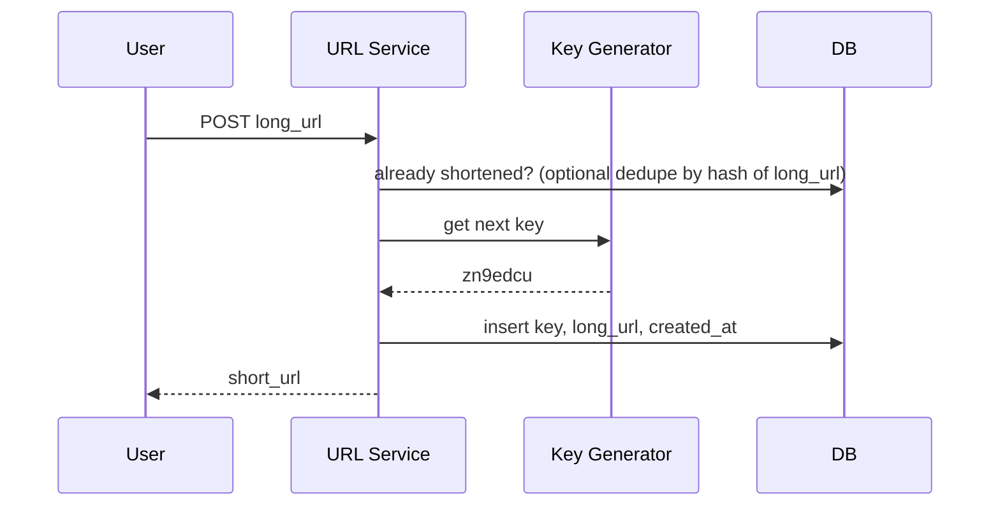
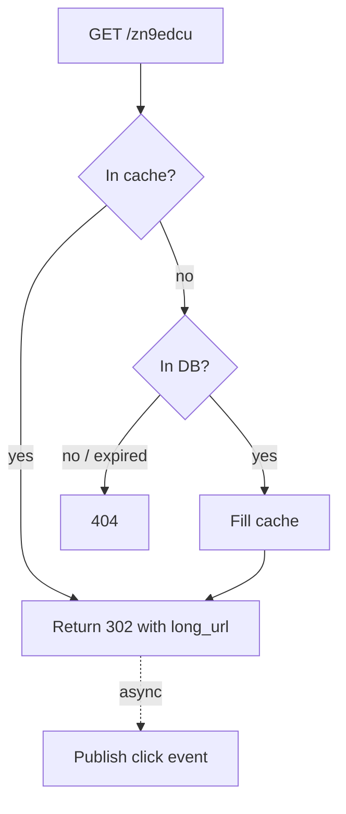

# 05 · Design a URL Shortener (TinyURL / bit.ly)

| Category | Difficulty | Key ideas |
|---|---|---|
| Read-heavy key lookup | Easy | unique key generation, Base62, cache-aside, 301 vs 302, analytics via events |

---

## Summary
Map a long URL to a 7-character key. Generate keys from a **unique ID -> Base62** (or pre-generated random keys from a **Key Generation Service**), store `key -> long_url` in a horizontally scalable store, and serve redirects from a **cache** (and CDN). Use **302** if you need click analytics, **301** if you want browsers to cache.

---

## Requirements
| Functional | Non-functional |
|---|---|
| Shorten a long URL | Very high availability |
| Redirect short -> long | Redirect latency < 50 ms |
| Optional: custom alias, expiry, analytics | Keys unpredictable (optional) |

### Estimates
| Quantity | Value |
|---|---|
| New URLs | 100M/day -> **~1,200 writes/s** |
| Reads (10:1) | **~12,000 redirects/s** |
| Records in 10 years | 100M × 365 × 10 = **365 billion** |
| Storage | 365B × ~100 B ≈ **36.5 TB** (with metadata, ~50-100 TB) |
| Key length | 62⁷ ≈ 3.5 trillion > 365B -> **7 chars** |

---

## API
```
POST /api/v1/urls            { "long_url": "...", "alias": "optional", "expires_at": "optional" }
     → 201 { "short_url": "https://sho.rt/zn9edcu" }
GET  /{key}                  → 301/302 Location: <long_url>   (404 if unknown/expired)
```

---

## Architecture



---

## Core flows

### Shorten


### Redirect


---

## Deep dive: generating the key

### Option A - Hash + truncate
`MD5(long_url)` -> take first 7 chars. Collisions possible -> append a salt and retry; checking existence costs a DB lookup (use a **Bloom filter** to make it cheap).

### Option B - Unique ID + Base62
Get a unique 64-bit ID (Snowflake / DB sequence) and encode in Base62 `[0-9a-zA-Z]`.
```python
ALPHA = "0123456789abcdefghijklmnopqrstuvwxyzABCDEFGHIJKLMNOPQRSTUVWXYZ"
def base62(n):
    out = ""
    while n: n, r = divmod(n, 62); out = ALPHA[r] + out
    return out or "0"
```
No collisions. Sequential IDs make keys guessable - scramble the ID (e.g., multiply by a large prime mod 62⁷) if that matters.

### Option C - Key Generation Service
Pre-compute random unique keys into an `unused_keys` table; each app server grabs a batch of 1,000 into memory. No collisions, not guessable, no hashing on the hot path.

| | Hash + truncate | ID + Base62 | KGS |
|---|---|---|---|
| Collisions | Yes -> retry | No | No |
| Guessable | No | Yes (unless scrambled) | No |
| Dependencies | DB check / Bloom | ID generator | Key DB |

---

## Data model & storage
`urls(key PK, long_url, user_id, created_at, expires_at)` - simple key lookups at massive scale -> **DynamoDB/Cassandra** or sharded MySQL (shard by key hash). Read replicas + Redis cache handle the 10:1 read ratio.

**Cache sizing:** traffic follows a power law. Caching the 20% hottest URLs: 12K req/s × 86,400 × 20% × 500 B ≈ **~100 GB** -> a small Redis cluster.

---

## vs 302
| 301 Permanent | 302 Temporary |
|---|---|
| Browser caches -> fewer hits to us | Every click reaches us |
| Lose analytics, can't change target | Click analytics, can edit/expire links |

---

## Extras
- **Analytics:** publish click events (time, referrer, country, device) to Kafka -> stream aggregation; never slow the redirect.
- **Expiry:** check `expires_at` on read; nightly cleanup job.
- **Abuse:** rate limit creation, scan targets against malware/phishing lists.
- **Custom aliases:** unique constraint; reserve offensive words.

---

## Interview Q&A
**Q: Same long URL shortened twice - same key?**
A: Optional: store `hash(long_url) -> key` index to dedupe; many services intentionally give different keys per user for separate analytics.

**Q: How do you scale to 1M redirects/s?**
A: CDN/edge caching of redirect responses, Redis cluster, multi-region read replicas.

**Q: What if the KGS dies?**
A: Run it replicated; servers already hold key batches in memory; losing an unused batch wastes a few keys - harmless given 3.5 trillion.

---

**Related:** [Unique ID generator](04-unique-id-generator.md) · [Pastebin](33-pastebin.md) · [Caching](../01-fundamentals/07-caching-deep-dive.md)
