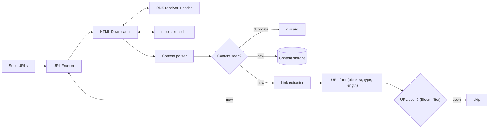
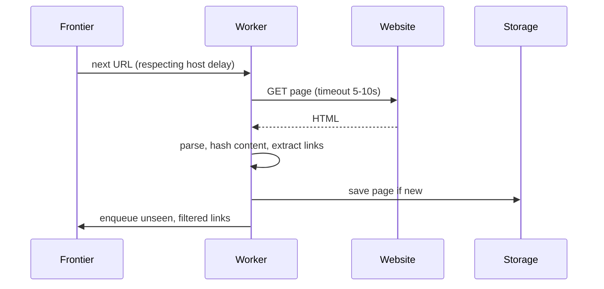
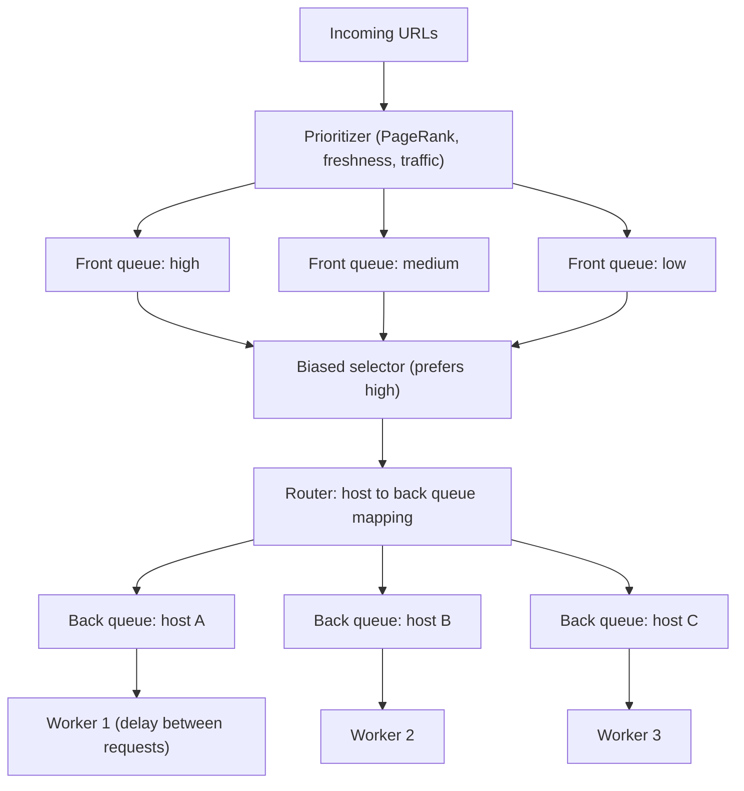

# 06 · Design a Web Crawler

| Category | Difficulty | Key ideas |
|---|---|---|
| Batch / job processing | Medium | BFS over a graph, URL frontier with priority & politeness queues, Bloom-filter dedupe, consistent hashing by host |

---

## Summary
Start from seed URLs, keep a **URL frontier** that balances **priority** (important pages first) and **politeness** (one connection per host, with delays). Workers download pages, parse them, drop **duplicate content** (hash / SimHash), extract links, filter and dedupe URLs (**Bloom filter**), and push new URLs back into the frontier. Partition the work by **hostname** across many crawler machines.

---

## Requirements
| Functional | Non-functional |
|---|---|
| Crawl HTML pages for search indexing | **Scalable** (billions of pages, parallel) |
| Discover new pages, refresh changed ones | **Robust** (bad HTML, traps, crashes) |
| Skip duplicate content | **Polite** (don't overload websites; obey robots.txt) |
| Store pages for 5 years | **Extensible** (new content types later) |

### Estimates
| Quantity | Value |
|---|---|
| Pages/month | 1 billion -> **~400 pages/s**, peak ~800 |
| Avg page | 500 KB -> 500 TB/month |
| 5-year storage | **~30 PB** |

---

## Architecture

---

## Crawl loop

---

## Deep dive: URL frontier

- **Front queues = priority**, **back queues = politeness** (each back queue holds one host; one worker per queue with delay between fetches).
- Frontier is mostly **on disk** with in-memory buffers for enqueue/dequeue (it holds hundreds of millions of URLs).
- **Freshness:** recrawl based on observed change rate and importance; use `If-Modified-Since`/ETag.

### BFS vs DFS
The web is a directed graph. DFS can go infinitely deep; plain BFS ignores importance and hammers one host (pages link mostly to the same site) -> hence the priority + politeness frontier.

---

## Other deep dives
| Topic | Approach |
|---|---|
| Distribute crawling | Assign hosts to crawler nodes via **consistent hashing on hostname** -> politeness & caches stay local |
| DNS bottleneck | Local DNS cache, async resolvers |
| Duplicate content (~30% of web) | Exact: hash of content; near-dup: **SimHash** fingerprints |
| URL seen? at 10B URLs | **Bloom filter** (~12 GB at 1% FP) + normalize URLs (lowercase host, drop fragments/tracking params) |
| Spider traps (infinite calendars) | Max URL length/depth, per-host page caps, pattern blocklists |
| JavaScript pages | Headless browser renderer pool for important sites |
| Robustness | Checkpoint frontier state, timeouts, retry with backoff, isolate parser crashes |
| Extensibility | Plug-in modules after the parser (image downloader, copyright monitor) |
| Security | Block private IP ranges (SSRF), size limits |

---

## Storage
- Raw pages: compressed blobs in object storage / Bigtable keyed by **reversed host** (`com.example.www/page`) to group a site's pages.
- Metadata: URL, last crawl time, content hash, status code, next crawl time.

---

## Interview Q&A
**Q: How do you stay polite?**
A: Honour robots.txt and Crawl-delay, one in-flight request per host, delay between requests, back off on 429/503, identify via User-Agent.

**Q: How do you avoid recrawling the same page under different URLs?**
A: URL normalization + canonical tags + content hashing.

**Q: How would you prioritize?**
A: PageRank/link popularity, site traffic, update frequency, freshness need (news > archives).

**Q: How do you scale to 10× pages?**
A: More crawler nodes (hash by host), larger frontier on disk, more storage; DNS and Bloom filters partitioned per node.

---

**Related:** [Web search engine](36-web-search-engine.md) · [Probabilistic DS](../01-fundamentals/18-probabilistic-data-structures-and-useful-algorithms.md) · [Consistent hashing](02-consistent-hashing.md)
