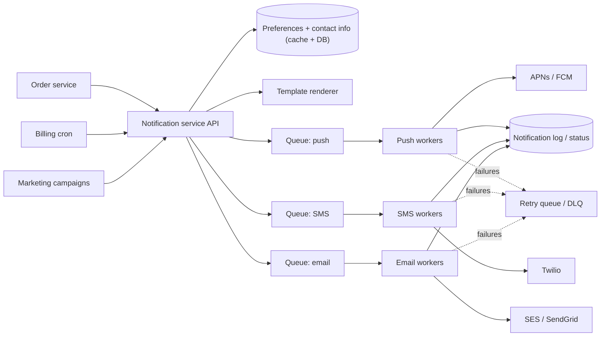
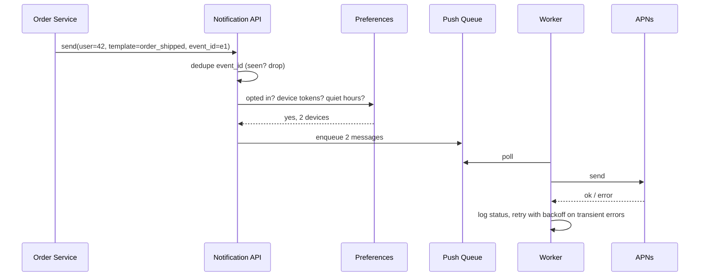

# 07 · Design a Notification System (Push, SMS, Email)

> **Category:** Async job processing · **Difficulty:** ⭐⭐⭐ · **Patterns:** queues per channel, workers, retries, idempotency/dedup, user preferences, rate limiting

---

## 1. TL;DR
Services call a **Notification API**; it validates, checks **user preferences**, renders a **template**, and enqueues one message per channel into **separate queues** (push / SMS / email). **Workers** send through third-party providers (APNs, FCM, Twilio, SES/SendGrid), **retry** failures with backoff, **dedupe** by event ID, and log status for tracking.

---

## 2. Requirements
| Functional | Non-functional |
|---|---|
| Push (iOS/Android), SMS, email | Soft real-time (seconds) |
| Triggered by services or scheduled | Don't lose notifications |
| User opt-out per type/channel | Don't spam: dedupe + frequency caps |
| Track delivery/open/click | Scale: 10M push, 1M SMS, 5M email per day (bursts much higher for campaigns) |

---

## 3. Architecture

Why separate queues? An SMS provider outage must not block push notifications; OTPs must not wait behind a 50M-email campaign → also **priority queues**.

---

## 4. Send flow

---

## 5. Data model
| Table | Fields |
|---|---|
| user | user_id, email, phone, country, timezone |
| device | device_id, user_id, platform, push_token, last_seen |
| preference | user_id, notification_type, channel, opted_in |
| notification_log | id, event_id, user_id, channel, status, attempts, created_at |
| template | template_id, channel, locale, body |

---

## 6. Deep dives
- **Reliability:** persist every notification in the log before sending; at-least-once delivery with retries (exponential backoff + jitter); after N failures → DLQ + alert.
- **Deduplication:** idempotency/event ID checked before enqueue and before send (`SET NX event:{id}` with TTL). Exactly-once to a phone is impossible; aim for effectively once.
- **Preferences & compliance:** opt-outs, unsubscribe links, quiet hours in the user's time zone, consent laws.
- **Rate limiting:** per user (e.g., max 3 marketing pushes/day) and per provider (respect APNs/FCM/SES quotas).
- **Campaigns:** split audiences into batches, spread sends over time, warm up email IPs.
- **Token hygiene:** remove invalid device tokens reported by APNs/FCM.
- **Tracking:** delivery receipts, open/click tracking via redirect links/pixels → events → analytics.
- **Security:** only authenticated internal services (API keys/mTLS) can send.

---

## 7. Failure modes
| Failure | Handling |
|---|---|
| Provider down | Retry later, failover to secondary provider (e.g., SMS) |
| Worker crash mid-send | Message re-delivered (visibility timeout) → dedupe prevents double send |
| Queue backlog | Autoscale workers on queue depth |
| Bad template deploy | Template versioning + preview + canary |

---

## 8. Interview Q&A
**Q: Push vs pull for in-app notifications?** In-app inbox stored per user (Cassandra by user_id); badge updates pushed via WebSocket when online; fetched on app open.

**Q: How to send a notification to 100M users fast?** Fan-out in batches through the queue, many workers, provider-aware rate limits; precompute audience segments.

**Q: How do you guarantee no duplicates?** You can't fully; idempotency keys at API and worker level make duplicates rare and harmless.

---

**Related:** [Message queues](../01-fundamentals/11-message-queues-pub-sub-and-event-streaming.md) · [Webhook delivery](47-webhook-delivery-service.md) · [Email service](20-distributed-email-service.md)
