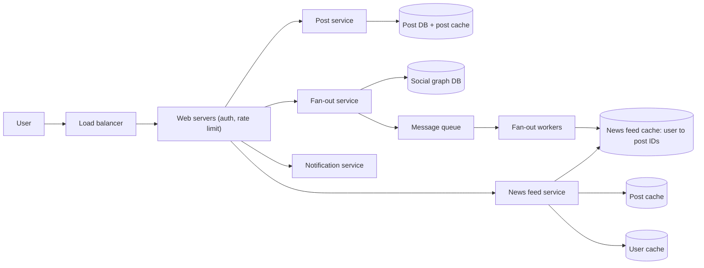
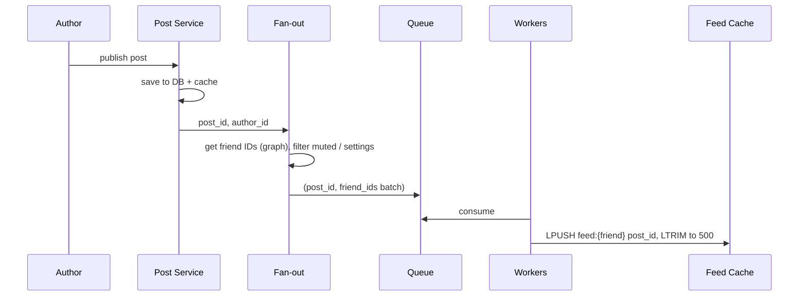
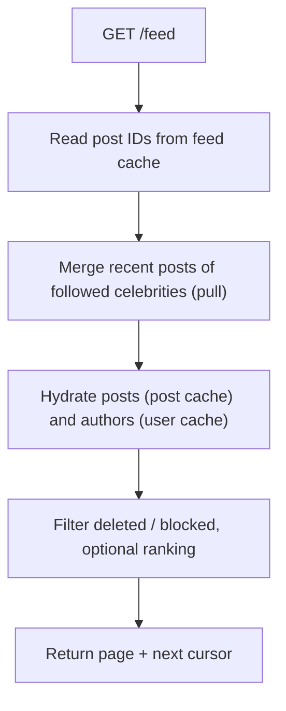

# 08 · Design a News Feed System (Facebook / LinkedIn feed)

| Category | Difficulty | Key ideas |
|---|---|---|
| Social / fan-out | Medium | fan-out on write vs read, hybrid for celebrities, ID-only feed cache, multi-layer caching, cursor pagination |

---

## Summary
Two flows: **publishing** (store the post, then a **fan-out service** pushes the post ID into each friend's **feed cache** via a queue) and **reading** (fetch post IDs from the user's feed cache, then **hydrate** them from post/user caches). Use **push** for normal users, **pull** for accounts with huge followings, and merge at read time.

---

## Requirements
| Functional | Non-functional |
|---|---|
| Publish posts (text, images, video) | Feed loads fast (< 200 ms) |
| See friends' posts, newest first (or ranked) | 10M DAU, up to 5,000 friends |
| Web + mobile | Eventual consistency OK (seconds) |

---

## APIs
```
POST /v1/me/feed     { content, media_ids }     → publish
GET  /v1/me/feed?cursor=&limit=20                → read feed
```

---

## Architecture



---

## Publishing flow


## Reading flow


---

## Fan-out models

| | Fan-out on write (push) | Fan-out on read (pull) |
|---|---|---|
| Work happens | When posting | When reading |
| Read latency | Very fast | Slow (gather from many friends) |
| Celebrity with 50M followers | Millions of writes per post | Fine |
| Inactive users | Wasted work | No waste |

**Hybrid:** push for most users; for users with > N followers, don't fan out - their followers pull those posts at read time. Skip fan-out for long-inactive users.

---

## Caching layers
| Layer | Content |
|---|---|
| News feed | `user_id -> [post_id...]` (IDs only, capped) |
| Content | Post objects (hot posts in a separate hot cache) |
| Social graph | Followers / following lists |
| Action | Did I like / reply / share this |
| Counters | Likes, replies, followers counts |

Storing only IDs keeps the feed cache small; hydration reads fresh post data (so edits show up).

---

## Deep dives
- **Ranking:** score candidate posts (engagement prediction, recency, affinity), diversify content types, inject ads.
- **Pagination:** cursor = last post ID (stable when new posts arrive).
- **New follow / unfollow:** backfill recent posts async; filter unfollowed authors at read time.
- **Cache miss / cold user:** rebuild feed by pulling from followees, then cache.
- **Scale DB:** shard posts by post_id, replicas for reads; counters via async aggregation.

---

## Interview Q&A
**Q: Where's the bottleneck at 1B users?**
A: Fan-out writes for popular users and feed-cache memory -> hybrid fan-out, ID-only caches, TTL/eviction for inactive users.

**Q: How do you handle a post deletion?**
A: Mark deleted; hydration filters it; optionally async-remove IDs from caches.

**Q: Why a message queue in fan-out?**
A: Absorbs bursts, retries failed inserts, lets workers scale independently.

---

**Related:** [Twitter](26-twitter.md) · [Instagram](27-instagram.md) · [Caching](../01-fundamentals/07-caching-deep-dive.md) · [Distributed counter](42-distributed-counter.md)
