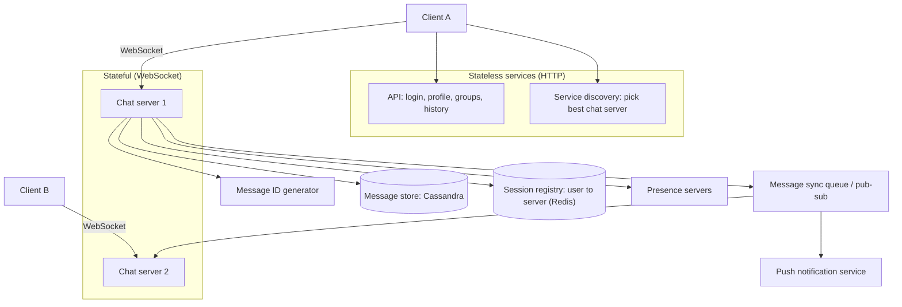
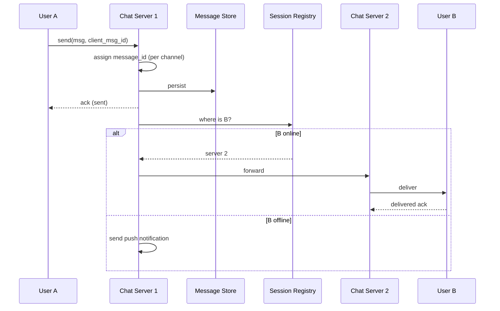
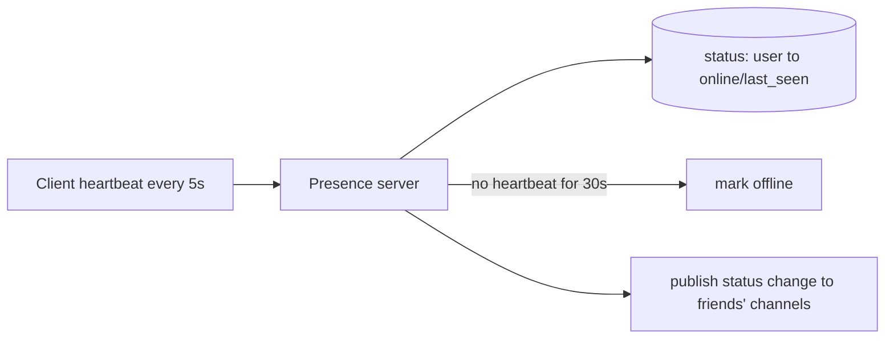

# 09 · Design a Chat System (WhatsApp / Messenger / Slack)

> **Category:** Real-time messaging · **Difficulty:** ⭐⭐⭐⭐ · **Patterns:** WebSockets, stateful connection servers, session registry, per-channel ordering, sync by max message ID, presence via heartbeats

---

## 1. TL;DR
Clients keep a **WebSocket** to a stateful **chat server**. Messages get a per-conversation increasing **message ID**, are stored in a write-optimised **wide-column DB** (Cassandra/HBase partitioned by channel), then routed to the recipient's chat server (found through a **session registry** in Redis) or sent as a **push notification** if offline. Devices sync by asking for messages with ID > their last seen ID. **Presence** uses heartbeats.

---

## 2. Requirements
| Functional | Non-functional |
|---|---|
| 1:1 chat and groups (≤ 100 members) | Low latency delivery (< 500 ms) |
| Online presence | 50M DAU |
| Multi-device sync | Durable message history (forever) |
| Push notifications when offline | Message order per conversation |
| Text (media optional) | Highly available |

---

## 3. Connection protocol choice
| Option | Fit |
|---|---|
| Short polling | ❌ wasteful |
| Long polling | ⚠️ works, but sender/receiver may hit different servers, hard to detect disconnects |
| **WebSocket** | ✅ bidirectional, persistent, starts as HTTP upgrade (passes firewalls) |

---

## 4. Architecture



---

## 5. 1:1 message flow


---

## 6. Data model
```
messages (
  channel_id   bigint,   -- partition key (1:1 = sorted pair of user IDs)
  message_id   bigint,   -- clustering key, descending
  sender_id    bigint,
  content      text,
  created_at   timestamp,
  PRIMARY KEY (channel_id, message_id))
```
Why wide-column? Huge write volume, read pattern is "latest N messages of a channel", linear scaling. Very large channels → partition by `(channel_id, time_bucket)`.

**Message IDs:** must be ordered within a channel. Options: Snowflake (roughly ordered), per-channel sequence counter (Redis `INCR`), or a local sequence on the server owning the channel.

---

## 7. Deep dives
- **Multi-device sync:** each device stores `cur_max_message_id`; on connect it fetches newer messages.
- **Group chat:** small groups → copy message reference into each member's sync queue (fan-out on write); large channels (Slack/Discord) → store once, members pull on open, push only to online members.
- **Delivery states:** sent ✓ (stored), delivered ✓✓ (device ack), read (blue) → track as "last read message_id" per user per channel.
- **Idempotency:** client-generated `client_msg_id` dedupes resends.
- **Presence:**

Heartbeats avoid flicker when the network briefly drops. For huge friend lists, fetch presence lazily instead of broadcasting.
- **Chat server failure:** clients reconnect to another server via service discovery and resync by message ID.
- **E2E encryption:** Signal protocol — server only relays ciphertext.
- **Media:** upload to object storage via pre-signed URL; message carries the URL/thumbnail.

---

## 8. Capacity sketch
50M DAU × 40 msgs = 2B msgs/day ≈ 23K/s (peak ~70K). 10M concurrent connections ÷ ~100K per server ≈ 100 chat servers.

---

## 9. Interview Q&A
**Q: Why separate stateless and stateful services?** Stateful WebSocket servers are hard to scale/deploy; keep them thin (only connection & routing) and do everything else in stateless services.

**Q: How do you guarantee order?** Per-channel monotonically increasing IDs assigned by one place; clients sort by ID, not by device time.

**Q: How do you load-balance WebSockets?** Service discovery (ZooKeeper/etcd) picks the least-loaded server by region; connections are long-lived so use least-connections.

**Q: Message delivered twice after reconnect?** Dedupe by message_id on the client.

---

**Related:** [Networking: real-time options](../01-fundamentals/01-networking-basics.md) · [Slack](58-slack.md) · [Google Docs](35-google-docs.md) · [Notifications](07-notification-system.md)
