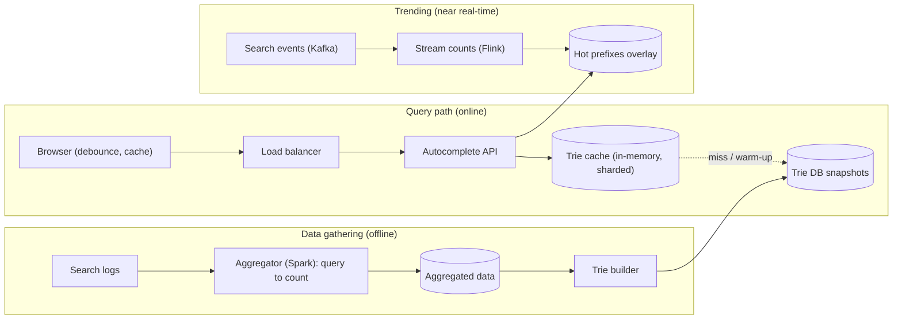
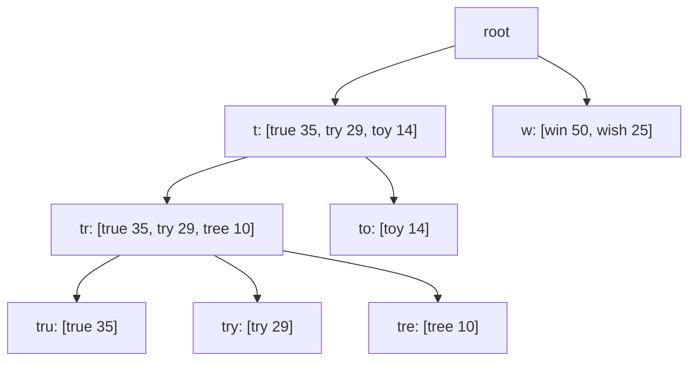
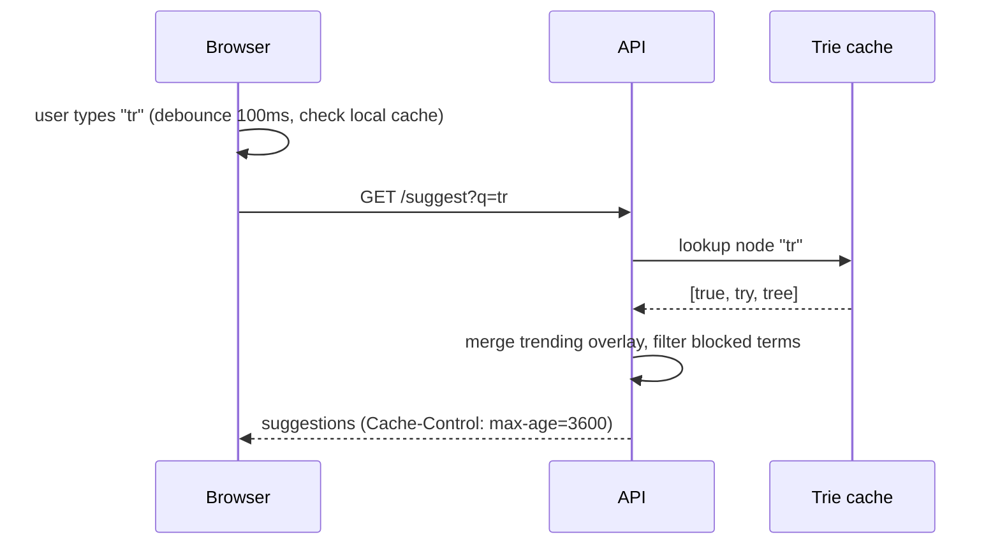

# 10 · Design Search Autocomplete (Typeahead)

> **Category:** Ranking / read-heavy · **Difficulty:** ⭐⭐⭐ · **Patterns:** trie with cached top-K, offline aggregation pipeline, sharding by prefix, client debouncing & caching

---

## 1. TL;DR
Serve suggestions from an in-memory **trie** where every node stores its **top-K most frequent queries**, so a lookup is just "walk the prefix, return the cached list". Build the trie **offline** (daily/weekly) from aggregated query logs, and add a small **real-time layer** for trending queries. Clients debounce keystrokes and cache responses.

---

## 2. Requirements
| Functional | Non-functional |
|---|---|
| Return top 5 suggestions for a prefix | Latency < 100 ms |
| Ranked by popularity | 10M DAU × 10 searches × ~20 keystrokes → **~24K QPS**, peak ~48K |
| Lowercase English (extensible) | Highly available |

---

## 3. Architecture

---

## 4. The trie with cached top-K

| Step | Without cache | With cached top-K |
|---|---|---|
| Find prefix node | O(p) | O(p) — p capped at ~50 chars |
| Collect & sort completions | O(c log c) over whole subtree | **O(1)** |

Trade-off: more memory (each node stores K entries) for constant-time answers.

---

## 5. Query flow

---

## 6. Deep dives
- **Building data:** aggregate logs per week with time decay (recent searches weigh more) → rebuild trie → serialize → swap in (blue/green).
- **Trie storage:** serialized snapshots in object storage, or a KV store `prefix → top-K list` (also usable directly as the serving format).
- **Sharding:** by first letters, but letters are uneven (`s` ≫ `x`) → use a **shard map** built from historical distribution (`a-ba`, `bb-c`, …).
- **Trending:** stream processing counts queries in sliding windows; hot prefixes are blended in with extra weight.
- **Filtering:** remove hateful/unsafe suggestions at query time and in next build.
- **Personalization:** merge user's own recent searches and location-based suggestions.
- **Typos/multilingual:** Unicode tries; fuzzy matching via n-gram indexes or Elasticsearch completion suggesters.

---

## 7. Interview Q&A
**Q: Why not query the DB with `LIKE 'tr%'`?** Too slow at 50K QPS and needs sorting by frequency each time.

**Q: How fresh are suggestions?** Base trie: daily/weekly; trending overlay: minutes.

**Q: How to reduce QPS?** Client debounce, browser caching, CDN caching of popular prefixes, only query after 2 chars.

**Q: How do you update the trie without downtime?** Build a new version offline, load it on new instances, switch traffic, discard old.

---

**Related:** [Search systems](../01-fundamentals/19-search-systems-and-inverted-index.md) · [Top-K](34-top-k-heavy-hitters.md) · [Web search](36-web-search-engine.md)
