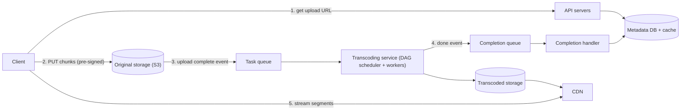
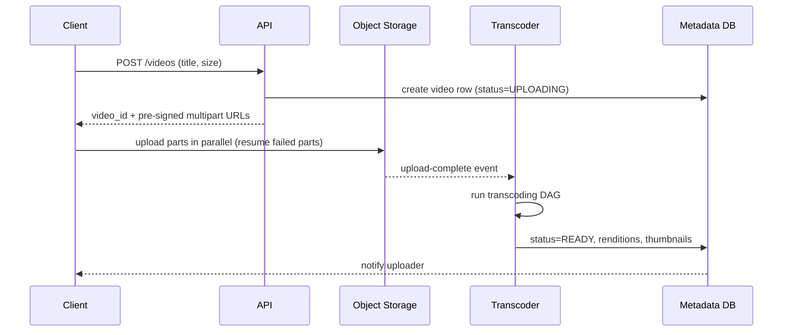
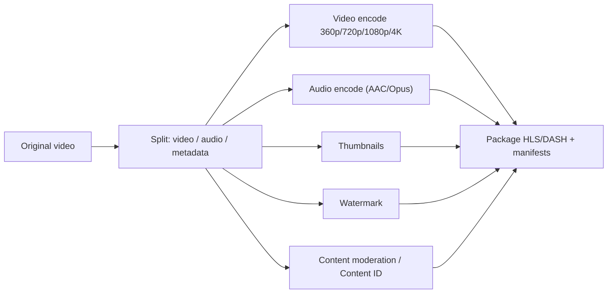

# 11 · Design YouTube (Video Upload & Streaming)

> **Category:** Media pipeline · **Difficulty:** ⭐⭐⭐⭐ · **Patterns:** pre-signed uploads, DAG-based transcoding, adaptive bitrate streaming, CDN, popularity-aware caching

---

## 1. TL;DR
Users upload videos **directly to object storage** via pre-signed (resumable, multipart) URLs. A **transcoding pipeline** (a DAG of tasks: split, encode to many resolutions/codecs, thumbnails, watermark, moderation) runs on a worker fleet via queues. Outputs go to storage and are streamed with **HLS/DASH adaptive bitrate** from a **CDN**. Metadata lives in sharded SQL + cache.

---

## 2. Requirements
| Functional | Non-functional |
|---|---|
| Upload videos (up to ~1 GB) | Fast uploads, resumable |
| Watch with smooth streaming | Smooth playback, low startup latency |
| Change quality, many devices | Highly available, global |
| Metadata: title, description, views | Cost-efficient (CDN is the biggest bill) |

### Estimates
| Quantity | Value |
|---|---|
| DAU | 5M, 5 videos watched each |
| Uploads | 10% upload 1 video/day → 500K/day |
| Avg size | 300 MB → **150 TB/day** new storage |
| CDN egress | 5M × 5 × 300 MB ≈ 7.5 PB/day → $$$ (≈ $150K/day at $0.02/GB) |

---

## 3. Architecture

---

## 4. Upload flow

Metadata (title, description) is uploaded in parallel with the video bytes.

---

## 5. Transcoding as a DAG

Components: **preprocessor** (split into GOP-aligned chunks, build DAG from config), **DAG scheduler** (turns DAG into stages of tasks), **resource manager** (task queue, worker queue, running queue, picks optimal worker), **task workers** (encode chunks in parallel), **temporary storage** (metadata in memory, chunks in blob storage).

Why chunk? Encoding a 1-hour video on one machine is slow; 1,000 chunks encoded in parallel finish in minutes and failures retry only one chunk.

---

## 6. Streaming
- **Adaptive bitrate (ABR):** each rendition split into 2–6 s segments + a manifest; the player switches quality per segment based on bandwidth & buffer.
- Protocols: **HLS** (Apple), **MPEG-DASH**, CMAF (shared segments).
- Videos stream from the closest CDN edge; never through API servers.

---

## 7. Optimizations
| Area | Idea |
|---|---|
| Upload speed | Parallel chunk upload, upload centers close to users (regional buckets) |
| Pipeline speed | Message queues between stages so each stage scales independently |
| Safety | Pre-signed URLs (only authorized uploads), DRM/encryption, watermarking |
| Cost | Only **popular** videos on CDN, long tail from origin/regional servers; encode short/unpopular videos on demand with fewer renditions; regional caching for regional content; own CDN/ISP partnerships at very large scale |

---

## 8. Error handling
| Error | Handling |
|---|---|
| Upload chunk fails | Retry that chunk (resumable) |
| Transcoding task fails | Retry task; after N attempts mark video failed and notify |
| Corrupt/invalid video | Non-recoverable → error to user |
| API/metadata server down | Stateless replicas / replica promotion |

---

## 9. Interview Q&A
**Q: Why not upload through API servers?** Large bytes waste server bandwidth/CPU; direct-to-storage via pre-signed URLs scales and is cheaper.

**Q: How do view counts work at scale?** Send view events to Kafka and aggregate (see [Distributed counter](42-distributed-counter.md)).

**Q: How is live streaming different?** Real-time encoding, latency budget of seconds, RTMP/SRT ingest — see [Live streaming](40-live-streaming.md).

---

**Related:** [Netflix](46-netflix.md) · [Instagram](27-instagram.md) · [Storage systems](../01-fundamentals/16-storage-systems-block-file-object-oltp-vs-olap.md) · [CDN design](52-cdn.md)
