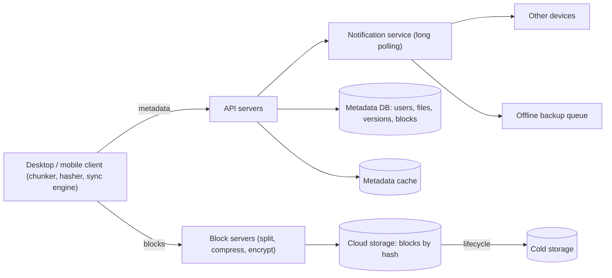
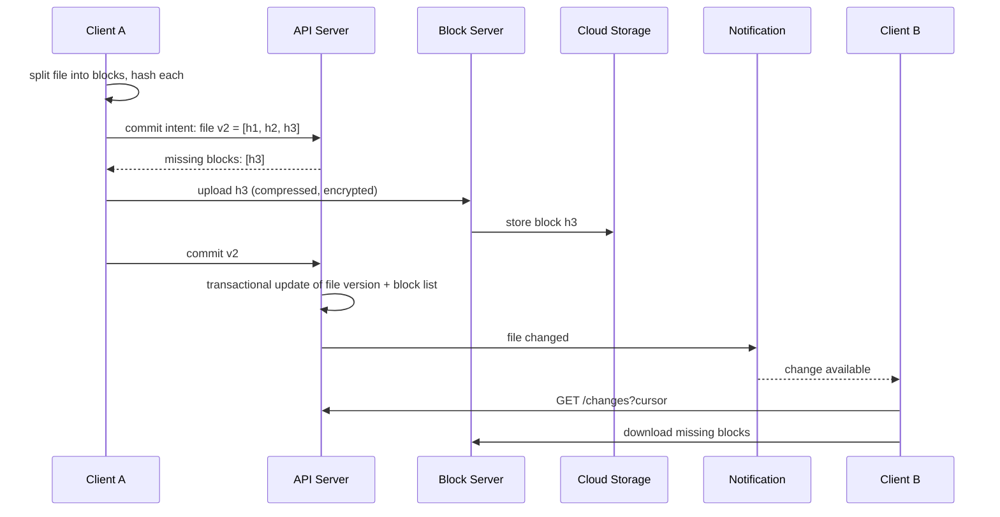
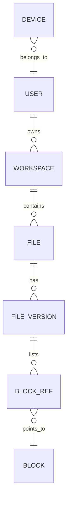

# 12 · Design Google Drive / Dropbox (File Storage & Sync)

| Category | Difficulty | Key ideas |
|---|---|---|
| File sync | Hard | block-level chunking, content-addressable dedupe, strongly-consistent metadata, change notifications (long polling), versioning |

---

## Summary
Split files into **blocks** (~4 MB), identify each by its **hash**, upload only blocks the server doesn't have (**delta sync + dedupe**), store blocks in object storage and file->block lists in a **strongly-consistent metadata DB**. A **notification service** (long polling/WebSocket) tells other devices to pull changes. Keep **versions** and resolve conflicts by "first commit wins, the other becomes a conflicted copy".

---

## Requirements
| Functional | Non-functional |
|---|---|
| Upload/download files, sync across devices | **Reliability: never lose data** |
| File revisions | Fast sync, low bandwidth |
| Share files, notifications on change | Scale: 50M users, 10M DAU |
| | Strong consistency of metadata |

### Estimates
10M DAU × 2 uploads/day × 500 KB ≈ 10 TB/day; 50M users × 10 GB quota ≈ 500 PB allocated; upload QPS ≈ 240/s (peak ~480/s).

---

## APIs
```
POST /files/upload?uploadType=resumable    → upload session (resume after failure)
GET  /files/download?path=/docs/a.pdf
GET  /files/list_revisions?path=...&limit=20
GET  /changes?cursor=...                    → metadata changes since cursor
```

---

## Architecture



---

## Upload & sync flow


---

## Metadata model

`block(hash, size, storage_key, ref_count)` - deduplicated, reference counted for garbage collection.

---

## Deep dives
- **Delta sync:** modifying 10 KB inside a 1 GB file uploads one block, not the whole file. **Content-defined chunking** (rolling hash) keeps block boundaries stable after insertions.
- **Dedup:** identical blocks across versions/users stored once.
- **Consistency:** metadata needs ACID (SQL/Spanner); caches invalidated on write; never expose a version whose blocks aren't fully uploaded.
- **Conflicts:** two offline edits -> first commit wins; the second client keeps its edit as `file (conflicted copy)`.
- **Notifications:** long polling per client (simple; responses carry "changes exist"), WebSocket also fine; offline clients catch up via `/changes?cursor`.
- **Storage savings:** dedupe, version limits (keep last N or N days), cold storage for old blocks, compression (skip already compressed formats).
- **Failure handling:** replicated storage (multi-region), DB replicas with failover, stateless API/block servers, notification server failure -> clients reconnect.
- **Security:** TLS, per-block encryption at rest, ACL sharing, signed share links with expiry.

---

## Interview Q&A
**Q: Why split upload into metadata + block paths?**
A: Block traffic is huge and simple (store/fetch bytes); metadata needs transactions. Separating lets each scale independently.

**Q: Why hash-based block IDs?**
A: Free deduplication and integrity verification.

**Q: How does a new device sync 100 GB?**
A: Fetch metadata snapshot, download blocks in parallel from CDN/storage, prioritize recently used files.

---

**Related:** [Object storage (S3)](21-object-storage-s3.md) · [Google Docs](35-google-docs.md) · [Storage systems](../01-fundamentals/16-storage-systems-block-file-object-oltp-vs-olap.md)
