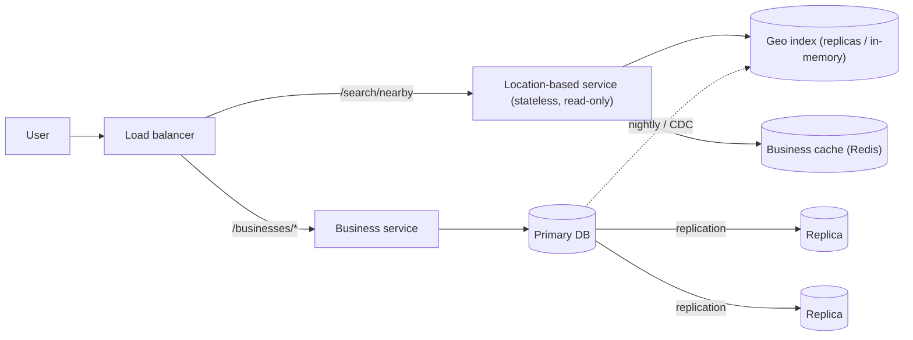
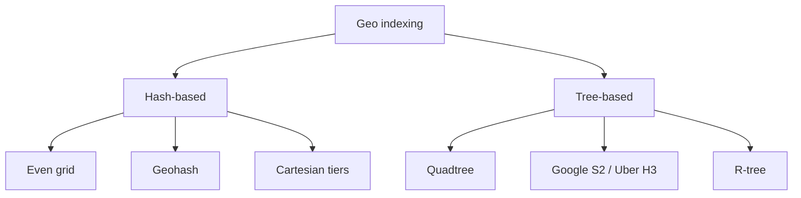
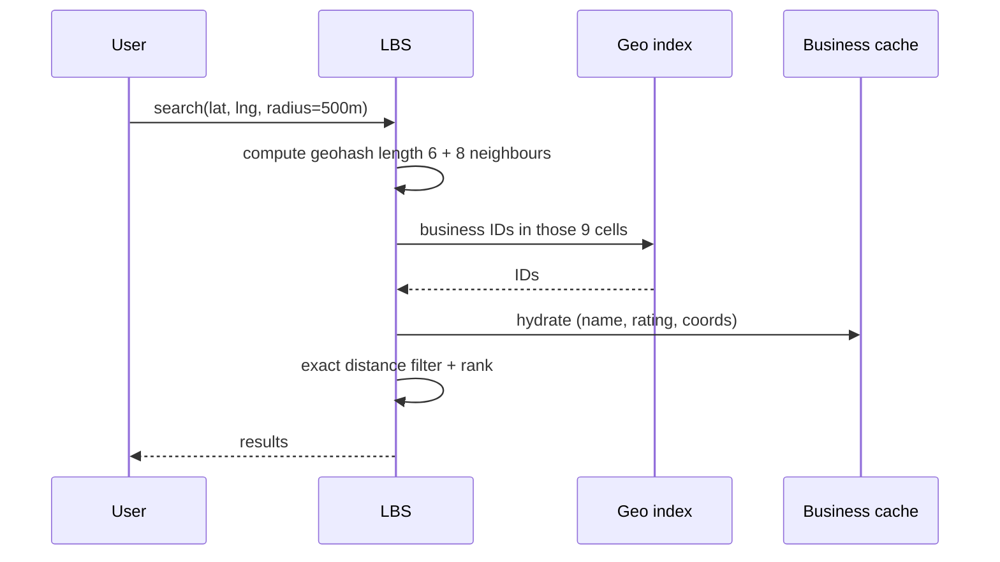

# 13 · Design a Proximity Service (Yelp "restaurants near me")

> **Category:** Geo / location · **Difficulty:** ⭐⭐⭐ · **Patterns:** geohash, quadtree, read replicas, separate read (LBS) and write (business) services

---

## 1. TL;DR
A stateless, read-only **Location-Based Service (LBS)** answers "businesses within radius R of (lat, lng)" using a **geospatial index** (geohash table or in-memory quadtree), then hydrates details from a cached **business service**. Business data changes rarely, so writes go to a primary DB and propagate to read replicas / index rebuilds (next-day freshness is fine).

---

## 2. Requirements
| Functional | Non-functional |
|---|---|
| Search nearby businesses by location + radius (0.5–20 km) | Low latency |
| View business details | Read-heavy, high availability |
| Owners add/update/delete businesses (visible next day OK) | 100M DAU, 200M businesses, **~5K search QPS** |

---

## 3. Architecture

---

## 4. Geospatial indexing options

| Method | Idea | ✅ | ❌ |
|---|---|---|---|
| Lat/lng range query | `WHERE lat BETWEEN … AND lng BETWEEN …` | Simple | Intersecting two big ranges is slow |
| Even grid | Fixed-size cells | Simple | Density varies hugely (cities vs ocean) |
| **Geohash** | Interleave bits of lat/lng → base32 string; shared prefix = nearby | Easy to store in any DB/Redis, easy radius by prefix length | Boundary issues (close points, different prefixes) |
| **Quadtree** | Split a cell into 4 until ≤ 100 businesses per leaf | Adapts to density, k-nearest queries | In-memory, rebuild on start, updates trickier |
| S2 / H3 | Hilbert curve / hexagonal hierarchical cells | Great for geofencing, uniform neighbors | More complex |

### Geohash precision
| Length | Cell size | Use for radius |
|---|---|---|
| 4 | 39 km × 19.5 km | 20 km |
| 5 | 4.9 km × 4.9 km | 2 km |
| 6 | 1.2 km × 0.6 km | 0.5–1 km |

**Boundary fix:** always query the user's cell **plus its 8 neighbours**. If too few results, shorten the prefix (expand radius).

### Quadtree build
200M businesses, leaf ≤ 100 → ~2M leaves, ~0.67M internal nodes → ~1.7 GB of memory → fits on one server; build takes minutes at startup (roll out servers gradually).

---

## 5. Search flow

---

## 6. Data & scaling
- `geohash_index(geohash, business_id)` — composite key; ~200M rows, a few GB → no sharding needed; **replicate** for read throughput.
- `business(business_id, name, lat, lng, address, …)` — shard by business_id if needed; cache in Redis.
- Multi-region deployment close to users; data-residency laws handled per region.
- Filters (open now, category) applied after the geo lookup, or with per-category indexes.

---

## 7. Interview Q&A
**Q: Geohash or quadtree?** Geohash is simpler to store/update in a DB/Redis; quadtree adapts to density and is great for k-nearest — both are acceptable when you explain trade-offs.

**Q: Why separate LBS from business service?** Very different traffic patterns: LBS is high-QPS read-only; business writes are rare.

**Q: Real-time updates for moving objects?** Different problem → [Nearby friends](14-nearby-friends.md), [Uber](28-uber.md).

---

**Related:** [Probabilistic DS & geo indexes](../01-fundamentals/18-probabilistic-data-structures-and-useful-algorithms.md) · [Google Maps](15-google-maps.md) · [Airbnb](51-airbnb.md)
