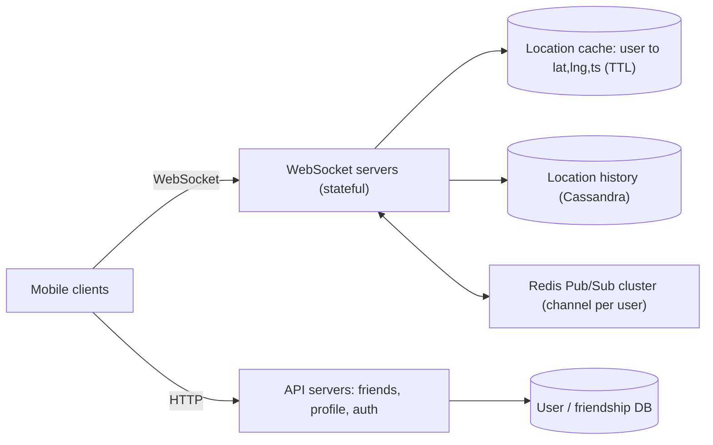
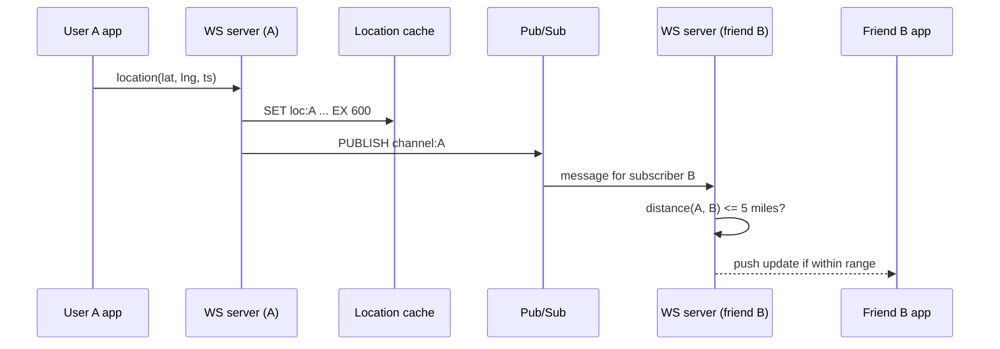

# 14 · Design Nearby Friends (live friend locations)

> **Category:** Geo + real-time · **Difficulty:** ⭐⭐⭐⭐ · **Patterns:** WebSockets, Redis Pub/Sub per user, location cache with TTL, consistent hashing for pub/sub cluster

---

## 1. TL;DR
Every active user's app sends its location every ~30 s over a **WebSocket**. The server stores the latest location in a **Redis cache with TTL**, appends to a **location history DB**, and **publishes** it to that user's **Pub/Sub channel**. Each friend's WebSocket handler is subscribed to that channel, computes the distance, and pushes the update only if within range (e.g., 5 miles).

---

## 2. Requirements
| Functional | Non-functional |
|---|---|
| See friends within 5 miles with distance + last updated | Low latency updates |
| Refresh every ~30 s | Location updates may occasionally be lost |
| Opt-in only | Eventual consistency OK |

### Estimates
100M DAU, 10% concurrent = **10M concurrent users**; update every 30 s → **~334K location updates/s**. Each fans out to ~400 friends (most offline / far away).

---

## 3. Architecture

---

## 4. Location update flow

On connect: the handler loads the friend list, subscribes to every friend's channel, and reads friends' current locations from the cache for the initial view. On disconnect: unsubscribe.

---

## 5. Deep dives
- **Why Pub/Sub?** It decouples senders from who's listening; channels are cheap (a few bytes when unused) → one channel per user is fine.
- **Pub/Sub sizing:** bottleneck is CPU for pushing messages (334K × ~100 active subscribers → ~14M pushes/s) → ~150 Redis servers; distribute channels with **consistent hashing**, with the hash ring stored in service discovery (etcd/ZooKeeper).
- **Resizing pub/sub cluster:** moving channels forces resubscriptions → do it off-peak, over-provision.
- **WebSocket server scaling:** stateless-ish (state = connections); drain connections gradually on deploy.
- **Location cache:** only the latest location, TTL expires inactive users; shard by user_id.
- **Adding/removing friends:** subscribe/unsubscribe the handler to that channel.
- **Users with many friends:** cap friends (e.g., 5,000); load spreads across many pub/sub nodes.
- **"Random nearby people" feature:** pub/sub channels per **geohash cell** — subscribe to your cell + neighbours.
- **Alternative:** Erlang/Elixir actor per user (WhatsApp/Discord style) instead of Redis Pub/Sub.

---

## 6. Interview Q&A
**Q: Why not store locations in a DB and query friends' locations periodically?** 10M users polling 400 friends every 30 s = massive read load; push via pub/sub only sends what changed.

**Q: How is this different from the proximity service?** Data is highly dynamic (constant updates) and must be pushed in real time; proximity data is static and read-only.

**Q: What if a pub/sub node dies?** Its channels move to other nodes per the ring; WebSocket handlers resubscribe; a few updates are lost (acceptable).

---

**Related:** [Proximity service](13-proximity-service.md) · [Uber](28-uber.md) · [Message queues & pub/sub](../01-fundamentals/11-message-queues-pub-sub-and-event-streaming.md)
