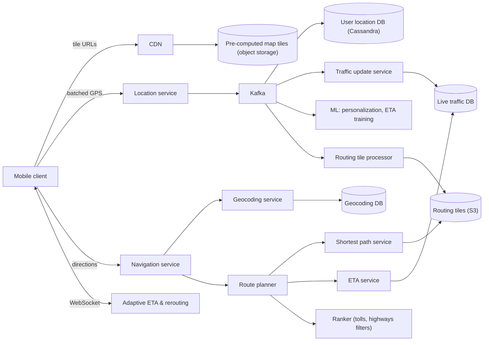
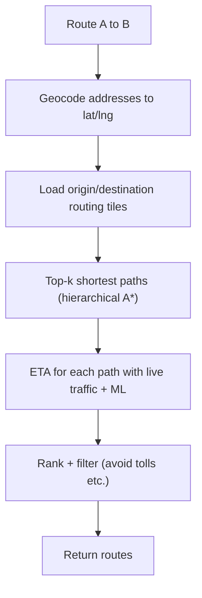

# 15 · Design Google Maps (Rendering, Routing, ETA)

> **Category:** Geo + graph algorithms · **Difficulty:** ⭐⭐⭐⭐⭐ · **Patterns:** pre-rendered map tiles on CDN, routing tiles, hierarchical shortest paths, location ingestion via Kafka, adaptive ETA

---

## 1. TL;DR
Three subsystems: **map rendering** (pre-computed tiles per zoom level served from a CDN; client computes tile URLs), **location service** (batched GPS updates → Kafka → Cassandra, feeding traffic & ETA), and **navigation** (geocoding → shortest path over **routing tiles** at multiple hierarchy levels → ETA with live traffic & ML → ranking → adaptive rerouting).

---

## 2. Requirements
| Functional | Non-functional |
|---|---|
| Show maps at any zoom level | Accurate directions |
| Directions (driving/walking/transit) with ETA | Smooth rendering, low data usage on mobile |
| Location updates for traffic | Highly available, 1B DAU |
| Turn-by-turn navigation with rerouting | |

### Estimates
- World at zoom 21 ≈ 4.4 trillion tiles × 100 KB ≈ 440 PB → but ~90% is ocean/empty → compress to ~**50–100 PB** for all zoom levels.
- Location updates: batched every 15 s; 1B DAU × 35 min navigation → ~**3M updates/s** peak.

---

## 3. Architecture

---

## 4. Map rendering
- World projected with **Web Mercator**, split into a quadtree of **tiles**: zoom 0 = 1 tile, zoom z = 4^z tiles (256×256 px).
- Client computes `tile(x, y, zoom)` from lat/lng → fetches `https://cdn/tiles/{z}/{x}/{y}.png` → highly cacheable, no server logic.
- **Vector tiles** (paths/polygons instead of images): smaller, smooth zooming, rendered on device.

## 5. Location service
Clients batch GPS points (every 15 s) → reduce request count; writes are huge → Cassandra keyed by `(user_id, timestamp)`; stream into Kafka for traffic, map updates (new roads), ML.

## 6. Routing
- Road network = graph (intersections = nodes, roads = edges). Too big for memory → split into **routing tiles** (by geohash) holding nodes/edges and links to neighbouring tiles.
- **Hierarchical tiles:** local roads (small tiles), arterial roads (medium), highways (large) → long routes use highway tiles, avoiding millions of local nodes.
- Algorithms: A* / Dijkstra variants, **contraction hierarchies** for fast queries.

## 7. Adaptive ETA & rerouting
Track active navigation sessions (which routing tiles each user's route crosses). When traffic changes in a tile, find affected users efficiently (`user → tiles on route` + hierarchy) and push new ETA/reroute over WebSocket.

---

## 8. Interview Q&A
**Q: Why pre-render tiles rather than render on request?** Same tile serves millions; CDN caching makes it cheap and fast.

**Q: How do you avoid loading the whole graph?** Routing tiles + hierarchy load only relevant regions.

**Q: How is ETA predicted?** Historical speeds per road segment & time, live traffic from GPS, ML models correcting for events/weather.

---

**Related:** [Proximity service](13-proximity-service.md) · [Uber](28-uber.md) · [CDN](52-cdn.md)
