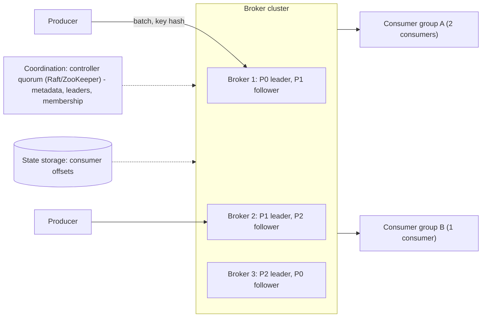
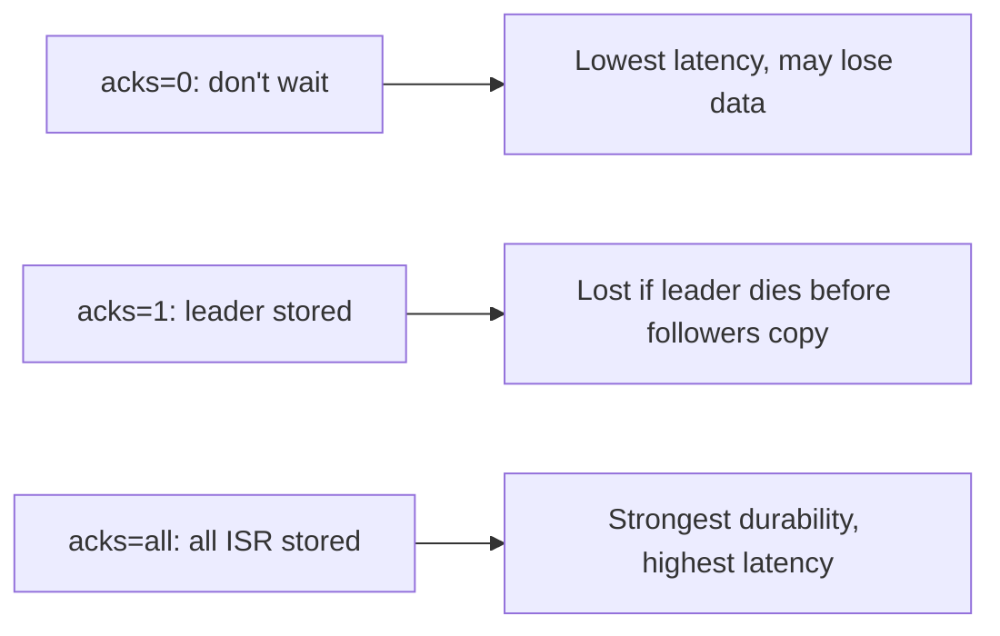
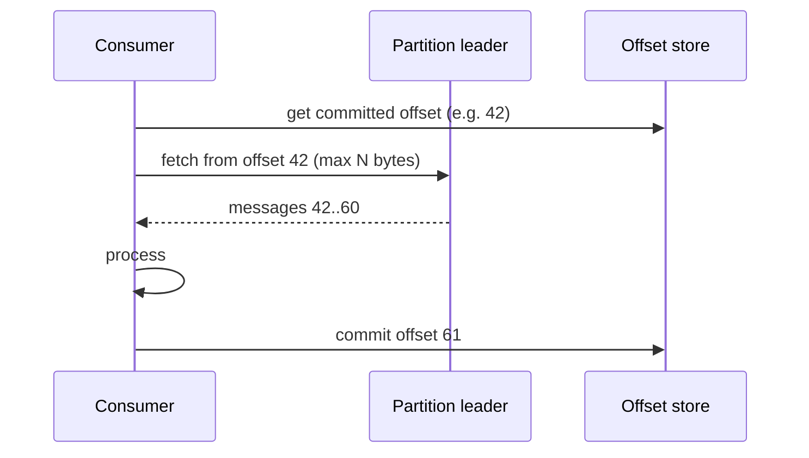

# 16 · Design a Distributed Message Queue (Kafka-like)

> **Category:** Infrastructure · **Difficulty:** ⭐⭐⭐⭐⭐ · **Patterns:** partitioned append-only logs, segment files, leader/follower replication with ISR, consumer groups & offsets, batching

---

## 1. TL;DR
Topics are split into **partitions**; each partition is an **append-only log** stored as segment files on a broker and **replicated** (one leader, followers; in-sync replicas = ISR). Producers batch and route by key; consumers **pull** in **consumer groups** where each partition is read by one consumer, and progress is tracked by committed **offsets**. Messages are retained by time/size (not deleted on read), so they can be replayed.

---

## 2. Requirements
| Functional | Non-functional |
|---|---|
| Produce / consume messages, repeated consumption | High throughput **or** low latency (configurable) |
| Ordering within a partition | Durable, replicated, scalable |
| Retention (e.g., 2 weeks) | Delivery semantics: at-most / at-least / exactly once |

---

## 3. Architecture

---

## 4. Storage: why an append-only log?
- Sequential disk writes are fast (hundreds of MB/s); random access is avoided.
- Partition = sequence of **segment files**; only the active segment receives appends; old segments deleted by retention.
- Message record: `key, value, offset, timestamp, size, crc`.
- OS page cache + **zero-copy** (`sendfile`) serve consumers without copying through user space.

---

## 5. Producer flow
Producer library buffers messages, routes `partition = hash(key) % N` (or round robin if no key), **batches** per partition (bigger batch = throughput, smaller = latency), compresses, sends to the partition leader.

### Durability via acks

---

## 6. Consumer flow
- **Pull** model: consumers control pace, can batch, replay; long-poll to avoid busy loops.
- **Consumer group:** partitions divided among members; parallelism ≤ number of partitions.
- **Rebalancing:** a **coordinator** broker tracks heartbeats; on join/leave/crash, it reassigns partitions.
- **Offsets** committed to the broker (internal topic).

### Delivery semantics
| Mode | Commit timing | Risk |
|---|---|---|
| At-most-once | Commit before processing | Loss on crash |
| **At-least-once** | Commit after processing | Duplicates → idempotent consumers |
| Exactly-once | Idempotent producer + transactions | Complexity, cost |

---

## 7. Replication
- Each partition has `replication_factor` replicas on different brokers/racks.
- Followers pull from the leader; replicas caught up within a lag threshold form the **ISR**.
- Commit point = highest offset replicated to all ISR ("high watermark"); consumers only see committed messages.
- Leader failure → controller elects a new leader from the ISR.

---

## 8. Other features
- **Scalability:** add partitions (only for new data; key→partition mapping changes), add brokers and move replicas.
- **Delayed / scheduled messages:** temporary storage + timing wheel / per-delay topics.
- **Filtering / tags:** metadata tags so consumers subscribe to subsets.
- **Log compaction:** keep only the latest value per key (changelogs, state).
- **Historical archive:** tiered storage to S3 for long retention.

---

## 9. Interview Q&A
**Q: How do you guarantee ordering?** Only within a partition — route related messages with the same key.

**Q: Why pull instead of push?** Consumers set their own rate, batch efficiently, and replay; push risks overwhelming slow consumers.

**Q: What's the trade-off of more partitions?** More parallelism, but more open files, longer leader elections, more rebalancing overhead.

**Q: How to tune for low latency vs throughput?** Small batches/`linger.ms`, `acks=1` for latency; big batches, compression, `acks=all` for throughput+durability.

---

**Related:** [Message queues fundamentals](../01-fundamentals/11-message-queues-pub-sub-and-event-streaming.md) · [Consensus](../01-fundamentals/09-consensus-leader-election-and-distributed-locks.md) · [Logging system](41-distributed-logging.md)
