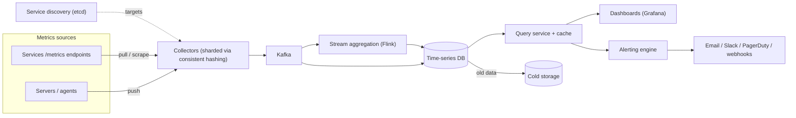
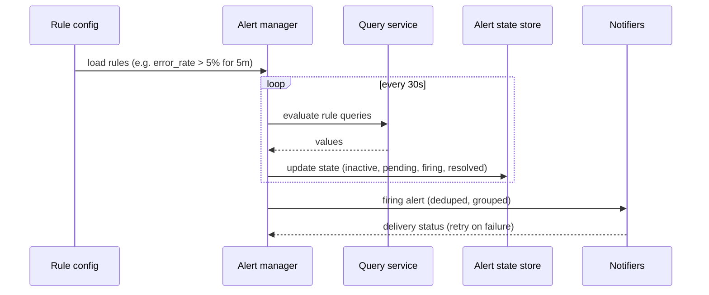

# 17 · Design a Metrics Monitoring & Alerting System (Prometheus / Datadog)

> **Category:** Observability infrastructure · **Difficulty:** ⭐⭐⭐⭐ · **Patterns:** pull vs push collection, Kafka buffering, time-series DB compression, downsampling, rule-based alerting

---

## 1. TL;DR
**Collect** metrics from hosts and services (pull/scrape or push via agents) → buffer in **Kafka** → optionally pre-aggregate with stream processing → store in a **time-series database** with heavy compression and **downsampling** → serve **dashboards** through a query service with cache → evaluate **alert rules** periodically and route notifications (email, Slack, PagerDuty) with dedupe.

---

## 2. Requirements
| Functional | Non-functional |
|---|---|
| Collect CPU, memory, request counts, latency, etc. | 100M DAU product, 1,000 server pools × 100 machines × ~100 metrics → **~10M metrics** |
| Dashboards, queries over time ranges | 1-year retention (raw 7 days, 1-min resolution 30 days, 1-h after) |
| Alerts on thresholds/anomalies | Reliable alerting, low latency queries |

---

## 3. Data model
`metric_name{label1=value1, …} → [(timestamp, value), …]`
Example: `http_requests_total{service="checkout", host="i-123", status="500"} 1732534800 17`.
Write-heavy (constant flow), read in bursts (dashboards, alert queries over recent data).

---

## 4. Architecture

---

## 5. Pull vs push
| Pull (Prometheus) | Push (StatsD/CloudWatch agents) |
|---|---|
| Collector scrapes `/metrics` on targets found via service discovery | Agents send to collector endpoint |
| Easy to detect down targets (scrape fails) | Works for short-lived jobs, behind firewalls/NAT |
| Needs reachability to every target | Collector can be overwhelmed → needs LB/queue |
Both work; large systems often support both.

---

## 6. Storage (TSDB) deep dive
- Purpose-built TSDBs (InfluxDB, Prometheus/Thanos/Mimir, M3, VictoriaMetrics) beat general DBs.
- **Compression:** delta-of-delta timestamps + XOR-encoded float values (Gorilla) → ~1.4 bytes per point.
- **Downsampling:** raw → 1-min → 1-h rollups as data ages.
- **Cold storage** for old blocks; index by labels (inverted index from label to series IDs).
- Watch **cardinality**: putting `user_id` as a label creates millions of series.

---

## 7. Alerting flow

Best practices: alert on **symptoms / SLO burn rate**, group & dedupe related alerts, silence during maintenance, runbooks per alert.

---

## 8. Interview Q&A
**Q: Why Kafka between collectors and TSDB?** Absorbs spikes and TSDB outages; enables multiple consumers (aggregation, anomaly detection).

**Q: How do you scale collectors?** Shard scrape targets with consistent hashing; HA pairs scrape the same targets and dedupe.

**Q: How to keep 1 year cheap?** Downsampling + compression + tiered storage.

**Q: Build or buy?** Most companies use Prometheus/Grafana/Datadog; designing it shows TSDB and pipeline knowledge.

---

**Related:** [Observability](../01-fundamentals/14-observability-logs-metrics-tracing.md) · [Distributed logging](41-distributed-logging.md) · [Distributed tracing](56-distributed-tracing.md)
