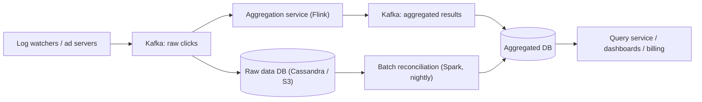
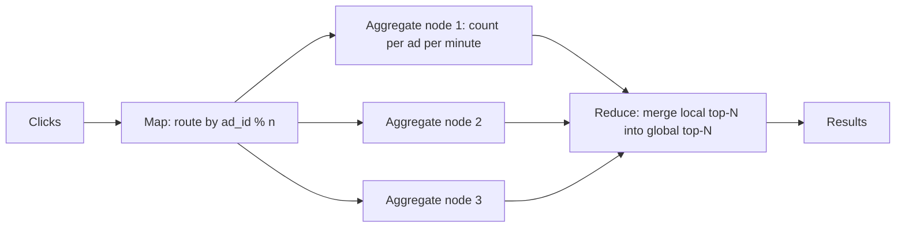
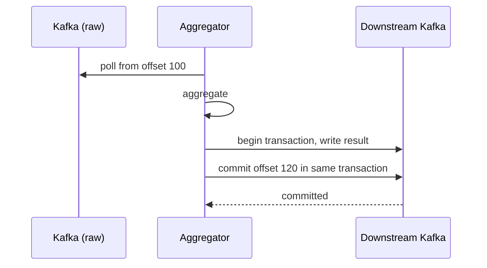

# 18 · Design Ad Click Event Aggregation

> **Category:** Stream aggregation · **Difficulty:** ⭐⭐⭐⭐⭐ · **Patterns:** MapReduce-style streaming, event-time windows & watermarks, exactly-once, raw + aggregated storage, reconciliation

---

## 1. TL;DR
Click events flow into **Kafka**, a stream aggregation job (Flink, structured as **map → aggregate → reduce**) counts clicks per ad per minute and computes **top-N ads**, using **event time with watermarks** for late events and **exactly-once** processing. Results go to an aggregated DB for dashboards and billing; **raw events** are kept too so a **batch reconciliation** job can verify and recompute.

---

## 2. Requirements
| Functional | Non-functional |
|---|---|
| Clicks of ad X in last M minutes | **Correctness** (billing!) |
| Top 100 most-clicked ads per minute | Handle late & duplicate events |
| Filter by country, device, etc. | 1B clicks/day ≈ 10K QPS, peak 50K |
| | End-to-end latency of a few minutes |

---

## 3. Architecture

Why two Kafkas? Decouples aggregation from the DB writer, enables exactly-once handoff and buffering.

---

## 4. Aggregation as a DAG

### Data
- Raw: `ad_id, click_timestamp, user_id, ip, country`.
- Aggregated: `ad_id, minute, count` and `minute, [top 100 ad_ids]`; filters by **pre-aggregating star-schema dimensions** (country, device).

---

## 5. Time & windows
- **Event time** (when clicked) vs **processing time** (when processed). Billing needs event time.
- **Tumbling windows** (1 min) for per-ad counts; **sliding windows** for top-N over last M minutes.
- **Watermark**: "assume events older than T+15s have arrived" → close the window. Events arriving later than the watermark are handled by reconciliation (or allowed-lateness updates).

---

## 6. Exactly-once
Failure scenario: aggregator emits a result, crashes before committing its Kafka offset → reprocesses → double count.
- Store **upstream offsets atomically with results** (or use Flink checkpoints + transactional sinks).
- Dedupe by click ID (fraud/bot double-clicks too).

---

## 7. Scaling & reliability
- Partition Kafka by `ad_id`; add consumers up to partition count; pre-scale partitions to avoid rebalancing hot paths.
- **Hotspot ads** (huge campaigns): allocate extra aggregation workers for those keys, or split + merge.
- Checkpoint aggregator state (snapshots) for fast recovery.
- Monitor: event lag, watermark delay, record counts in vs out.
- **Reconciliation:** nightly batch from raw data compares to stream results.

### Lambda vs Kappa
Lambda = streaming + separate batch path; Kappa = streaming only, recompute by replaying raw Kafka data through the same job. This design is Kappa-style with a batch check.

---

## 8. Interview Q&A
**Q: Why keep raw data if we have aggregates?** For audit, recomputation after bugs, and new aggregations.

**Q: How do you handle a click arriving 10 minutes late?** Watermark already closed → stored raw → picked up by reconciliation (or a late-data side output updates the window).

**Q: How do you find top-N across partitions?** Each partition computes local top-N; the reducer merges (correct because each ad lives in exactly one partition).

---

**Related:** [Batch & stream processing](../01-fundamentals/17-batch-and-stream-processing.md) · [Top-K](34-top-k-heavy-hitters.md) · [Ad serving / RTB](57-ad-serving-rtb.md)
