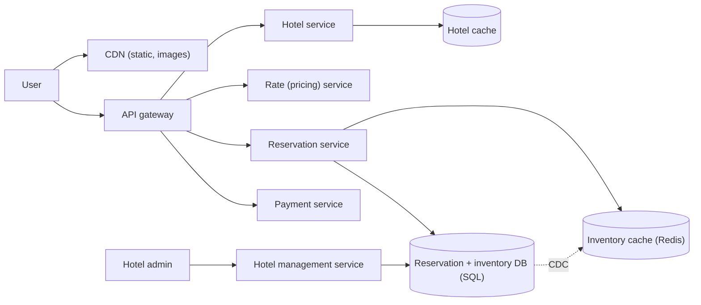
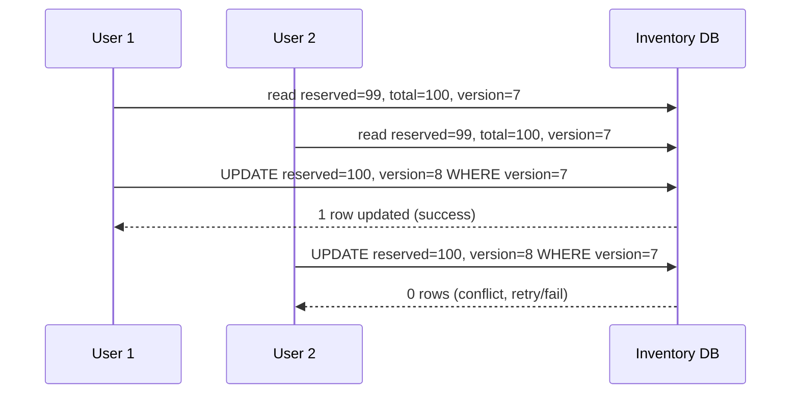

# 19 · Design a Hotel Reservation System (Marriott / Booking.com)

| Category | Difficulty | Key ideas |
|---|---|---|
| Inventory & booking | Medium | inventory per room type per date, idempotency keys, optimistic locking / DB constraints, overbooking, caching inventory reads |

---

## Summary
Model inventory as `(hotel, room_type, date) -> total, reserved`. A reservation decrements availability for every night in a **single transaction** using an **optimistic-lock version check** or a **CHECK constraint**, and carries a client-generated **idempotency key** so retries can't double-book. Reads (search/availability) are served from cache; the DB is the source of truth for writes.

---

## Requirements
| Functional | Non-functional |
|---|---|
| Show hotel & room-type details, prices | High concurrency for popular hotels |
| Reserve, cancel | No double booking |
| Admin: manage hotels/rooms/prices | Allow ~10% overbooking (industry norm) |
| | 5,000 hotels, 1M rooms, ~3 reservations TPS (tiny writes; heavy browsing) |

Booking funnel QPS: view hotel ~300 QPS -> booking page ~30 -> reserve ~3.

---

## APIs
```
GET  /v1/hotels/{id}
GET  /v1/hotels/{id}/availability?from=&to=&room_type=
POST /v1/reservations   { reservation_id, hotel_id, room_type_id, start, end, guests }
DELETE /v1/reservations/{id}
```
`reservation_id` is generated by the client/booking page -> **idempotency key**.

---

## Architecture



---

## Data model
```sql
room_type_inventory(hotel_id, room_type_id, date, total_inventory, total_reserved, version,
                    PRIMARY KEY (hotel_id, room_type_id, date))
reservation(reservation_id PK, hotel_id, room_type_id, start_date, end_date, status, guest_id)
```
Reserve **room types**, not specific room numbers (rooms are assigned at check-in). Inventory rows are pre-created for the next 2 years by a daily job (5,000 × 20 types × 730 days ≈ 73M rows).

---

## Concurrency problems

### Problem 1: same user clicks "Book" twice
-> **Idempotency key** (`reservation_id` primary key): second insert fails with duplicate -> return the first result.

### Problem 2: two users book the last room


| Technique | How | Fits when |
|---|---|---|
| Pessimistic lock | `SELECT ... FOR UPDATE` | High contention; risk of deadlocks/slow |
| **Optimistic lock** | version column, retry on conflict | Low contention - hotels |
| **DB constraint** | `CHECK (total_reserved <= total_inventory * 1.1)` | Simple, enforces 10% overbooking rule |

All nights of a multi-night stay are updated in **one transaction**.

---

## Scaling
- Shard DB by `hotel_id` (all a hotel's inventory on one shard -> single-shard transactions).
- **Inventory cache** for availability checks (most traffic); reservation still validated in DB -> cache may be slightly stale, DB is authoritative. Keep cache updated via CDC.
- Microservices consistency: keep reservation + inventory in the **same DB/service** to avoid distributed transactions; otherwise use a **saga** with compensations (reserve -> pay -> confirm / release).

---

## Interview Q&A
**Q: Why not reserve specific room numbers?**
A: Customers book a type; assigning rooms later maximizes utilization and simplifies inventory.

**Q: What if payment fails?**
A: Reservation in `PENDING` state with TTL; release inventory on failure/expiry.

**Q: Very popular hotel during a sale?**
A: Contention rises -> pessimistic locks or a queue per hotel; see [Ticketmaster](29-ticketmaster.md) for flash-crowd patterns.

---

**Related:** [Databases: isolation & locking](../01-fundamentals/04-databases-sql-vs-nosql-acid-indexing.md) · [Airbnb](51-airbnb.md) · [Distributed transactions](../01-fundamentals/10-distributed-transactions-2pc-saga-outbox.md)
