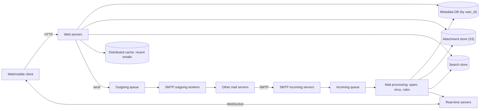
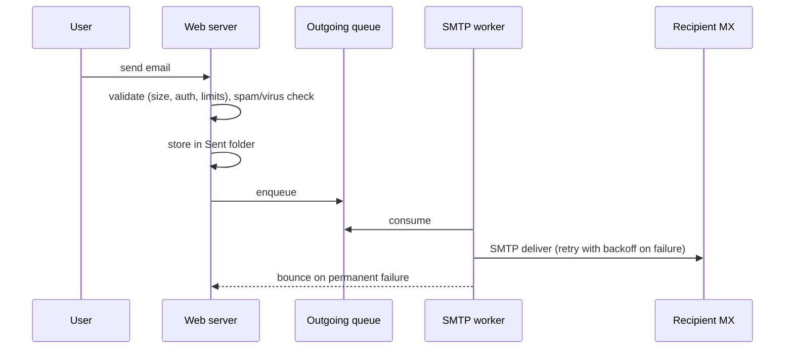

# 20 · Design a Distributed Email Service (Gmail / Outlook)

> **Category:** Messaging + storage · **Difficulty:** ⭐⭐⭐⭐ · **Patterns:** SMTP pipeline with queues, per-user partitioned metadata, attachments in object storage, search index, real-time push

---

## 1. TL;DR
Web/mobile clients talk HTTP to **web servers** and hold a **WebSocket** to real-time servers for new-mail push. Outgoing mail is validated, spam/virus-checked and queued for **SMTP workers**; incoming mail passes **SMTP servers → filters → storage**. Metadata is partitioned by **user_id** in a wide-column store, attachments in **object storage**, and a per-user **search index** supports full-text search.

---

## 2. Requirements
| Functional | Non-functional |
|---|---|
| Send/receive email | 1B users; reliability (never lose mail) |
| Fetch, folders, read/unread | Availability, low latency |
| Search by subject/body/sender | Scale: 100K sends/s, PB of storage |
| Anti-spam, anti-virus | Flexibility for new features |

---

## 3. Protocols
| Protocol | Purpose |
|---|---|
| **SMTP** | Send mail between servers |
| POP3 / IMAP | Legacy client retrieval |
| HTTP/JSON | Modern web/mobile clients |
| DNS MX record | Find the recipient domain's mail servers |

---

## 4. Architecture



---

## 5. Send flow


## 6. Receive flow
SMTP incoming servers accept (with policy checks) → incoming queue → processing (spam/virus/filters) → store metadata/body/attachments → if recipient online, push via real-time server; else delivered on next fetch.

---

## 7. Metadata storage
Access pattern: "all emails of user X in folder Y, newest first", read/unread filters, conversation threads. Strongly tied to user → **partition by user_id** (wide-column / Bigtable-like).

```
emails_by_folder (user_id, folder_id, email_id TIMEUUID DESC, from, subject, preview, is_read)
emails_by_user   (user_id, email_id) → full metadata
read_emails / unread_emails  (denormalized to query by status)
```
Threads: group by `Message-ID` / `In-Reply-To` / `References` headers.

---

## 8. Deep dives
- **Search:** per-user index; Elasticsearch (with user-based routing) or a custom LSM-based index co-located with mail data (writes ≫ searches).
- **Deliverability:** SPF, DKIM, DMARC, dedicated IP pools, IP warm-up, monitoring bounce/complaint rates.
- **Consistency:** a single user's mailbox needs consistency (one primary per user partition); availability trade-offs during failover.
- **Attachments:** object storage + virus scan; dedupe identical attachments.
- **Anti-spam:** reputation, ML classifiers, user reports.
- **Encryption:** TLS in transit (STARTTLS), at rest.

---

## 9. Interview Q&A
**Q: Why queues for SMTP?** Remote servers are slow/unavailable; queues decouple user actions from delivery and allow retries for days.

**Q: Why not a relational DB for mailboxes?** Data size per user is large and growing; wide-column partitions by user scale horizontally with fast per-user range reads.

**Q: How do you push new mail?** WebSocket to real-time servers (fallback long polling).

---

**Related:** [Notification system](07-notification-system.md) · [Search systems](../01-fundamentals/19-search-systems-and-inverted-index.md) · [Security](../01-fundamentals/15-security-authn-authz-encryption.md)
