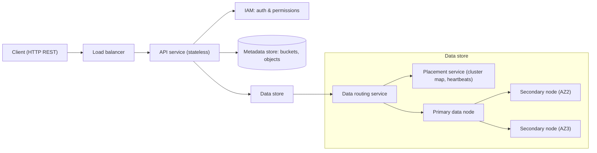
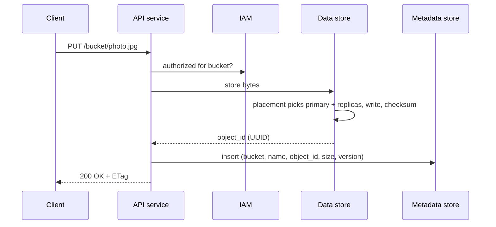

# 21 · Design S3-like Object Storage

> **Category:** Storage infrastructure · **Difficulty:** ⭐⭐⭐⭐⭐ · **Patterns:** metadata/data separation, immutable objects, append-only data files, replication vs erasure coding, checksums, placement service

---

## 1. TL;DR
Split the system into a **metadata store** (bucket + object name → object ID, version, size) and a **data store** (immutable bytes). The data store has a **placement service** that picks data nodes, which pack small objects into large **append-only files** and track `object_id → (file, offset, size)`. Durability comes from **replication** across AZs or **erasure coding**, with **checksums** to catch corruption.

---

## 2. Requirements
| Functional | Non-functional |
|---|---|
| Buckets: create/delete/list | 100 PB/year, **11 nines durability** (99.999999999%) |
| Objects: PUT/GET/DELETE, list by prefix | 4 nines availability |
| Versioning | Storage efficiency (cost) |
| Large uploads (multipart) | Objects from KB to TB |

---

## 3. Architecture



---

## 4. Upload (PUT) flow

GET = metadata lookup (name → object_id) → data store read by object_id.

---

## 5. Data node internals
- Storing each object as its own file wastes blocks and exhausts inodes for billions of small objects.
- Instead: **append many objects into a large data file** (e.g., a few GB); when full, mark read-only and open a new one.
- Local **object index** (RocksDB/SQLite): `object_id → (file_name, offset, size)`.
- Deletes = mark deleted; **compaction/garbage collection** copies live objects into new files.

## 6. Durability
| Technique | Overhead | Notes |
|---|---|---|
| 3× replication across AZs | 200% | Simple, fast reads/repair |
| **Erasure coding (e.g., 8+4)** | 50% | Survives 4 failures, more CPU, slower repair/reads |
| **Checksums** (per object + per file) | tiny | Detect bit rot; read from another replica if mismatch |

Write consistency: wait for all replicas (strong) vs majority/one (faster, weaker).

---

## 7. Metadata store
```
bucket(bucket_name PK, owner, versioning_enabled, created_at)
object(bucket_name, object_name, object_version, object_id, size, etag, deleted, PRIMARY KEY(bucket_name, object_name, object_version))
```
Shard by `hash(bucket_name, object_name)`. **Listing by prefix** across shards requires scatter-gather + merge with pagination tokens, or a denormalized listing table sharded by bucket.

---

## 8. Other features
- **Versioning:** each PUT creates a new version (new object_id); DELETE inserts a delete marker.
- **Multipart upload:** initiate → upload parts in parallel (each with ETag) → complete (assemble) → GC orphan parts.
- **Lifecycle policies:** move to cold tiers / delete after N days.
- **Garbage collection:** reclaim deleted/orphaned/overwritten data during compaction.

---

## 9. Interview Q&A
**Q: Why separate metadata and data?** Different scale and access patterns: metadata needs indexing/consistency; data is huge immutable blobs.

**Q: How do you reach 11 nines?** Replication/erasure coding across failure domains + checksums + fast repair of lost replicas.

**Q: Why immutable objects?** Simplifies replication, caching and consistency — updates are new versions.

---

**Related:** [Storage systems](../01-fundamentals/16-storage-systems-block-file-object-oltp-vs-olap.md) · [Google Drive](12-google-drive.md) · [CDN](52-cdn.md)
