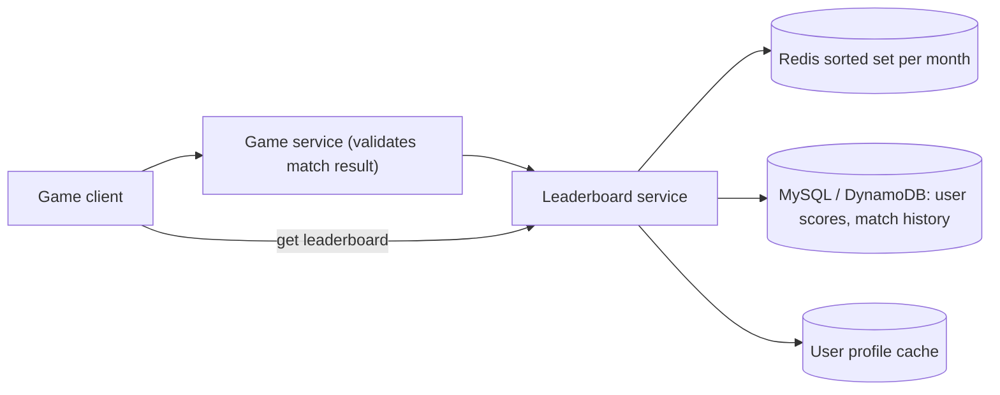
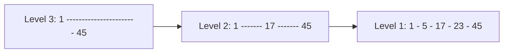
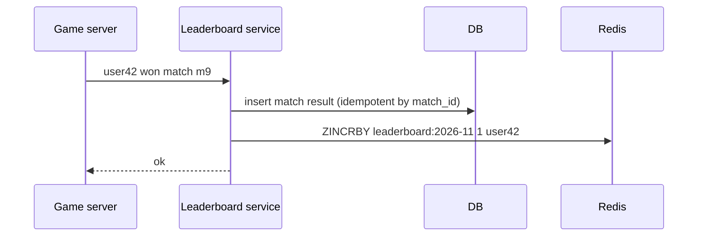

# 22 · Design a Real-Time Gaming Leaderboard

> **Category:** Ranking · **Difficulty:** ⭐⭐⭐ · **Patterns:** Redis sorted sets (skip lists), periodic keys for resets, sharding by score range vs hash, persistence for recovery

---

## 1. TL;DR
Store scores in a **Redis sorted set** per period (`leaderboard:2026-11`). Winning a match → `ZINCRBY`; top 10 → `ZREVRANGE 0 9`; my rank → `ZREVRANK`. All O(log n). Persist scores to a durable DB so Redis can be rebuilt. Beyond one Redis node, shard by **score ranges** (fixed partitions) or by hash with scatter-gather for top-K.

---

## 2. Requirements
| Functional | Non-functional |
|---|---|
| Top 10 players | Real-time rank updates |
| A user's rank (and neighbours ±4) | 5M DAU, 25M MAU |
| Monthly reset | Score update ~2,500 QPS peak; top-10 reads heavy |

---

## 3. Why not SQL?
`SELECT rank() OVER (ORDER BY score DESC)` over millions of rows on every request = full sort → too slow at real-time rates. Fine for small or batch leaderboards.

---

## 4. Architecture

Never let clients set scores directly (cheating) — the game server reports verified results.

---

## 5. Redis operations
| Action | Command | Complexity |
|---|---|---|
| Win a match | `ZINCRBY leaderboard:2026-11 1 user42` | O(log n) |
| Top 10 | `ZREVRANGE leaderboard:2026-11 0 9 WITHSCORES` | O(log n + 10) |
| My rank | `ZREVRANK leaderboard:2026-11 user42` | O(log n) |
| Around me | `ZREVRANGE key rank-4 rank+4` | O(log n + 9) |

Sorted set = **hash map** (member → score) + **skip list** (ordered by score).

**Storage:** 25M users × ~26 bytes ≈ 650 MB → one Redis instance (+ replica) is enough. Monthly reset = new key; old key archived.

---

## 6. Score update flow

---

## 7. Scaling to 500M users
| Approach | How | Top-K | My rank |
|---|---|---|---|
| **Fixed partition by score range** | Shard 1: 1–100 pts, shard 2: 101–200… | Read the highest shard | Rank in shard + sizes of higher shards (`ZCARD`) |
| Hash partition (Redis Cluster) | user → slot | Scatter-gather each shard's top-K and merge | Hard (needs all shards) |

Score-range partitioning needs moving users between shards when scores cross a boundary; works well when the score distribution is known.

Alternative: NoSQL (DynamoDB) with write sharding + GSI on score, or approximate percentile ranks for the long tail.

---

## 8. Tie-breaking
Equal scores → earlier achiever ranks higher: encode `score = points × 10^10 + (MAX_TS − timestamp)`.

---

## 9. Interview Q&A
**Q: What if Redis crashes?** Replica failover; rebuild from the DB (sum match results per user for the month).

**Q: Daily/weekly/all-time boards?** Separate sorted sets per period, updated together (pipeline).

**Q: Friends leaderboard?** Fetch friends' scores (`ZMSCORE`) and sort client-side/in service — friend lists are small.

---

**Related:** [Code judge (contest leaderboard)](37-online-code-judge.md) · [Probabilistic DS & skip lists](../01-fundamentals/18-probabilistic-data-structures-and-useful-algorithms.md) · [Top-K](34-top-k-heavy-hitters.md)
