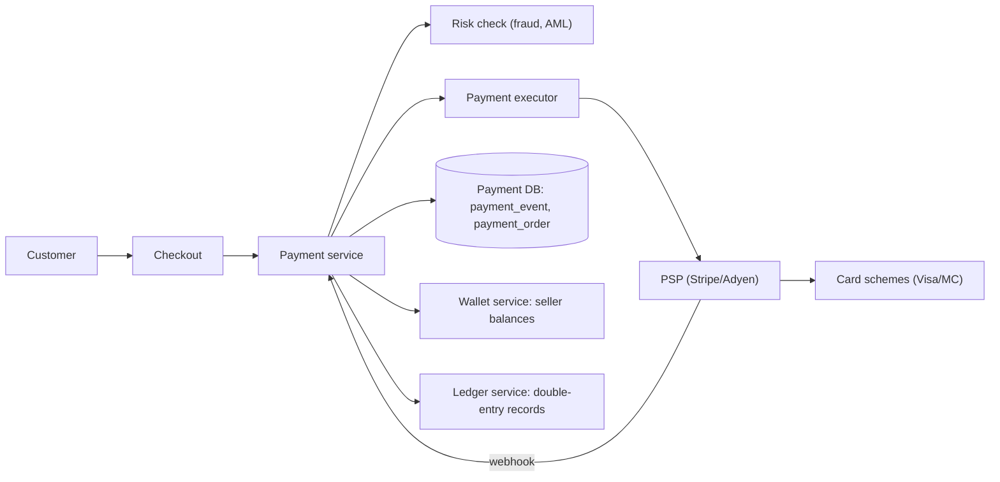
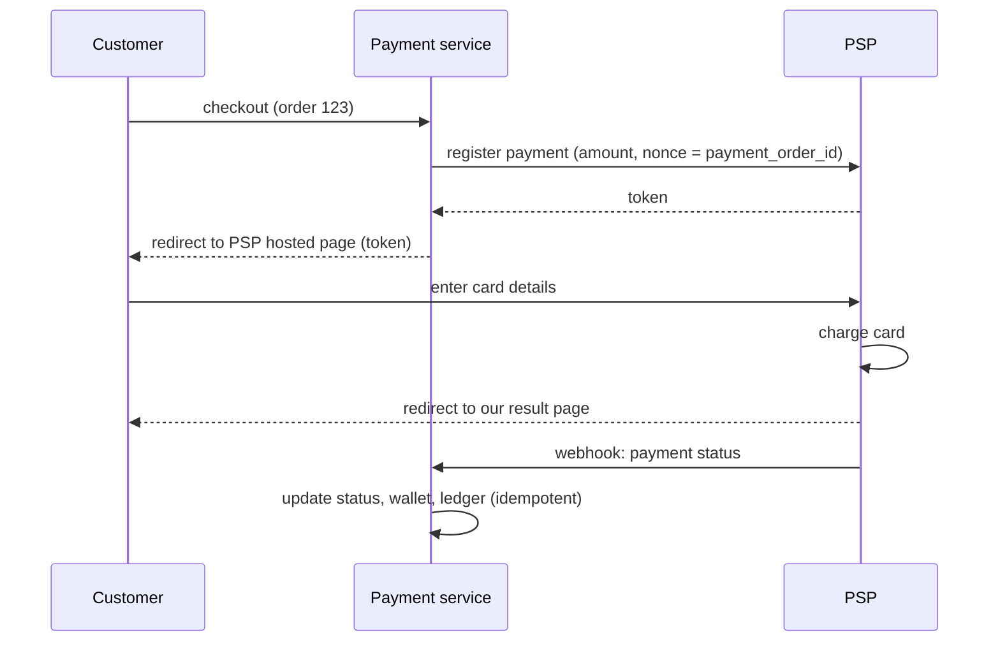
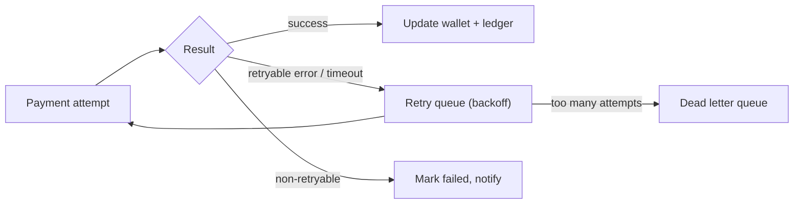

# 23 · Design a Payment System (e-commerce checkout)

| Category | Difficulty | Key ideas |
|---|---|---|
| Money movement | Very hard | PSP integration via hosted page, idempotency keys, double-entry ledger, async processing, retries/DLQ, reconciliation |

---

## Summary
The **payment service** receives a payment event (an order), creates a payment order per seller, and the **payment executor** charges through a **PSP** (Stripe/Adyen) using a **hosted payment page** so card data never touches us (PCI scope). Successful charges update the **wallet** (balances) and the immutable **double-entry ledger**. Every call carries an **idempotency key**; failures go to retry/dead-letter queues; nightly **reconciliation** with PSP settlement files catches inconsistencies.

---

## Requirements
| Functional | Non-functional |
|---|---|
| Pay-in: customer pays (on behalf of sellers) | **Correctness & exactly-once** charging |
| Pay-out: transfer to sellers monthly | Reliability, fault tolerance |
| Refunds, status tracking | Reconciliation between internal & external records |
| | Low QPS (~10 TPS for 1M txns/day) but zero tolerance for errors |

---

## Pay-in architecture



### Hosted payment page flow


---

## Data model
```
payment_event(checkout_id PK, buyer_info, seller_info, credit_card_info_token, is_payment_done)
payment_order(payment_order_id PK, checkout_id, amount, currency, status, ledger_updated, wallet_updated)
```
Status machine: `NOT_STARTED -> EXECUTING -> SUCCESS / FAILED` (+ `REFUNDED`).
Store amounts as **strings/decimals or integer minor units** - never floats.

---

## Double-entry ledger
Every movement has equal debit and credit entries; the sum of all entries is always zero -> easy auditing.

| Account | Debit | Credit |
|---|---|---|
| Buyer | $10 | |
| Seller | | $10 |

Ledger is **append-only**; corrections are new entries, never updates.

---

## Reliability toolkit
- **Idempotency:** the same `payment_order_id` / `Idempotency-Key` header on every PSP and internal call -> retries never double-charge; DB unique constraint guards inserts.
- **Retries:** exponential backoff for transient failures; **retry queue** -> **dead letter queue** after N attempts for manual investigation.

- **Timeouts are "unknown"**, not failures -> query PSP for status before retrying.
- **Async communication** (Kafka) between payment, wallet, ledger, analytics; at-least-once + idempotent consumers.
- **Reconciliation:** nightly compare PSP settlement file vs ledger vs wallet -> classify mismatches (auto-fixable / manual / unknown).
- **Distributed transaction across wallet + ledger:** use outbox/saga patterns or keep them consistent via event sourcing.

---

## Pay-out
Accumulated seller balances -> payout provider (e.g., Tipalti) -> bank transfers; same idempotency and reconciliation rules.

## Security
HTTPS, hosted payment pages/tokenization (PCI DSS), fraud checks (3-D Secure, ML risk scoring), rate limiting, audit logs, encryption at rest.

---

## Interview Q&A
**Q: How do you ensure exactly-once payment?**
A: At-least-once retries + idempotency keys on both sides = effectively once.

**Q: User double-clicks "Pay"?**
A: Same checkout ID -> idempotency key -> second request returns the first result.

**Q: PSP says success but our DB update failed?**
A: PSP webhook + periodic status polling + reconciliation repair it.

**Q: Why a ledger if we have balances?**
A: Balances are derived; the ledger is the auditable source of truth.

---

**Related:** [Digital wallet](24-digital-wallet.md) · [Distributed transactions](../01-fundamentals/10-distributed-transactions-2pc-saga-outbox.md) · [Fraud detection](55-fraud-detection.md) · [Security](../01-fundamentals/15-security-authn-authz-encryption.md)
