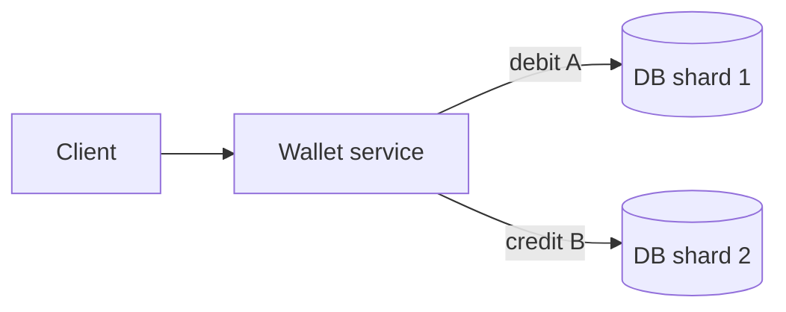
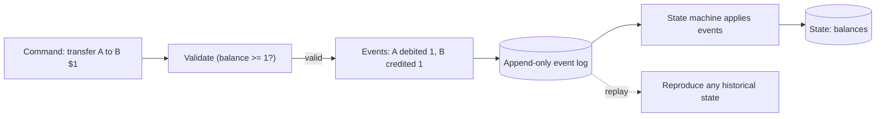
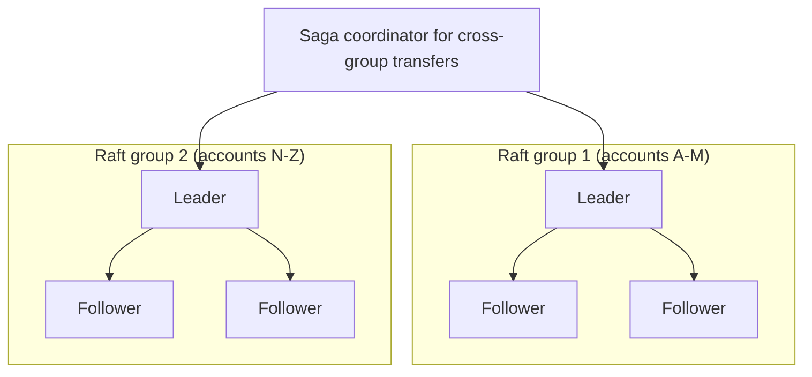

# 24 · Design a Digital Wallet (balance transfers at 1M TPS)

> **Category:** Money movement at scale · **Difficulty:** ⭐⭐⭐⭐⭐ · **Patterns:** sharded balances, distributed transactions (2PC / TCC / Saga), event sourcing, CQRS, Raft-replicated state machines

---

## 1. TL;DR
Balance transfers between accounts must be **atomic and auditable** at ~1M TPS. Sharding balances across many DB nodes forces **distributed transactions** (2PC, TCC or Saga). The strongest design uses **event sourcing**: validated **commands** become immutable **events** in a log, a deterministic **state machine** applies them to balances, and any past state can be **reproduced** by replay. Make it fast with local append-only files + snapshots, and reliable by replicating the event log with **Raft**.

---

## 2. Requirements
| Functional | Non-functional |
|---|---|
| Transfer between two wallets | 1,000,000 TPS |
| Show balances | 99.99% availability |
| | Correctness (no money created/lost) |
| | **Reproducibility**: rebuild historical balances for audit |

Each transfer = 2 balance updates → 2M operations/s. If one DB node does ~1K TPS → need ~2,000 nodes → sharding is unavoidable.

---

## 3. Approach 1: in-memory (Redis) shards
`account → balance` in a sharded Redis, a wallet service updates both sides. ❌ Not durable, no atomicity across shards. Not acceptable for money.

## 4. Approach 2: sharded SQL + distributed transactions

| Protocol | How | ✅ | ❌ |
|---|---|---|---|
| **2PC** | Coordinator: prepare all, then commit all | Atomic | Locks held across network; coordinator SPOF blocks |
| **TCC** (Try-Confirm-Cancel) | App-level: Try reserves (A −$1), Confirm finalizes, Cancel compensates | No long DB locks | Complex app logic; out-of-order cancel/try handling |
| **Saga** | Sequential local transactions + compensations | Simple, linear | Intermediate states visible; slower (sequential) |

TCC phase table:
| Phase | Account A | Account B |
|---|---|---|
| Try | −$1 (reserved) | nothing |
| Confirm | nothing | +$1 |
| Cancel | +$1 back | nothing |

## 5. Approach 3: Event sourcing ✅

Terms: **command** (intent, may be rejected), **event** (validated fact, immutable), **state** (current balances), **state machine** (deterministic: same events → same state).

### Making it fast
- Commands/events in local **append-only files** (mmap) instead of a remote DB.
- State in local **RocksDB**; periodic **snapshots** so replay starts from a recent point.
- **CQRS:** reads (balances) served from read models built off the event stream.

### Making it reliable
- Replicate the event log across nodes with **Raft** — majority commit, leader election on failure.
- Partition accounts across many Raft groups for throughput.

Cross-partition transfers → **saga** orchestrated by a coordinator, each step an event in the respective group.

---

## 6. Interview Q&A
**Q: Why event sourcing for a wallet?** Full audit trail, deterministic reproduction of balances for any point in time, natural fit with replication.

**Q: Isn't replay slow?** Snapshots bound replay time.

**Q: How do you avoid double-applying a transfer?** Idempotent command IDs; state machine rejects duplicates.

**Q: Where does 2PC fit?** Acceptable for low-throughput cross-shard transfers, but blocking & lock-heavy at 1M TPS.

---

**Related:** [Payment system](23-payment-system.md) · [Architecture patterns: event sourcing & CQRS](../01-fundamentals/12-architecture-patterns-microservices-cqrs-event-sourcing.md) · [Consensus](../01-fundamentals/09-consensus-leader-election-and-distributed-locks.md)
