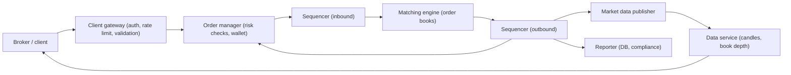
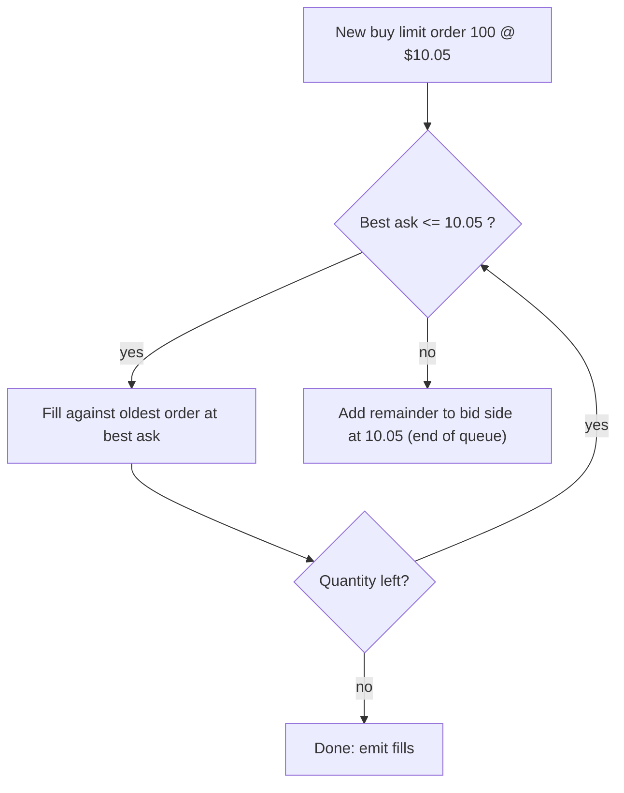
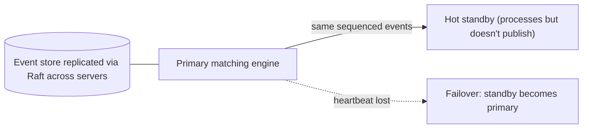

# 25 · Design a Stock Exchange (matching engine)

| Category | Difficulty | Key ideas |
|---|---|---|
| Ultra-low-latency trading | Very hard | order book, price-time priority matching, sequencer, deterministic replay, single-threaded hot path, mmap event store |

---

## Summary
Orders flow through a **gateway -> risk check (order manager) -> sequencer -> matching engine**. The **sequencer** stamps every order with a sequence ID so processing is **deterministic**; the **matching engine** keeps an in-memory **order book** per symbol and matches by **price-time priority**. Outputs (fills) go back through the sequencer to reporting and **market data** publishers. For microsecond latency, keep the critical path on **one server**, single-threaded, pinned to CPU cores, communicating via shared memory (mmap) - and recover by **replaying** the event log on a hot standby.

---

## Requirements
| Functional | Non-functional |
|---|---|
| Place / cancel limit orders | **Latency**: millisecond-level, predictable p99 |
| Matching, order status, fills | Availability 99.99% |
| Real-time market data (order book, candles) | Fault tolerance, fast recovery |
| Risk checks (e.g., max 1M shares/day) | Security, fairness |

Scale: 100 symbols, 1B orders/day (≈ 43K QPS average during 6.5 trading hours, peak 5×).

---

## Architecture

**Critical path:** gateway -> order manager -> sequencer -> matching engine. Reporting/market data are off the critical path.

---

## Order book & matching
- Two sides per symbol: **bids** (buy) sorted price descending, **asks** (sell) sorted ascending.
- Each price level = FIFO queue (doubly-linked list) of orders -> **price-time priority**.
- `order_id -> node` map for O(1) cancel.

Order book operations needed in O(1)/O(log n): place, cancel, match, best bid/ask, depth.

---

## Why a sequencer?
- Assigns a monotonically increasing sequence ID to every inbound order and outbound fill.
- Enables **deterministic replay**: same sequenced input -> same output -> hot-warm failover and audit.
- Detects missing messages (gaps in sequence).

---

## Low-latency design
| Technique | Reason |
|---|---|
| Everything on one server | Network hops cost ~500 µs each |
| **mmap shared memory event store** | Components communicate via an in-memory log, no network |
| Single-threaded application loop, CPU pinning | No context switches, no locks |
| No GC pauses (or careful tuning), pre-allocated memory | Predictable p99 |
| Kernel-bypass networking | Lower gateway latency |

---

## Fault tolerance

Recovery = replay events since the last snapshot. Multi-server Raft cluster replicates the event store; RTO in seconds.

---

## Market data
- L1 (best bid/ask), L2 (depth per price), L3 (individual orders).
- Candlestick charts aggregated from trade stream (ring buffers per interval).
- Fair distribution: multicast to subscribers so nobody gets data earlier; colocation services offered equally.

---

## Interview Q&A
**Q: Why is determinism so important?**
A: It makes failover safe (standby reaches identical state) and lets regulators replay history.

**Q: Why not microservices with Kafka on the hot path?**
A: Each network hop and broker adds latency and jitter; exchanges keep the hot path in-process.

**Q: How do you protect from abusive clients?**
A: Gateway rate limiting, risk limits per account, kill switches.

---

**Related:** [Time, clocks & ordering](../01-fundamentals/20-time-clocks-and-ordering.md) · [Digital wallet](24-digital-wallet.md) · [Price alerts](54-price-alerts.md)
