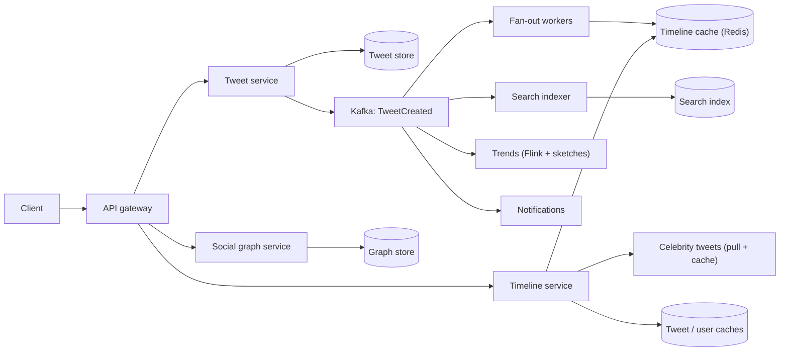
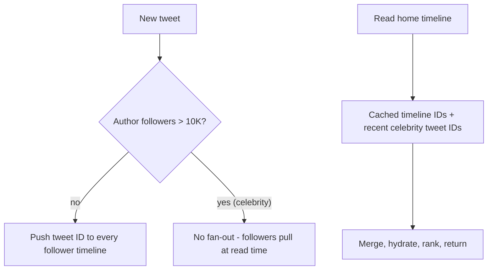

# 26 · Design Twitter (X)

| Category | Difficulty | Key ideas |
|---|---|---|
| Social / fan-out | Hard | hybrid fan-out, timeline cache, Snowflake IDs, trends via stream processing |

Core challenges: **massive read/write asymmetry**, **fan-out to followers**, the **celebrity problem**, search and trends.
Related: [News Feed System (Facebook / LinkedIn feed)](08-news-feed-system.md), [Unique ID Generator for Distributed Systems](04-unique-id-generator.md), Fundamentals -> Caching, Message Queues, Search.

---

## Architecture at a glance



### Key flow



---

## Requirements

### Functional
1. Post a tweet (text ≤ 280 chars, optional images/video).
2. Follow / unfollow users.
3. **Home timeline** - tweets from people I follow, newest first (optionally ranked).
4. **User timeline** - a user's own tweets.
5. Like, retweet, reply.
6. Search tweets; trending topics.

### Non-functional
- Highly available (AP); eventual consistency OK - a tweet appearing a few seconds late is fine.
- Timeline load **< 200 ms p99**.
- Read-heavy: reads ≫ writes (~100:1).

### Back-of-the-envelope
- 500M DAU, each posts 0.5 tweets/day -> **250M tweets/day ≈ 3K writes/s** (peak ~10K).
- Each user opens the timeline 10×/day -> **5B timeline reads/day ≈ 60K reads/s** (peak ~200K).
- Tweet ≈ 300 bytes text + metadata ≈ 1 KB -> 250 GB/day -> ~90 TB/year (text). Media stored separately in object storage (~PBs).
- Avg followers ≈ 200 -> fan-out writes: 250M × 200 = **50B timeline inserts/day ≈ 600K/s**.

---

## API
```
POST /v1/tweets                    {text, media_ids[], reply_to?}     → {tweet_id}
GET  /v1/timeline/home?cursor=&limit=20                               → {tweets[], next_cursor}
GET  /v1/users/{id}/tweets?cursor=
POST /v1/users/{id}/follow         DELETE /v1/users/{id}/follow
POST /v1/tweets/{id}/like          POST /v1/tweets/{id}/retweet
GET  /v1/search?q=&cursor=
POST /v1/media/upload-url          → pre-signed S3 URL
```

---

## Data model
| Store | Data | Why |
|---|---|---|
| **Tweets** (Cassandra/Manhattan, sharded by `tweet_id`) | `tweet_id (Snowflake), user_id, text, media_urls, created_at, reply_to` | Huge write volume, key lookups |
| **User tweets index** | `user_id -> [tweet_ids]` sorted by time | User timeline |
| **Social graph** (sharded MySQL / FlockDB-like) | `follower_id, followee_id` both directions | "Who follows X?" and "who does X follow?" |
| **Timeline cache** (Redis) | `user_id -> list of last ~800 tweet_ids` | Fast home timeline |
| **Counters** (Redis + periodic DB flush) | likes, retweets, followers count | Very high write rate |
| **Media** | S3 + CDN | Large blobs |
| **Search index** | Elasticsearch / Earlybird-like inverted index | Full-text search |

Snowflake IDs are time-sortable -> sorting by id = sorting by time, no separate timestamp index needed.

---

## High-level design
```
Client → CDN (media) 
Client → LB → API Gateway ─┬─► Tweet Service ──► Tweet DB
                           │        └──► Kafka (TweetCreated)
                           │                 ├─► Fan-out Service ──► Timeline Cache (Redis)
                           │                 ├─► Search Indexer ──► Search Index
                           │                 ├─► Trends (stream processing)
                           │                 └─► Notification Service
                           ├─► Timeline Service ──► Timeline Cache + Tweet cache/DB
                           ├─► Social Graph Service ──► Graph DB
                           └─► Search Service
```

---

## Deep dive - Home timeline (the core)

### Option A: Fan-out on read (pull)
At read time: get followees -> fetch their recent tweets -> merge-sort.
- Cheap writes, no wasted work for inactive users.
- Slow reads (following 1,000 people = 1,000 lookups) at 200K reads/s - too expensive.

### Option B: Fan-out on write (push)
On new tweet: look up all followers, insert `tweet_id` into each follower's Redis timeline list (`LPUSH` + `LTRIM 800`).
- Timeline read = one Redis `LRANGE` + hydrate tweets (multi-get from tweet cache) -> very fast.
- A celebrity with 100M followers -> 100M inserts per tweet (minutes of lag, huge load).
- Wasted work for inactive followers.

### Option C: Hybrid (what Twitter does)
- **Normal users (< ~10K followers):** push.
- **Celebrities:** *don't* fan out. At read time, merge the user's pre-computed timeline with recent tweets from the celebrities they follow (pull, cached heavily because many readers share them).
- **Inactive users** (not logged in for 30 days): skip fan-out; rebuild timeline on next login.

### Timeline read path
1. `LRANGE timeline:{user_id} 0 19` -> tweet ids.
2. Fetch followed celebrities' recent tweet ids (cached per celebrity), merge by id.
3. Hydrate: multi-get tweet objects from tweet cache (Memcached/Redis), user objects from user cache.
4. Filter (blocked/muted, deleted tweets), optionally **rank** (ML model: engagement probability).
5. Return with `next_cursor = last tweet_id`.

---

## Other deep dives

### Likes & counters
100K+ likes/s on viral tweets. Don't `UPDATE tweets SET likes=likes+1` (row contention).
- Write like event to a `likes` table (`user_id, tweet_id` - unique -> idempotent).
- Increment Redis counter; flush aggregates to DB periodically; or shard the counter (`likes:{tweet}:{0..N}`).

### Search
Tweets -> Kafka -> indexer -> inverted index sharded by time (recent index in RAM - Twitter's "Earlybird"). Query fans out to shards, merges by relevance + recency.

### Trending topics
Stream processing (Flink) on tweet stream: extract hashtags/entities -> **Count-Min Sketch** / windowed counts per region -> compare to baseline (velocity, not just volume) -> top-K heap -> cache for ~1 min.

### Media
Client requests pre-signed URL -> uploads directly to S3 -> async processing (thumbnails, transcoding) -> CDN.

### Notifications
Consumer of tweet/like/follow events -> notification service ([Notification System (Push, SMS, Email)](07-notification-system.md)).

---

## Scaling & reliability
- Stateless services behind LBs, autoscaled.
- Redis timeline cluster sharded by `user_id`, replicated; can be rebuilt from DB (it's a cache).
- Kafka absorbs fan-out bursts; fan-out workers scale on consumer lag.
- Multi-region: users homed to a region; tweets replicated async across regions.
- Rate limit posting & following (spam).

---

## Points to mention in an interview
- Hybrid fan-out & the celebrity problem - the key insight.
- Timeline cache stores only IDs (memory efficient); hydrate from object caches.
- Snowflake IDs for time ordering and cursor pagination.
- Counters via sharded/async increments.
- Search & trends as async consumers of the tweet stream.

---

## Interview Q&A

**Q: Why hybrid fan-out?**
A: Push makes reads cheap but a 100M-follower account would create 100M writes per tweet; pulling those few celebrity timelines at read time is cheaper.

**Q: How is the timeline paginated?**
A: Cursor on the last tweet ID (Snowflake IDs sort by time).

**Q: How would you show "trending"?**
A: Stream counts of hashtags per window and region, rank by velocity vs baseline, Count-Min Sketch + heap for memory efficiency.

**Q: What happens when a user deletes a tweet?**
A: Tombstone in tweet store; hydration filters it; async cleanup from caches and search index.
