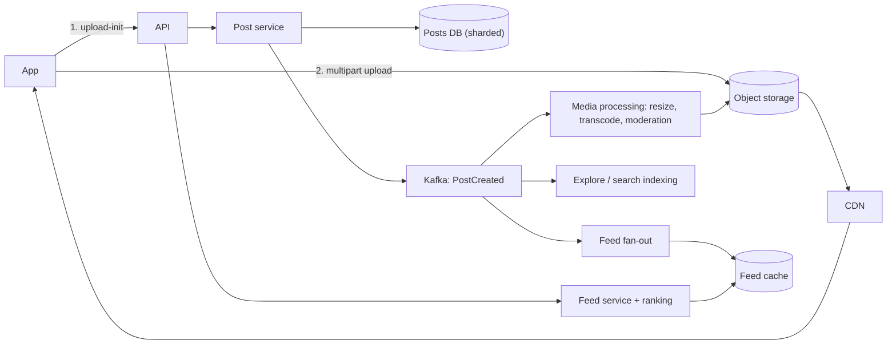
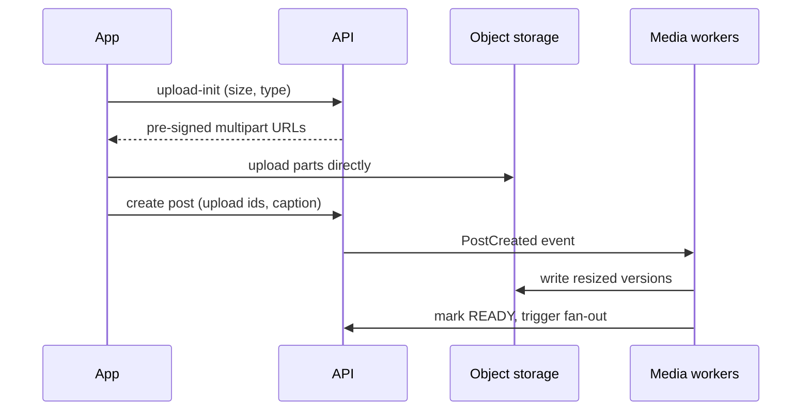

# 27 · Design Instagram

| Category | Difficulty | Key ideas |
|---|---|---|
| Social / media | Hard | pre-signed uploads, async media pipeline, CDN, ranked feed, TTL stories |

Core challenges: **media upload & storage at petabyte scale**, **fast image delivery**, **feed generation**, stories, likes/comments.
Related: [News Feed System (Facebook / LinkedIn feed)](08-news-feed-system.md), [YouTube (Video Upload & Streaming)](11-youtube.md), [Twitter (X)](26-twitter.md), Fundamentals -> Storage Systems, Caching.

---

## Architecture at a glance



### Key flow



---

## Requirements

### Functional
1. Upload photos/videos with caption.
2. Follow users.
3. Home feed of followed users' posts.
4. Like & comment.
5. Stories (disappear after 24 h).
6. User profile grid; explore/search.

### Non-functional
- High availability; feed eventual consistency OK.
- Feed loads < 200-300 ms; images load fast worldwide.
- Durable media (never lose a photo).

### Estimates
- 500M DAU; 100M uploads/day ≈ **1.2K uploads/s** (peak ~5K).
- Avg photo 2 MB original; store ~4 resized versions (thumbnail 20 KB, small, medium, large) ≈ 3 MB total -> **300 TB/day** -> ~100 PB/year.
- Feed reads: 500M × 20 opens = 10B/day ≈ 115K/s. Image GETs ≫ that -> **served almost entirely by CDN**.

---

## API
```
POST /v1/media/upload-init  {content_type, size}  → {upload_id, presigned_urls[] (multipart)}
POST /v1/posts              {upload_ids[], caption, location}   → {post_id}
GET  /v1/feed?cursor=
GET  /v1/users/{id}/posts?cursor=
POST /v1/posts/{id}/like    POST /v1/posts/{id}/comments
POST /v1/stories            GET /v1/stories/feed
```

---

## Data model
- **Users** (Postgres, sharded by user_id)
- **Posts** (sharded Postgres or Cassandra): `post_id, user_id, caption, media_keys[], created_at, like_count, comment_count`
- **Follows**: `(follower_id, followee_id)` + reverse index
- **Likes**: `(post_id, user_id)` unique; counters cached
- **Comments**: Cassandra partitioned by `post_id`, clustered by time
- **Media**: object storage, key = `media/{shard}/{media_id}/{size}.jpg`
- **Feed cache**: Redis list of post_ids per user
- **Stories**: Cassandra/Redis with **TTL = 24 h**

Instagram's real trick: Postgres with thousands of **logical shards**; IDs = `41-bit time | 13-bit shard id | 10-bit sequence` generated *inside* Postgres -> the ID tells you the shard.

---

## High-level design
```
             ┌──── pre-signed upload ────► Object Storage (S3) ──► CDN ◄── image GETs
Client ──────┤
             └──► LB → API ─┬─► Post Service ──► Posts DB
                            │       └──► Kafka: PostCreated
                            │               ├─► Media Processing workers (resize, compress, strip EXIF, moderation)
                            │               ├─► Feed Fan-out workers ──► Feed cache (Redis)
                            │               ├─► Search/Explore indexer
                            │               └─► Notifications
                            ├─► Feed Service ──► Feed cache + Post cache
                            └─► Like/Comment Service ──► Cassandra + counters
```

---

## Deep dives

### Upload flow
1. Client calls `upload-init` -> server returns pre-signed **multipart** URLs.
2. Client uploads **directly to S3** (servers don't proxy bytes) - resumable on mobile networks.
3. Client calls `POST /posts` with upload ids -> post saved with status `PROCESSING`.
4. Media workers: generate sizes (WebP/AVIF), video transcoding (HLS renditions, [YouTube (Video Upload & Streaming)](11-youtube.md), blurhash placeholder, content moderation (ML for nudity/violence), then mark `READY` -> fan-out.
5. **Client-side optimisation**: resize/compress on device before upload; upload while user is still writing the caption.

### Image delivery
- CDN with long TTL (images are immutable: new edit = new key).
- Serve size matching device (`srcset`), modern formats.
- Progressive loading: tiny blurred placeholder -> full image.
- Origin shield to protect S3 from CDN miss storms.

### Feed
Same hybrid fan-out as Twitter ([Twitter (X)](26-twitter.md)): push for normal users, pull for celebrities. Instagram's feed is **ranked** (not purely chronological):
1. Candidate generation: recent posts from followees (feed cache) + celebrity pulls.
2. Ranking model (likelihood of like/comment/share/time spent).
3. Inject ads & suggested posts.
4. Cache the ranked page briefly.

### Likes & comments at scale
- Likes table keyed by `(post_id, user_id)` for idempotency ("did I like this?" check).
- Count in Redis (`INCR`) + async batch persistence; display approximate counts ("1.2M likes").
- Hot posts: shard counters, local aggregation before writing.

### Stories
- Separate store with 24 h TTL; story tray = list of followees with active stories, ordered by affinity.
- Pre-fetch first story media on app open.
- Viewed state per user in Redis bitset/sets.

### Explore / search
- Embeddings of posts & users -> nearest-neighbour candidates -> ranking.
- Hashtag & user search via Elasticsearch.

---

## Reliability & scale
- Media replicated across AZs (S3 11-nines); metadata DB replicated (leader + followers), cross-region async.
- Feed cache is rebuildable.
- Kafka decouples upload from processing; workers autoscale on lag.
- Rate limiting & spam detection on uploads/comments.
- Graceful degradation: if ranking is down, fall back to chronological feed.

---

## Points to mention in an interview
- **Direct-to-S3 uploads with pre-signed URLs**, async processing pipeline.
- **CDN** serves 99% of bytes; immutable media keys.
- Hybrid fan-out feed + ML ranking.
- Counters & likes designed for hot posts.
- Stories via TTL storage.

---

## Interview Q&A

**Q: Why upload directly to object storage?**
A: App servers never handle large bytes; uploads scale with S3 and resume on flaky mobile networks.

**Q: How are images served fast globally?**
A: Immutable keys + long-TTL CDN caching + right-sized formats (WebP/AVIF) + blurred placeholders.

**Q: How do stories expire?**
A: Stored with a 24 h TTL; story tray built from followees with active stories.

**Q: How do you handle a viral post's like counter?**
A: Redis counters with async persistence or sharded counters.
