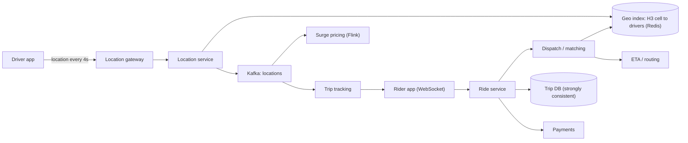
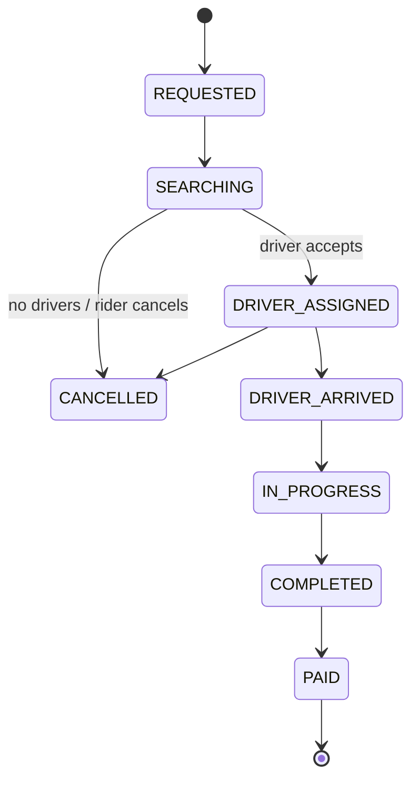

# 28 · Design Uber (Ride Hailing)

> **Category:** Geo / real-time marketplace · **Difficulty:** ⭐⭐⭐⭐⭐ · **Patterns:** in-memory geo index (H3), dispatch with conditional locks, trip state machine, surge via streams

> Core challenges: **real-time location tracking of millions of drivers**, **matching riders to nearby drivers fast**, **consistency of trip state** (one driver ↔ one trip), surge pricing, payments.
> Related: [Proximity Service (Yelp "restaurants near me")](13-proximity-service.md), [Nearby Friends (live friend locations)](14-nearby-friends.md), [Google Maps (Rendering, Routing, ETA)](15-google-maps.md), [Payment System (e-commerce checkout)](23-payment-system.md).

---

## Architecture at a glance



### Key flow



---

## Step 1: Requirements

### Functional
1. Rider requests a ride (pickup, destination) and sees fare estimate & ETA.
2. System matches rider with a nearby available driver; driver accepts/declines.
3. Real-time location of driver shown to rider during pickup and trip.
4. Trip lifecycle: requested → matched → driver arriving → in progress → completed → paid.
5. Ratings, payments, trip history.

### Non-functional
- Matching latency < a few seconds.
- **No double assignment** (a driver can't get two trips; a rider can't get two drivers) → strong consistency for trip/driver state.
- Location updates: high write throughput, eventual consistency OK.
- Highly available, especially in a region (a city outage = lost revenue).

### Estimates
- 5M active drivers at peak, location update every **4 s** → **1.25M location writes/s**.
- 20M trips/day ≈ 230 ride requests/s (peak ~1K/s).
- Location data is ephemeral: only latest position needed for matching; history kept for trips (analytics/billing).

---

## Step 2: API
```
POST /v1/rides/estimate     {pickup, dropoff}          → {fare, eta, surge_multiplier, quote_id}
POST /v1/rides              {quote_id, payment_method}  → {ride_id, status: SEARCHING}
GET  /v1/rides/{id}                                     → status, driver, location
POST /v1/drivers/location   {lat, lng, heading, ts}     (driver app, every 4 s — or over WebSocket)
POST /v1/rides/{id}/accept  (driver)     POST /v1/rides/{id}/start   POST /v1/rides/{id}/complete
WebSocket /v1/stream        → push: match found, driver location, status changes
```

---

## Step 3: High-level design
```
Driver app ──WebSocket/HTTP──► Location Gateway ──► Location Service ──► Geo index (Redis/in-memory, by cell)
                                                        └──► Kafka (location stream) ─► Trip tracking, ETA, Surge, Analytics
Rider app ──► API GW ──► Ride Service ──► Matching / Dispatch Service ──► Geo index (find candidates)
                              │                     └──► Driver offer via push/WebSocket
                              ├──► Trip DB (strongly consistent, sharded by city/trip_id)
                              ├──► Pricing Service (surge from supply/demand per cell)
                              ├──► Maps/ETA Service (routing, [Google Maps (Rendering, Routing, ETA)](15-google-maps.md)
                              └──► Payment Service ([Payment System (e-commerce checkout)](23-payment-system.md))
```

---

## Step 4: Deep dives

### 4.1 Location ingestion & geo index
- Drivers send location every ~4 s over a persistent connection (WebSocket/gRPC stream) to stateless **location gateways**.
- **Geo index**: map the world into cells (Uber uses **H3 hexagons**; geohash/S2/quadtree also work). Maintain `cell_id → set of available driver_ids` and `driver_id → {lat, lng, cell, status, ts}` in memory (Redis cluster sharded by cell/city).
- On each update: if the driver moved to a new cell, remove from old set, add to new. Entries expire if no update in ~30 s (driver went offline).
- Publish updates to Kafka for trip tracking (send to the rider), ETA models, surge computation, and storage of trip GPS traces (Cassandra / S3).

**Why not a SQL DB for locations?** 1.25M writes/s of data that's stale in 4 s — in-memory, sharded, TTL'd storage is the right fit.

### 4.2 Matching (dispatch)
1. Rider request → Dispatch Service gets pickup cell + neighbouring rings of cells (k-ring) → candidate available drivers.
2. Rank candidates by **ETA** (road-network routing, not straight-line distance), driver rating, vehicle type, acceptance probability.
3. **Lock** the chosen driver (atomic state transition `AVAILABLE → OFFERED` via compare-and-set in Redis/DB with TTL, e.g., 15 s).
4. Send offer to driver. If accepted → create trip `MATCHED` (transaction). If declined/timeout → release lock, try next candidate.
5. Optionally **batch matching**: collect requests over ~1–2 s window and solve an assignment problem globally per area (better overall ETA than greedy).

**Preventing double assignment:** driver status changes only via conditional writes (`UPDATE drivers SET status='OFFERED', ride_id=? WHERE id=? AND status='AVAILABLE'`). Trip state is a **state machine** stored in a strongly consistent DB.

### 4.3 Trip state machine
```
REQUESTED → SEARCHING → DRIVER_ASSIGNED → DRIVER_ARRIVED → IN_PROGRESS → COMPLETED → PAID
          ↘ CANCELLED (rider/driver/no drivers)
```
Every transition is validated and idempotent (retries from flaky mobile networks). Events published via outbox to Kafka → notifications, receipts, analytics.

### 4.4 Real-time updates to rider
Rider app keeps a WebSocket; driver location stream for that trip is forwarded via pub/sub (Redis channel / Kafka → push gateway). Client interpolates between updates for smooth movement.

### 4.5 ETA & routing
Road graph partitioned into tiles, contraction hierarchies for fast shortest paths, live traffic from GPS traces; ML correction on top (see [Google Maps (Rendering, Routing, ETA)](15-google-maps.md).

### 4.6 Surge pricing
Stream processing per H3 cell: demand (requests) vs supply (available drivers) over the last few minutes → multiplier, smoothed and capped; quote locked for the rider for N minutes (`quote_id`).

### 4.7 Payments
On completion: compute fare (distance/time from GPS trace), charge via payment service using an idempotency key = `ride_id`; pre-authorize card at request time to reduce fraud. Driver payouts via ledger ([Payment System (e-commerce checkout)](23-payment-system.md), [Digital Wallet (balance transfers at 1M TPS)](24-digital-wallet.md)).

---

## Step 5: Scale & reliability
- **Partition by city/region** — matching is local; each region runs its own cell of services (blast radius).
- Location service is stateless; geo index replicated; if lost, rebuilt within seconds from the next updates.
- Trip DB: strongly consistent (e.g., Schemaless/MySQL, Spanner, CockroachDB), sharded by trip_id, replicated.
- Mobile app retries with idempotency keys; offline buffering of GPS on the driver phone.
- Graceful degradation: if ETA service slow, fall back to straight-line distance estimates.
- Monitor: match rate, time-to-match, cancellation rate, location lag.

---

## Interview wrap-up
- **In-memory geo index (H3/geohash cells)** for 1M+ location writes/s.
- Matching ranks by **ETA**, locks driver with **conditional writes** to avoid double dispatch.
- Trip as a **state machine** in a strongly-consistent store; location in an eventually-consistent fast path.
- Region-based partitioning, surge via stream processing, idempotent payments.

---

## Interview Q&A

**Q: How do you prevent assigning one driver to two riders?**
A: Conditional update `status AVAILABLE → OFFERED` (CAS) with a TTL; only one dispatcher wins.

**Q: Why not store locations in SQL?**
A: 1M+ writes/s of data that's stale in seconds — in-memory, TTL'd, sharded by cell is the right tool.

**Q: Greedy nearest driver or batch matching?**
A: Batch matching every 1–2 s per area optimizes total ETA; greedy is simpler.

**Q: How do you partition?**
A: By city/region — matching is local, failures stay local.
