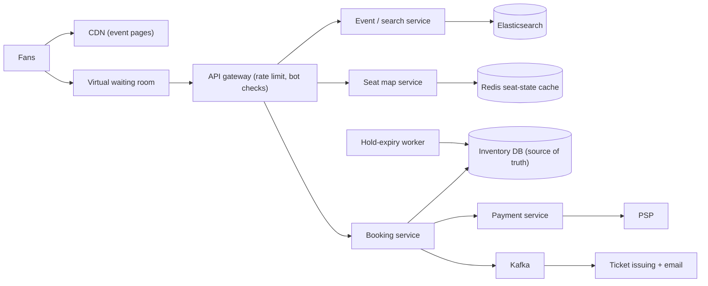
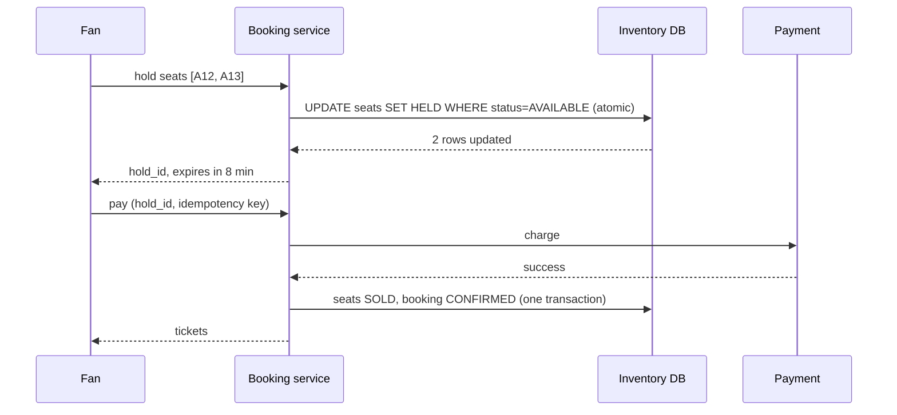

# 29 · Design Ticketmaster (Event Ticketing)

| Category | Difficulty | Key ideas |
|---|---|---|
| Inventory & booking under contention | Hard | seat holds with TTL, atomic conditional updates, virtual waiting room, idempotent payments |

Core challenges: **no double-selling of a seat**, **extreme traffic spikes** at on-sale time (Taylor Swift effect), fairness (virtual waiting room), bots.
Related: [Hotel Reservation System (Marriott / Booking.com)](19-hotel-reservation.md), [Payment System (e-commerce checkout)](23-payment-system.md), Fundamentals -> Databases (locking), Distributed Transactions, Reliability.

---

## Architecture at a glance



### Key flow



---

## Requirements

### Functional
1. Browse/search events (concert, venue, date).
2. View seat map with availability.
3. Select seats -> **hold** them for a few minutes -> pay -> get ticket.
4. Cancel/refund; ticket delivery (QR code).

### Non-functional
- **Strong consistency for seat inventory** - a seat sold exactly once.
- High availability for browsing; booking path correctness > availability.
- Handle flash crowds: 10M users trying to buy 50K seats in minutes.
- Fair (FIFO-ish) access; anti-bot.

### Estimates
- Normal: ~1K bookings/s overall. On-sale for a mega event: 10M+ users, **millions of requests/s** on seat map & hold endpoints for a few minutes.
- Seats per venue 20K-100K -> inventory per event is small (fits in one DB shard / memory easily). The challenge is **contention**, not size.

---

## API
```
GET  /v1/events?q=&city=&date=
GET  /v1/events/{id}                      → details
GET  /v1/events/{id}/seats                → seat map + availability (cached)
POST /v1/events/{id}/holds  {seat_ids[]}  → {hold_id, expires_at}      (409 if taken)
POST /v1/bookings           {hold_id, payment_token, idempotency_key} → {booking_id, tickets[]}
DELETE /v1/holds/{id}
```

---

## Data model (Postgres / strongly-consistent SQL, sharded by event_id)
```
events(event_id, venue_id, name, start_time, on_sale_at, status)
seats(event_id, seat_id, section, row, number, price_tier,
      status ENUM('AVAILABLE','HELD','SOLD'), hold_id, hold_expires_at, version)
holds(hold_id, user_id, event_id, seat_ids[], expires_at, status)
bookings(booking_id, user_id, event_id, hold_id UNIQUE, amount, payment_id, status, created_at)
tickets(ticket_id, booking_id, seat_id, qr_code_secret)
```
For general admission (no seat numbers): `inventory(event_id, tier, remaining)` decremented atomically.

---

## High-level design
```
Users ─► CDN (static event pages, seat-map images)
      ─► Virtual Waiting Room (queue) ─► API GW (rate limit, bot detection)
             ├─► Event/Search Service ─► Elasticsearch + cache
             ├─► Seat Map Service ─► Redis (availability bitmap per event, refreshed from DB)
             ├─► Booking Service ─► Inventory DB (source of truth for seats)
             │        └─► Payment Service ─► PSP (Stripe/Adyen)
             └─► Ticket Service ─► generate QR, email/app delivery (via Kafka)
Hold Expiry worker: releases expired holds
```

---

## Deep dives

### Preventing double booking (the core)
**Hold (reserve) step** - atomic conditional update inside a transaction:
```sql
BEGIN;
UPDATE seats
   SET status='HELD', hold_id=:hold, hold_expires_at=now()+interval '8 minutes'
 WHERE event_id=:e AND seat_id = ANY(:seats)
   AND (status='AVAILABLE' OR (status='HELD' AND hold_expires_at < now()));
-- if rows_updated != number of seats → ROLLBACK, return 409 (some seat taken)
INSERT INTO holds(...);
COMMIT;
```
Alternatives:
- `SELECT ... FOR UPDATE` (pessimistic lock) - fine, contention is per seat.
- Optimistic locking with `version`.
- **Redis** `SET seat:{event}:{seat} {hold_id} NX EX 480` as a fast first-line lock, *then* confirm in DB (DB remains source of truth).

**Booking step**: verify hold valid & owned by user -> charge payment (idempotency key = hold_id) -> mark seats `SOLD` and booking `CONFIRMED` in one transaction. Unique constraint on `bookings.hold_id` prevents double charge/booking on retries.

### Hold expiry
- Holds have `expires_at`; queries treat expired holds as available (lazy expiry) **and** a background worker (or delayed queue / Redis keyspace events) releases them proactively so the seat map updates.
- Payment in flight near expiry: extend hold while payment is processing, or validate post-payment and auto-refund if lost.

### Flash-crowd handling: Virtual waiting room Easy
- Before on-sale, users land in a **queue** page (served from CDN/edge). Each gets a signed token with queue position.
- Admit users at a controlled rate (e.g., 2K/min) matching backend capacity; admitted users get a short-lived **access token** required by booking APIs.
- Benefits: protects backend, fairness, predictable load, better UX than errors.
- Implementation: Redis sorted set (score = arrival time) or a managed solution (Cloudflare/Queue-it).

### Seat map reads
- Millions of users refreshing the map -> serve from **Redis** (bitmap of seat states per event) or cache with ~1-2 s TTL; push updates via WebSocket/SSE.
- Map may be slightly stale - that's OK because the **hold** is the authoritative check.

### Anti-bot & fairness
CAPTCHA at queue entry, device fingerprinting, per-account purchase limits (max 4 tickets), verified fan pre-registration, rate limiting per IP/account.

### Search & browse
Event catalog in Postgres -> CDC -> Elasticsearch; heavy caching + CDN; this path is AP and can degrade independently from booking.

---

## Scaling & reliability
- Shard inventory by `event_id` - but a single hot event lands on one shard: that's fine because the waiting room caps admission rate; keep the hot path tiny (single-row conditional updates).
- Payment service behind circuit breakers; if PSP is slow, holds extend.
- Idempotency keys on every write; outbox events for ticket issuance and emails.
- Pre-scale before known on-sales; load-test.

---

## Points to mention in an interview
- **Hold-then-confirm** with atomic conditional updates & expiry - no double booking.
- **Virtual waiting room** to turn a stampede into a controlled stream.
- Cached seat map for reads; DB is source of truth for writes.
- Idempotent payments keyed by hold id; anti-bot measures.

---

## Interview Q&A

**Q: How do you stop 1M users from crushing the system at on-sale time?**
A: Virtual waiting room admits users at the rate the backend can handle.

**Q: Seat map shows a seat free but hold fails?**
A: The map is cached/eventually consistent; the hold is the authoritative check -> return 409 and refresh.

**Q: What if payment takes longer than the hold?**
A: Extend the hold during payment, or refund automatically if the hold was lost.

**Q: General admission (no seat numbers)?**
A: Atomic counter decrement `remaining = remaining - n WHERE remaining >= n`.
