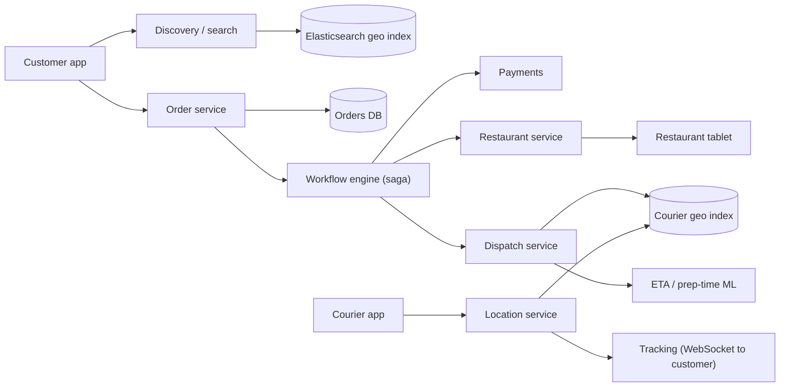
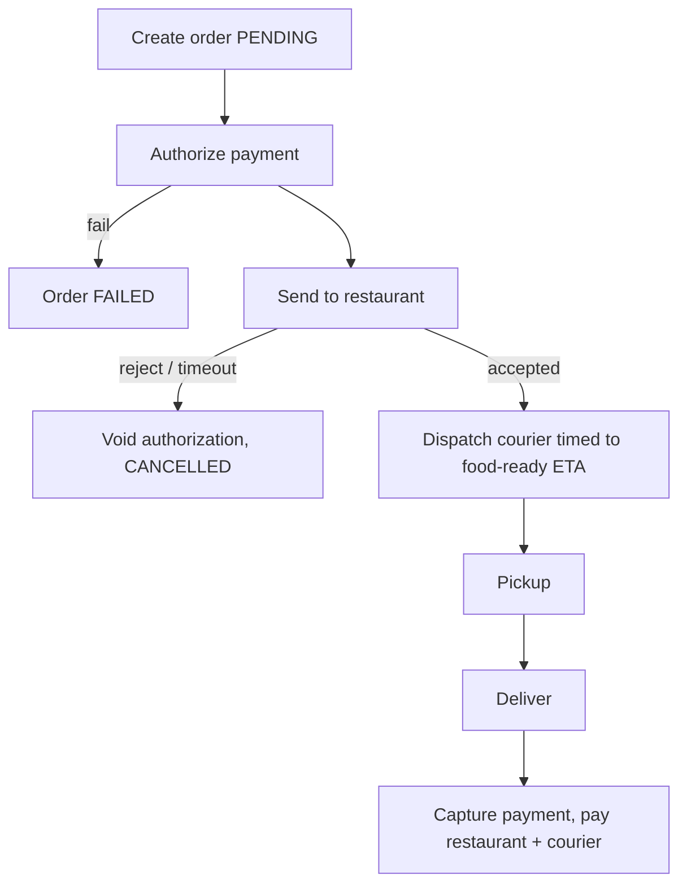

# 30 · Design Food Delivery (DoorDash / Swiggy)

| Category | Difficulty | Key ideas |
|---|---|---|
| Three-sided marketplace | Hard | geo search, order saga, courier dispatch with prep-time prediction, live tracking |

A three-sided marketplace: **customers, restaurants, couriers (dashers)**. Combines restaurant search (proximity), ordering & payments (consistency), and courier dispatch & tracking (real-time geo).
Related: [Proximity Service (Yelp "restaurants near me")](13-proximity-service.md), [Uber (Ride Hailing)](28-uber.md), [Payment System (e-commerce checkout)](23-payment-system.md), Fundamentals -> Sagas, Search.

---

## Architecture at a glance



### Key flow



---

## Requirements

### Functional
1. Customer searches nearby restaurants & menus (filter by cuisine, rating, delivery time).
2. Add items to cart, place order, pay.
3. Restaurant receives order, accepts, marks "ready".
4. System assigns a courier; courier picks up and delivers.
5. Real-time order status & courier location for the customer.
6. Ratings, refunds, promotions.

### Non-functional
- Restaurant/menu browsing: highly available, low latency, eventual consistency OK.
- Orders/payments: strongly consistent, exactly-once charge.
- Dispatch: decisions within seconds; optimize delivery time & courier utilisation.
- Peak at lunch/dinner (5-10× average).

### Estimates
- 20M orders/day -> ~230 orders/s average, ~2K/s peak.
- 1M active couriers sending location every 5 s -> 200K location writes/s.
- 500K restaurants, ~100 menu items each -> 50M items (small, cacheable).

---

## API (sample)
```
GET  /v1/restaurants?lat=&lng=&cuisine=&cursor=      → nearby restaurants with ETA
GET  /v1/restaurants/{id}/menu
POST /v1/carts/{id}/items
POST /v1/orders   {cart_id, address_id, payment_method, idempotency_key}  → {order_id}
GET  /v1/orders/{id}         (+ WebSocket for live updates)
POST /v1/restaurant/orders/{id}/accept | /ready          (restaurant tablet)
POST /v1/courier/location    POST /v1/courier/offers/{id}/accept | /pickup | /deliver
```

---

## High-level design
```
Customer app ─┬─► Search/Discovery Service ─► Elasticsearch (geo + text) + Redis cache
              ├─► Menu Service ─► Menu DB (+ CDN for images)
              ├─► Cart Service ─► Redis/DynamoDB
              └─► Order Service ─► Orders DB (Postgres, sharded by order_id)
                       │   (orchestrated saga)
                       ├─► Payment Service ─► PSP
                       ├─► Restaurant Service ─► push to restaurant tablet
                       └─► Kafka: OrderPlaced / OrderReady / ...
                                ├─► Dispatch Service ─► Courier Geo Index (Redis, H3/geohash cells)
                                ├─► ETA Service (ML: prep time + travel time)
                                └─► Notification Service
Courier app ─► Location Gateway ─► Location Service ─► Geo index + Kafka (tracking)
```

---

## Deep dives

### Restaurant discovery
- Restaurants indexed in Elasticsearch with `geo_point`, cuisine, rating, open hours, **delivery radius** polygon.
- Query: restaurants whose delivery zone contains the customer & currently open, ranked by relevance, rating, predicted delivery time, promotions, personalisation.
- Cache popular results per geohash cell (e.g., 1-2 min TTL); menus cached in Redis/CDN.
- Availability (item sold out, restaurant paused) pushed via events to update the index quickly.

### Order placement (saga)
```
1. Order Service: create order (PENDING) with idempotency key
2. Payment: authorize (not capture) card            ── fail → order FAILED
3. Restaurant: send order, wait for accept (timeout) ── reject/timeout → void auth, order CANCELLED
4. Dispatch: find courier (can start before food ready, timed to prep ETA)
5. On delivery: capture payment, pay out restaurant & courier (ledger)
```
Orchestrated by a workflow engine (Temporal/Step Functions) with compensations. Price/total computed server-side from the current menu snapshot (never trust client prices).

### Dispatch (courier assignment) Easy
Differs from Uber: food needs **prep time**, and one courier can carry **multiple orders** (batching).
1. ETA service predicts **food ready time** (per restaurant ML model).
2. Candidate couriers near the restaurant via geo index (k-ring of cells).
3. Score assignments: courier travel time to restaurant vs food ready time (avoid courier waiting or food getting cold), delivery distance, batching opportunities, courier fairness.
4. Solve periodically (every few seconds) as an **assignment/optimisation problem** per region rather than greedy per order.
5. Offer to courier with expiry; lock courier state via conditional write; on decline -> next best.

### Real-time tracking
Courier location -> Kafka -> tracking service -> customer's WebSocket (only while order is active). Status updates from restaurant/courier actions push notifications.

### Consistency choices
| Data | Consistency |
|---|---|
| Orders, payments, ledger | Strong (SQL transactions, idempotency) |
| Courier state (available/assigned) | Strong per courier (CAS) |
| Courier locations | Eventual, in-memory, TTL |
| Menus, search index | Eventual (seconds) |

---

## Scaling & reliability
- Partition by **geography/market** (city) for dispatch and location services.
- Lunch peaks: autoscale on queue lag; pre-warm caches.
- Restaurant tablets lose connectivity -> retry/push via SMS/phone fallback; order acceptance timeout triggers escalation.
- Observability: order funnel metrics, dispatch latency, late deliveries.

---

## Points to mention in an interview
- Geo-indexed restaurant search with delivery zones.
- Order **saga**: authorize -> restaurant accept -> dispatch -> capture.
- Dispatch optimises **food-ready time vs courier arrival**, supports batching.
- Real-time tracking via location stream + WebSockets; strong consistency only where money/assignments are involved.

---

## Interview Q&A

**Q: How is dispatch different from Uber?**
A: Food has prep time - optimize courier arrival vs food-ready time; couriers can batch multiple orders.

**Q: Restaurant tablet offline?**
A: Retry pushes, fall back to SMS/phone call, auto-cancel after timeout.

**Q: Which data needs strong consistency?**
A: Orders, payments, courier assignment. Menus, search and locations can be eventual.
