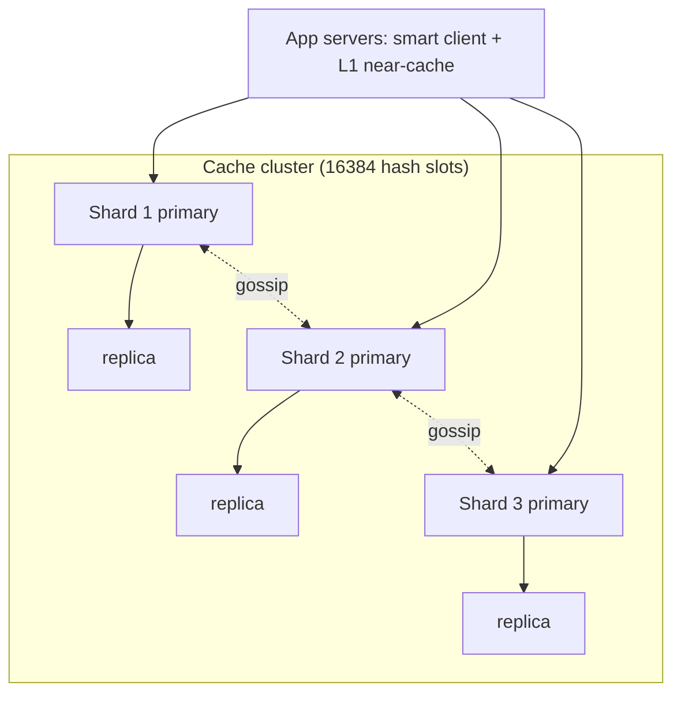
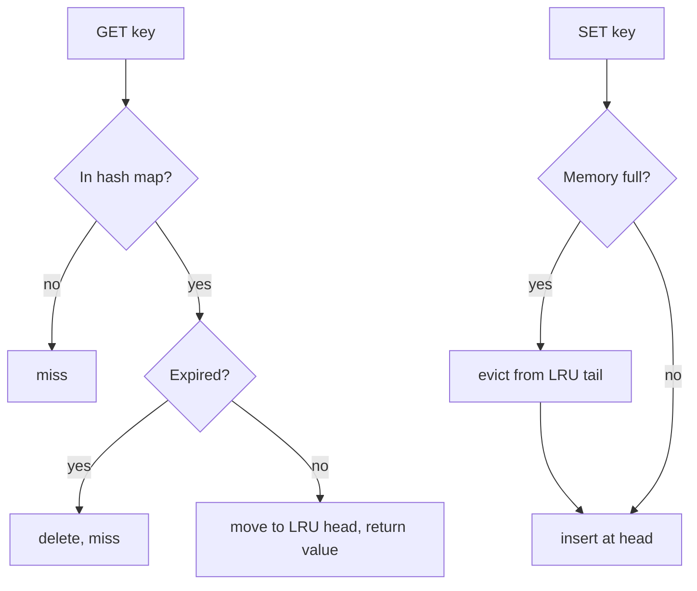

# 31 · Design Distributed Cache (Redis / Memcached)

> **Category:** Infrastructure · **Difficulty:** ⭐⭐⭐⭐ · **Patterns:** hash map + LRU, TTL expiry, hash slots, async replication, failover, hot-key mitigation

> Related: [Consistent Hashing](02-consistent-hashing.md), [Distributed Key-Value Store (Dynamo / Cassandra style)](03-key-value-store.md), Fundamentals → Caching, Replication, Consensus.

---

## Architecture at a glance



### Key flow



---

## Step 1: Requirements

### Functional
- `get(key)`, `set(key, value, ttl)`, `delete(key)`.
- TTL expiry; eviction when memory is full (LRU/LFU).
- (Optional) data structures: counters, lists, sorted sets.

### Non-functional
- **Sub-millisecond** latency (p99 < 1–2 ms).
- Scales horizontally to TBs of RAM and millions of ops/s.
- Highly available; tolerate node failures (data loss of some cache entries acceptable — it's a cache — but avoid full cold restarts).
- Eventual consistency between replicas is OK.

### Estimates
- 10M ops/s, 80% reads; 2 TB of hot data; a node with 64 GB usable RAM handling ~100K–200K ops/s → ~40–60 primary nodes + replicas.

---

## Step 2: Single-node design
- **Hash table** for `key → entry` (O(1)).
- **LRU**: doubly-linked list ordering entries by recency; on access move to head; evict from tail. (Redis uses *approximated* LRU: sample N keys, evict the oldest → no list pointers per key.)
- **TTL**: store `expires_at`; expire **lazily** on access + **actively** by a background task sampling keys with TTLs (Redis samples 20 keys, repeats if >25% expired).
- **Memory management**: slab allocator (Memcached) to avoid fragmentation; `maxmemory` limit triggers eviction policy.
- **Concurrency**: single-threaded event loop (Redis — no locks, predictable, I/O multiplexing with epoll) vs multi-threaded with striped locks (Memcached).
- **Protocol**: simple text/binary protocol over TCP; pipelining for throughput.

---

## Step 3: Distribution (partitioning)
- **Consistent hashing** with virtual nodes (client-side, e.g., Ketama for Memcached) — adding a node remaps ~1/N keys.
- or **Hash slots** (Redis Cluster): `slot = CRC16(key) % 16384`; slots assigned to nodes; moving slots = resharding unit. Hash tags `{user42}:profile` force related keys to the same slot (multi-key ops).

### Routing options
1. **Smart client** knows the slot map; redirects (`MOVED`) update it.
2. **Proxy** (Twemproxy, Envoy, mcrouter) — simpler clients, extra hop.

---

## Step 4: Replication & failover
- Each shard: 1 primary + 1–2 replicas, **async replication** (low latency; a few writes may be lost on failover — acceptable for a cache).
- Failure detection via **gossip** between nodes (Redis Cluster) or an external monitor (Redis Sentinel / ZooKeeper): majority of masters agree a primary is down → promote a replica (epoch number avoids split brain).
- Replicas can serve reads (stale reads OK) to scale read throughput / hot keys.
- Cross-region: separate clusters per region; invalidate via events rather than replicating the cache.

---

## Step 5: Persistence (optional)
- **Snapshots (RDB)**: fork + copy-on-write dump periodically — fast restarts.
- **Append-only file (AOF)**: log every write; fsync every second.
- Persistence lets a restarted node warm up quickly instead of causing a DB stampede.

---

## Step 6: Hard problems & solutions
| Problem | Solution |
|---|---|
| **Hot key** (one key gets 1M QPS) | Client-side L1 cache with short TTL; replicate key to `key#1..N`; read from replicas |
| **Big values** | Limit value size; compress; split into chunks |
| **Thundering herd on miss** | Lease/single-flight: first misser gets a lease token to repopulate; others wait or get stale value (Facebook's Memcache "leases") |
| **Cache stampede after node failure** | Replicas; gradual warm-up; "gutter pool" (Facebook) — temporary servers take over failed node's keys with short TTL |
| **Stale data / invalidation** | Delete on write; CDC-driven invalidation; versioned keys |
| **Resharding while serving** | Migrate slot by slot; during migration redirect (`ASK`) requests for moving keys |
| **Network overhead** | Batching/pipelining, multi-get, connection pooling, UDP for gets (Facebook) |

---

## Step 7: Architecture
```
App servers (client lib with slot map + L1 near-cache)
        │
        ▼
 ┌──────────────┐  ┌──────────────┐  ┌──────────────┐
 │ Shard 1 (P)  │  │ Shard 2 (P)  │  │ Shard N (P)  │   ← slots 0..16383 distributed
 │  ├ Replica   │  │  ├ Replica   │  │  ├ Replica   │
 └──────────────┘  └──────────────┘  └──────────────┘
        ▲ gossip / cluster bus (failure detection, slot map) ▲
 Config/Coordinator (optional): ZooKeeper/etcd or built-in consensus
```

---

## Step 8: Monitoring
Hit ratio, evictions/s, memory usage & fragmentation, p99 latency, replication lag, hot keys (sampling), connection counts.

---

## Interview wrap-up
- Hash map + approximate LRU + lazy/active TTL expiry on each node.
- Partition by consistent hashing / hash slots, smart clients.
- Async primary-replica replication, gossip failure detection, automatic failover.
- Specific mitigations for hot keys, stampedes and resharding.

---

## Interview Q&A

**Q: How does the cache evict efficiently?**
A: Hash map + doubly linked list = O(1) LRU; Redis approximates LRU by sampling.

**Q: How do you handle a hot key?**
A: L1 near-cache with short TTL, replicate the key across shards, read from replicas.

**Q: Do we need strong consistency between replicas?**
A: No — it's a cache; async replication keeps latency low.
