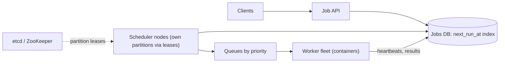
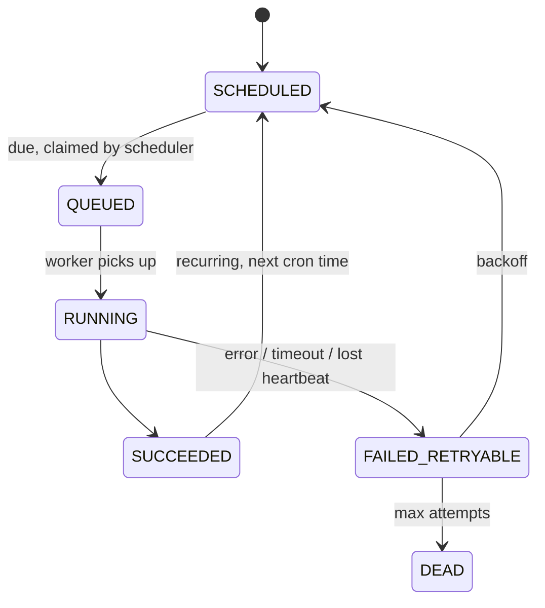

# 32 · Design Distributed Job Scheduler

> **Category:** Job / task execution · **Difficulty:** ⭐⭐⭐⭐ · **Patterns:** due-job polling with SKIP LOCKED, partition leases, queue + workers, at-least-once, retries, DAGs

> Related: Fundamentals → Message Queues, Consensus & Locks, Reliability.

---

## Architecture at a glance



### Key flow



---

## Step 1: Requirements

### Functional
1. Submit jobs: run **once at time T**, **recurring** (cron expression), or **immediately**.
2. Jobs execute code/containers/HTTP callbacks on a worker fleet.
3. Retries with backoff on failure; timeouts; max attempts.
4. Query job status & history; cancel/pause jobs.
5. (Optional) DAG dependencies (job B after job A), priorities, per-tenant quotas.

### Non-functional
- **At-least-once execution** (exactly-once effect via idempotent jobs); never silently skip a job.
- Scheduling accuracy: start within ~1 s of scheduled time.
- Scale: 10M scheduled jobs/day, bursts (many jobs at midnight `0 0 * * *`).
- Highly available — no single scheduler SPOF.

---

## Step 2: API
```
POST   /v1/jobs   {name, schedule: "cron"|"at", payload, image|callback_url, retries, timeout, priority}
GET    /v1/jobs/{id}            GET /v1/jobs/{id}/runs
POST   /v1/jobs/{id}/pause      DELETE /v1/jobs/{id}
```

---

## Step 3: Data model
```
jobs(job_id, tenant_id, schedule, next_run_at, payload, retry_policy, status, version)
job_runs(run_id, job_id, scheduled_at, started_at, finished_at, attempt, status, worker_id, output_ref)
```
Index on `next_run_at` (or partition into time buckets) so "due jobs" queries are cheap.

---

## Step 4: High-level design
```
Clients ─► API Service ─► Jobs DB (Postgres/Cassandra, sharded by job_id)
                                   ▲
Scheduler nodes (partition owners) ┘ poll due jobs ─► Queue (Kafka/SQS, per priority) ─► Workers
                                                                                         │
                                         Run status / heartbeats ◄────────────────────────┘
Coordinator (etcd/ZooKeeper): partition assignment & leader election for schedulers
```

---

## Step 5: Deep dives

### 5.1 Finding due jobs efficiently
- **Polling with index**: `SELECT ... WHERE next_run_at <= now() AND status='SCHEDULED' ORDER BY next_run_at LIMIT 1000 FOR UPDATE SKIP LOCKED` — `SKIP LOCKED` lets multiple schedulers grab different rows without blocking.
- **Time-bucketed partitions**: jobs stored by minute bucket (`bucket = floor(run_at/60)`), schedulers read the current bucket — great for Cassandra.
- **In-memory timing wheel / Redis sorted set** (`ZADD due {timestamp} job_id`; `ZRANGEBYSCORE due 0 now`) for near-term jobs (next hour), loaded from DB.

### 5.2 Avoiding duplicate dispatch & SPOF
- Shard jobs into N partitions; each scheduler node **owns** some partitions via leases in etcd/ZooKeeper. If a node dies, its lease expires and another takes over.
- When enqueuing, atomically transition `SCHEDULED → QUEUED` with a conditional update (or version check) → a job is enqueued once per run.
- For recurring jobs, compute and store the **next** `next_run_at` in the same transaction that creates the run.

### 5.3 Execution & at-least-once semantics
- Workers pull from the queue, mark run `RUNNING` with heartbeat timestamps.
- **Visibility timeout / heartbeat**: if a worker dies (no heartbeat for 30 s), the run is re-queued → job might run twice → jobs must be **idempotent** (pass `run_id` as idempotency key).
- On failure: retry with exponential backoff (`next_run_at = now + backoff`), up to max attempts → then `FAILED` + DLQ + alert.
- Timeouts: worker kills job; scheduler marks `TIMED_OUT`.

### 5.4 Thundering herd at popular times
Midnight cron for millions of jobs: add **jitter** (spread within a window if allowed), priority queues, per-tenant rate limits/quotas, autoscale workers ahead of known peaks.

### 5.5 DAGs / workflows
Store dependencies; when a run succeeds, emit event; a DAG manager checks downstream tasks whose parents are all complete and enqueues them. (Airflow: scheduler + metadata DB + executor; Temporal: durable workflow state via event history.)

### 5.6 Isolation
Run jobs in containers (Kubernetes jobs) with CPU/memory limits; separate worker pools per tenant/priority (bulkheads).

---

## Step 6: Monitoring
Schedule lag (actual start − scheduled time), queue depth, success/failure rate, retries, stuck runs, worker utilisation.

---

## Interview wrap-up
- DB as source of truth with indexed `next_run_at`; partitioned schedulers with leases (no SPOF, no double dispatch).
- Queue between scheduling and execution; workers scale independently.
- At-least-once + idempotent jobs, heartbeats, retries with backoff, DLQ.
- Jitter & quotas for cron storms; DAG support via completion events.

---

## Interview Q&A

**Q: How do you avoid running a job twice?**
A: Claim with conditional updates; still possible after worker crashes → jobs must be idempotent (run_id key).

**Q: Millions of jobs at midnight?**
A: Jitter, priority queues, quotas, pre-scaled workers.

**Q: How do you find due jobs cheaply?**
A: Index on next_run_at, time-bucketed partitions, or a Redis sorted set for the near future.
