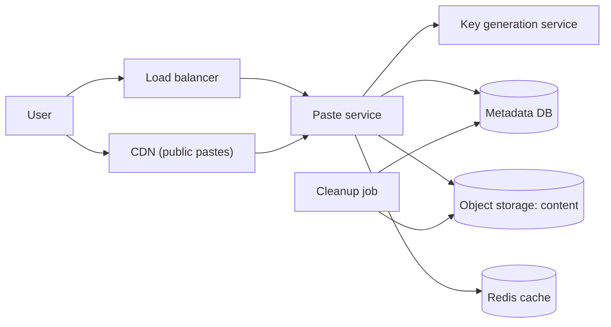
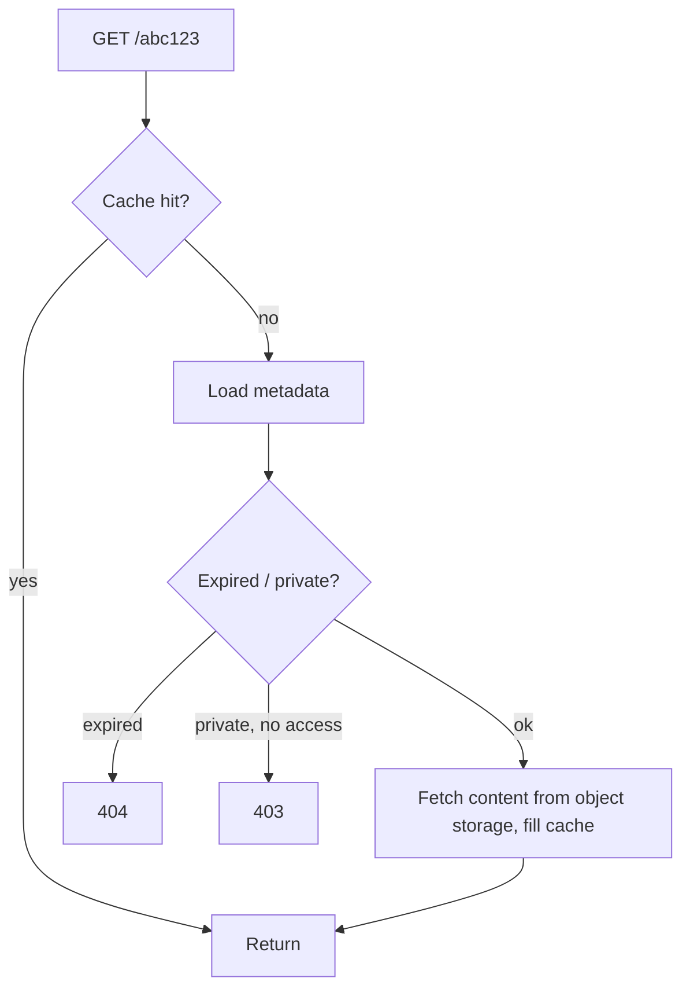

# 33 · Design Pastebin

> **Category:** Read-heavy key lookup · **Difficulty:** ⭐⭐ · **Patterns:** key generation service, metadata vs blob separation, expiry, caching

> A classic warm-up problem, similar to the URL shortener ([URL Shortener (TinyURL / bit.ly)](05-url-shortener.md)) but with **larger payloads**, expiry, and privacy.

---

## Architecture at a glance



### Key flow



---

## Step 1: Requirements

### Functional
1. Create a paste (text up to e.g. 10 MB) → get a unique short URL.
2. View paste by URL; raw view.
3. Optional: expiry (10 min / 1 day / never), private/unlisted, password, syntax highlighting, custom alias.
4. Delete paste (owner).

### Non-functional
- Read-heavy (~10:1 reads:writes), low latency reads.
- Durable — pastes must not be lost before expiry.
- URLs not guessable for private/unlisted pastes.

### Estimates
- 5M new pastes/day ≈ 60 writes/s; 50M reads/day ≈ 600 reads/s (peaks ×5).
- Avg paste 10 KB → 50 GB/day → ~18 TB/year (before compression; text compresses ~4–5×).

---

## Step 2: API
```
POST   /v1/pastes  {content, expires_in, visibility, syntax, custom_alias?}  → {key, url}
GET    /v1/pastes/{key}          → metadata + content
GET    /raw/{key}                → text/plain
DELETE /v1/pastes/{key}          (auth)
```

---

## Step 3: Design
```
Client ─► LB ─► Paste Service ─┬─► Metadata DB (key, user_id, s3_key, size, syntax, visibility, created_at, expires_at)
                               ├─► Object storage (S3): compressed paste content
                               └─► Key Generation Service (pre-generated random keys)
Reads: CDN / Redis cache (hot pastes) → Metadata DB → S3
Cleanup worker: deletes expired pastes (or S3 lifecycle rules)
```

### Why separate content from metadata?
Pastes can be MBs; storing blobs in the DB bloats it and slows queries. Metadata rows stay tiny (~200 B) → DB fits in memory; S3 is cheap and durable. Small pastes (< 4 KB) could be inlined in the DB as an optimisation.

---

## Step 4: Deep dives

### 4.1 Key generation
- 8 chars of base62 → 62⁸ ≈ 218 trillion keys — random keys are **unguessable** (important for unlisted pastes, unlike sequential base62 ids).
- **Key Generation Service (KGS)**: pre-generates random unique keys into a `unused_keys` table; app servers fetch batches into memory; mark used atomically. Avoids collision checks on the hot path. If a server dies, the batch is lost — acceptable (keyspace is huge).
- Alternative: random key + insert with unique constraint, retry on collision (collisions are vanishingly rare).
- Custom alias: check availability with unique constraint.

### 4.2 Read path
1. CDN (for public pastes) → Redis cache (`key → metadata + content` for small hot pastes, LRU).
2. Miss → DB metadata → check expiry/visibility/password → fetch content from S3 (or redirect client to pre-signed S3 URL for large pastes).
3. Expired → 404 (lazy expiry), even if cleanup hasn't run.

### 4.3 Expiry & cleanup
- Lazy: check `expires_at` on read.
- Active: batch job deletes expired metadata rows + S3 objects (or S3 lifecycle + DB TTL in Cassandra/DynamoDB).
- Freed keys can be recycled back to KGS (optional).

### 4.4 Abuse & security
Rate limit creation per IP/user, max size, malware/secret scanning (people accidentally paste API keys), spam detection, password-protected pastes hashed with bcrypt, private pastes require auth.

### 4.5 Scaling
- Stateless services; DB sharded by key hash if needed (metadata fits in one big DB for years at these numbers + read replicas).
- Analytics (view counts) via async events to avoid write amplification on reads.

---

## Interview wrap-up
- Metadata in DB, content in object storage, cache/CDN for hot reads.
- Random unguessable keys via KGS.
- Lazy + background expiry; abuse prevention.

---

## Interview Q&A

**Q: Why not store paste text in the DB?**
A: Large blobs bloat the DB; object storage is cheaper and keeps metadata small and fast.

**Q: How are keys made unguessable?**
A: Random 8-char base62 keys from a KGS (not sequential IDs).
