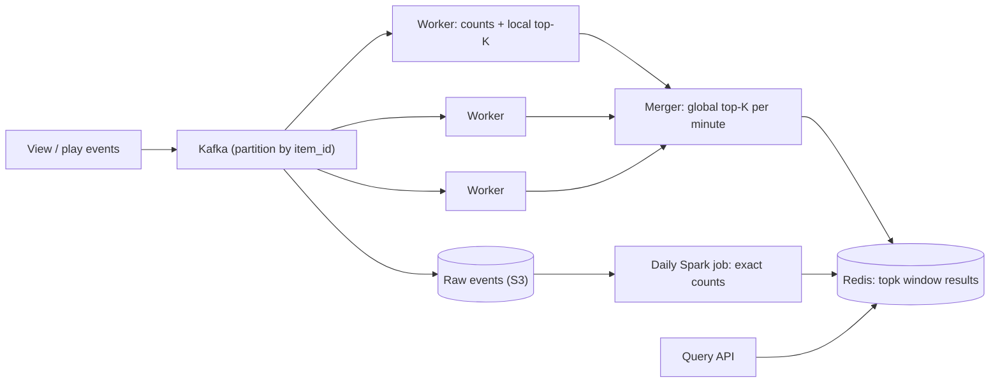
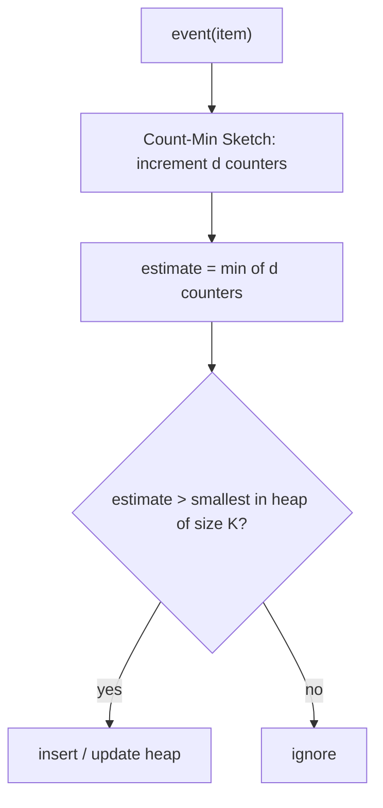

# 34 · Design Top-K Heavy Hitters (Trending)

> **Category:** Stream aggregation · **Difficulty:** ⭐⭐⭐⭐ · **Patterns:** partition by key, local top-K + merge, Count-Min Sketch, time buckets, lambda architecture

> "Show the top 10 most viewed videos in the last hour / day / all-time" — a stream aggregation problem at massive scale.
> Related: [Ad Click Event Aggregation](18-ad-click-aggregation.md), Fundamentals → Batch & Stream Processing, Probabilistic Data Structures.

---

## Architecture at a glance



### Key flow



---

## Step 1: Requirements

### Functional
- `topK(k, window)` for windows like last 1 min, 1 h, 1 day (optionally per region/category).
- Events: views/plays/clicks of items (video_id, song_id, hashtag).

### Non-functional
- Huge ingest: e.g., **1M events/s**, billions of distinct items.
- Query latency < 50 ms (results can be precomputed).
- Freshness: seconds to a minute.
- Accuracy: approximate is acceptable for short windows; exact desirable for daily/official charts.

---

## Step 2: Naive approach & why it fails
Single hash map `item → count` + heap:
- Billions of keys don't fit in one machine's memory.
- 1M writes/s exceeds a single node.
- Sliding windows need per-time-bucket counts.

---

## Step 3: Building blocks

### Count-Min Sketch (approximate counts)
Fixed memory (e.g., 4 × 1M counters ≈ 16 MB) independent of distinct items; never underestimates. Maintain a **min-heap of size K** alongside: on each event, estimate count; if > heap min, update heap.

### Space-Saving / Misra-Gries
Deterministic algorithms keeping only `m` counters, guaranteed to find all items with frequency > N/m.

### Exact counting with MapReduce/Spark
For daily/official results, batch-count from raw logs.

---

## Step 4: Architecture (Lambda-style: fast approximate + slow exact)
```
Clients ─► API ─► Kafka (events, partitioned by item_id)
                    │
                    ├─► FAST PATH: Flink/stream workers
                    │      • each partition: local counts (hash map or CMS) per 1-min tumbling window
                    │      • emit local top-K' (K' > K, e.g., 100) per window
                    │      ▼
                    │   Aggregator: merge partition top-K's → global top-K per minute
                    │      ▼
                    │   Store: Redis / DB  (topk:{window}:{minute})
                    │   1h / 1d views = merge last 60 / 1440 minute results (or hopping windows)
                    │
                    └─► SLOW PATH: raw events → S3 → hourly/daily Spark job → exact counts → overwrite results
Query service ─► Redis (precomputed top-K) ─► client
```

### Why partition by item_id?
All events of one item go to the same worker → that worker's count for the item is complete → merging partition-level top-K lists is correct (an item can't be split across partitions). If partitioned randomly, you'd need to merge full counts (much more data).

### Hot items
A viral video concentrates on one partition → **pre-aggregate** on the producer/API side (count locally for 1–5 s and send `(item, +n)`), or two-stage aggregation with salted keys.

---

## Step 5: Sliding windows
- Keep per-minute counts (buckets); "last hour" = sum of last 60 buckets. Maintain a running total: add new minute, subtract the expired one.
- Merging top-K lists from buckets is approximate (an item that's #101 in every minute might be #5 for the hour). Mitigate by keeping larger K' per bucket, or keep CMS per bucket (CMS are **mergeable** by adding arrays) and a candidate set.

---

## Step 6: Serving
- Precompute top-K for common (window, region, category) combos; cache in Redis; clients poll or get pushed every few seconds.
- For "trending" (not just popular), score by **velocity**: current window count vs historical baseline (z-score), with spam filtering.

---

## Step 7: Trade-offs to discuss
| Choice | Pro | Con |
|---|---|---|
| Exact hash maps per partition | Accurate | Memory for billions of keys |
| Count-Min Sketch + heap | Tiny memory | Overestimates; heavy hitters fine, tail inaccurate |
| Lambda (stream + batch) | Fast + eventually exact | Two code paths |
| Kappa (stream only, replay) | One code path | Exactness depends on stream job |

---

## Interview wrap-up
- Kafka partitioned by item → per-partition counting → merge top-K lists.
- Count-Min Sketch + heap for memory efficiency; pre-aggregation for hot keys.
- Minute buckets for sliding windows; batch job for exact daily charts.
- Precomputed results in Redis for fast reads.

---

## Interview Q&A

**Q: Why partition by item?**
A: Each item's full count lives on one worker, so merging local top-K lists is correct.

**Q: Exact or approximate?**
A: Approximate (sketches) for real-time windows; exact batch job for official daily charts.
