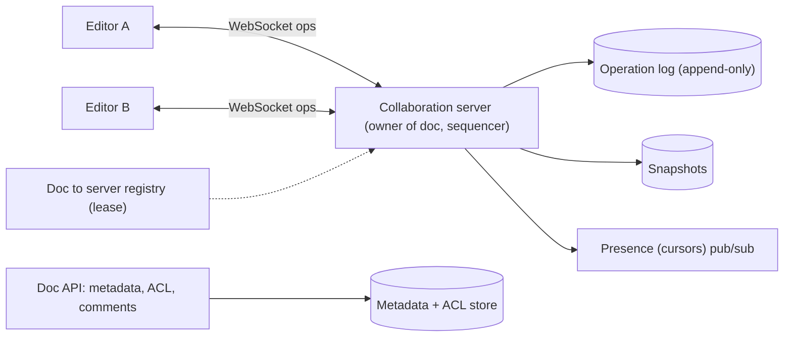
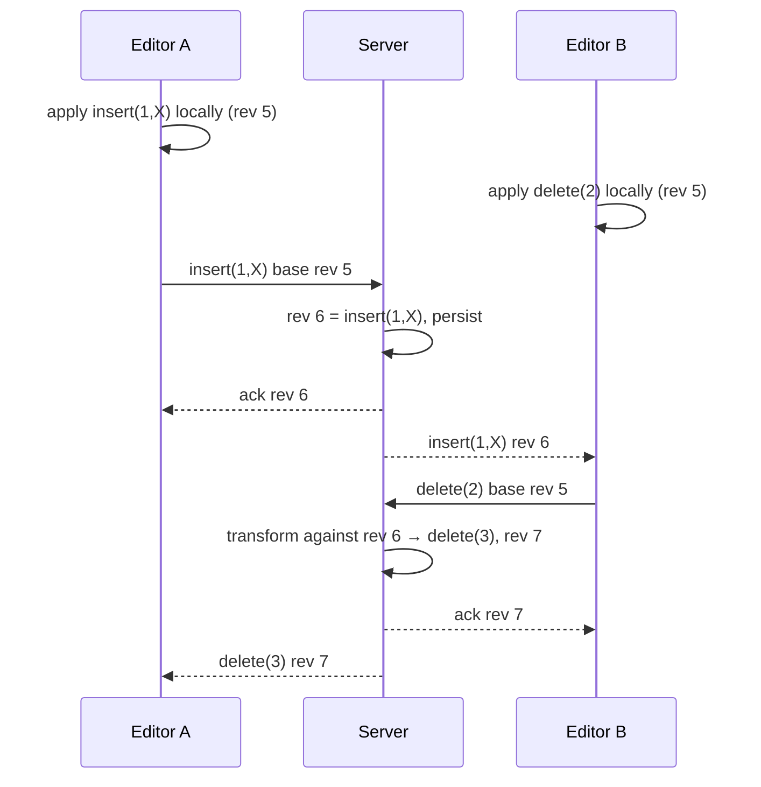

# 35 · Design Google Docs (Collaborative Editing)

> **Category:** Real-time collaboration · **Difficulty:** ⭐⭐⭐⭐⭐ · **Patterns:** OT vs CRDT, per-document sequencer, WebSockets, op log + snapshots, presence

> Core challenge: many users edit the **same document simultaneously**, everyone must converge to the **same final text**, with low latency and offline support.
> Related: [Chat System (WhatsApp / Messenger / Slack)](09-chat-system.md), [Google Drive / Dropbox (File Storage & Sync)](12-google-drive.md), Fundamentals → Consistency, Clocks, Security (ReBAC).

---

## Architecture at a glance



### Key flow



---

## Step 1: Requirements

### Functional
1. Create/open/edit documents (rich text).
2. Real-time collaboration: see others' edits & cursors within ~100–300 ms.
3. Version history, restore; comments & suggestions.
4. Sharing permissions (owner/editor/commenter/viewer).
5. Offline editing with sync on reconnect.

### Non-functional
- **Convergence**: all replicas end up identical (no lost edits).
- Low latency local typing (edits applied locally instantly).
- Durable (never lose acknowledged edits); highly available.
- Scale: hundreds of millions of docs; most docs have 1–5 concurrent editors, some up to ~100.

---

## Step 2: The core problem — concurrent edits
Doc = "abc". User A inserts "X" at position 1 → "aXbc". Concurrently user B deletes position 2 ("c") → "ab".
If each blindly applies the other's operation: A applies `delete(2)` to "aXbc" → deletes "b" ❌. Positions shift; naive replay diverges.

Two families of solutions:

### Option 1: Operational Transformation (OT) — used by Google Docs
- Every edit is an **operation** (`insert(pos, char)`, `delete(pos)`), tagged with the document **revision** it was based on.
- A **central server** orders operations (assigns revision numbers).
- When an op arrives based on an old revision, the server **transforms** it against all ops committed since: `transform(delete(2), insert(1,"X")) = delete(3)`.
- Clients also transform incoming server ops against their pending local ops.
- ✅ Mature, compact ops, server is authoritative. ❌ Transformation functions are tricky; needs a central sequencer per document.

### Option 2: CRDTs (Conflict-free Replicated Data Types) — used by Figma-like tools, Yjs, Automerge
- Every character gets a **unique, ordered identifier** (e.g., `(lamport_counter, site_id)` with fractional positions). Inserts reference neighbours by id, not index; deletes mark tombstones.
- Operations commute → any order of application converges, no central server required (peer-to-peer & offline friendly).
- ✅ Decentralised, great offline support. ❌ Metadata overhead (ids per char, tombstones) → needs garbage collection/compaction.

**Interview answer:** "Central collaboration server per document using OT (like Google Docs); or CRDT (Yjs) if we want offline-first / P2P."

---

## Step 3: High-level design
```
Browser (editor + local OT/CRDT engine)
   │  WebSocket (ops, cursor presence)
   ▼
LB (sticky by doc_id) ─► Collaboration Service (one "owner" instance per active doc, in-memory doc state)
                           │  ├─ assigns revisions, transforms, broadcasts to all doc sessions
                           │  ├─ appends ops to Operation Log (durable) ─► Kafka / DB
                           │  └─ periodic snapshots ─► Doc Store
                           ▼
       Document Store (snapshots, Bigtable/Spanner/Postgres)  +  Op log (append-only, per doc)
API Service: doc metadata, sharing/ACL (Zanzibar-style), comments, version history
Presence Service: cursors/selections (ephemeral, Redis pub/sub)
```

### Routing a document to one server
All editors of doc D must reach the same collaboration instance (it's the sequencer). Use consistent hashing on `doc_id` or a lookup service (doc → server) with leases in etcd/ZooKeeper. If the server dies, another instance takes the lease, loads latest snapshot + op log tail, and clients reconnect.

---

## Step 4: Edit flow (OT)
1. User types → op applied locally immediately (optimistic) → sent `{doc, base_rev, op, client_id, seq}`.
2. Server transforms op against ops since `base_rev`, assigns `rev = latest+1`, **persists to op log**, then ACKs sender and broadcasts to others.
3. Clients transform the incoming op against their unacknowledged ops, apply, update rev.
4. Client sends one outstanding batch at a time (simplifies transformation).

## Storage
- **Op log**: append-only per document — `(doc_id, rev) → op, user, timestamp`. Gives version history & audit.
- **Snapshots** every N ops/minutes → load = snapshot + replay ops after it.
- Version history UI = named snapshots + grouping ops by time/user.

## Presence & cursors
Ephemeral, high-frequency, lossy is fine → don't persist; broadcast via in-memory pub/sub with throttling (e.g., 10 updates/s).

## Offline
Client queues ops locally (IndexedDB); on reconnect, sends them with old base revision → transformed on server (OT) or merged (CRDT).

## Permissions
Checked when opening the WebSocket and on every op (viewer can't send edits). ACLs modelled as relationships (doc ∈ folder ∈ shared drive) — Google Zanzibar.

---

## Step 5: Scaling
- Millions of documents but each active doc is small and lives on one server → scale horizontally by doc.
- Very popular doc (1,000 viewers): separate **viewers** (read-only fan-out via pub/sub tier) from **editors**; limit concurrent editors.
- Cold docs live only in storage.

---

## Interview wrap-up
- Explain **why naive concurrent edits diverge**, then OT vs CRDT.
- One sequencer (collaboration server) per active doc, WebSockets, op log + snapshots.
- Optimistic local apply, transformation on server and client.
- Presence is ephemeral; permissions via ReBAC; offline via queued ops.

---

## Interview Q&A

**Q: Why can't you just replay edits by position?**
A: Concurrent inserts/deletes shift positions; replicas diverge without transformation (OT) or position-independent IDs (CRDT).

**Q: OT or CRDT?**
A: OT with a central server is proven (Google Docs); CRDTs suit offline/peer-to-peer (Figma-like, Yjs).
