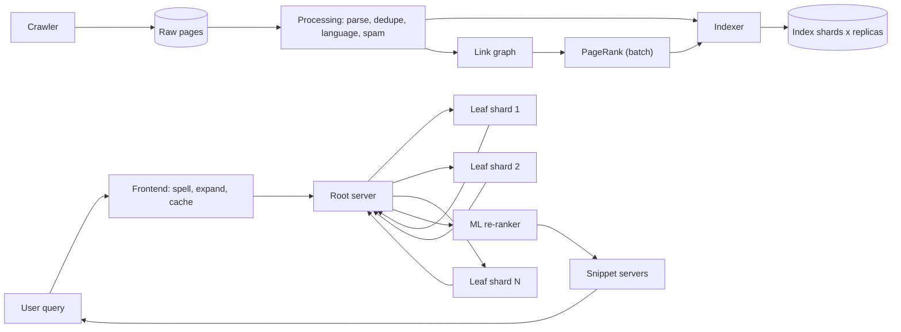
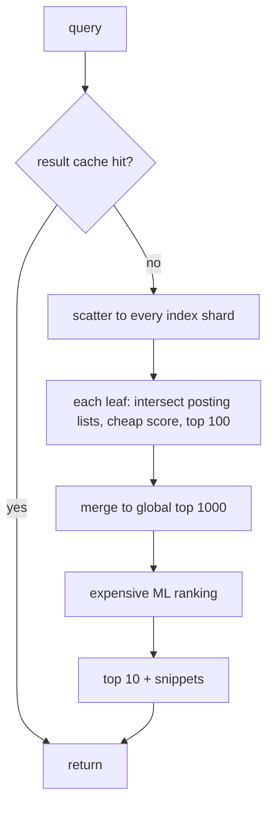

# 36 · Design Web Search Engine

> **Category:** Search / indexing · **Difficulty:** ⭐⭐⭐⭐⭐ · **Patterns:** inverted index, document-partitioned shards, scatter-gather, two-stage ranking, hedged requests

> Combines [Web Crawler](06-web-crawler.md) + inverted indexing + ranking + serving at enormous scale.
> Related: [Search Autocomplete (Typeahead)](10-search-autocomplete.md), Fundamentals → Search Systems, Batch Processing, Probabilistic Data Structures.

---

## Architecture at a glance



### Key flow



---

## Step 1: Requirements
- **Functional:** user types a query → top 10 relevant web pages with title, URL, snippet; spelling correction; pagination.
- **Non-functional:** p99 latency < 300–500 ms; index billions of pages; freshness (news within minutes, typical pages within days); highly available.

### Estimates
- 50B pages indexed, avg 100 KB raw HTML → 5 PB raw; text extracted ~10 KB/page → 500 TB; compressed inverted index ~100s of TB.
- 100K queries/s (peak 200K+).

---

## Step 2: Pipeline overview
```
          (offline / near-line)                                          (online)
Crawler ─► Raw page store (Bigtable/S3) ─► Processing ─► Indexer ─► Index shards ◄── Query servers ◄── Frontend ◄── User
   ▲                                       │ parse, dedupe (SimHash),     │
   └───── URL frontier ◄── link extraction ┤ language, spam score         └── Doc store (titles, snippets)
                                           └► Link graph ─► PageRank (batch)
```

---

## Step 3: Indexing
1. **Parse & clean**: extract text, title, headings, anchor text from *other* pages linking here (very strong signal), language detection.
2. **Dedupe**: exact (hash) and near-duplicate (SimHash/MinHash) detection; keep canonical URL.
3. **Tokenize, normalise, stem** (per language).
4. **Build inverted index**: `term → posting list [(doc_id, term frequency, positions, field flags)]`, doc ids sorted; delta + varint compression.
5. **Static rank** per doc (PageRank, quality, spam score) — doc ids assigned in static-rank order so posting lists are naturally sorted by quality → allows **early termination**.
6. Batch (MapReduce-style) for the main index + an **incremental/real-time index** for fresh content (news), merged at query time.

### Sharding the index
- **Document-partitioned**: each shard holds full posting lists for a subset of documents. Query goes to **all shards** (scatter-gather), each returns its local top-K, merged.
  ✅ Load balanced, easy updates, shard failure only loses a fraction of results. Used by Google.
- Term-partitioned: fewer shards per query but hot terms & multi-term intersections across machines are expensive.
- Each shard **replicated** many times for QPS & availability; index held largely in RAM/SSD.

---

## Step 4: Query serving
1. **Frontend**: parse query, spelling correction ("did you mean"), query expansion (synonyms), detect intent (news, maps, shopping).
2. **Cache**: results cache for popular queries (big hit ratio due to Zipfian distribution).
3. **Root server → leaf servers (index shards)**: each leaf intersects posting lists (`AND` of terms using skip pointers), scores candidates with a cheap function (BM25 + static rank + proximity), returns top ~100.
4. **Merge & rerank**: global top ~1000 → expensive ML ranking (learning-to-rank, neural models, BERT-style) using hundreds of signals: relevance, freshness, click data, location, personalisation.
5. **Snippets**: fetch doc text from doc servers, generate query-dependent snippet.
6. Return results; log impressions/clicks for ranking feedback.

### Tail latency tricks
Hundreds of leaves per query → p99 of the slowest dominates. Use **hedged/backup requests** (send to a second replica if no reply in p95 time), partial results if a shard is slow, timeouts per stage.

---

## Step 5: PageRank (intuition)
A page is important if important pages link to it. Iterative computation over the link graph (`PR(p) = (1-d)/N + d Σ PR(q)/outlinks(q)`), run as a batch graph job (MapReduce/Pregel).

---

## Step 6: Freshness
- Crawl prioritisation by change frequency & importance ([Web Crawler](06-web-crawler.md)).
- Real-time tier: news/social pages indexed within minutes into a small in-memory index; queries search both tiers.

---

## Step 7: Spam & quality
Link-farm detection, content quality classifiers, SafeSearch, manual actions.

---

## Interview wrap-up
- Crawl → process → inverted index → document-partitioned shards with replicas.
- Query path: cache → scatter to leaves → cheap scoring → merge → ML re-rank → snippets.
- Static rank ordering for early termination; hedged requests for tail latency.
- Separate real-time index for freshness.

---

## Interview Q&A

**Q: Document- or term-partitioned index?**
A: Document-partitioned: balanced load, simple updates, partial results on shard failure.

**Q: How do you control tail latency with 1000 leaves?**
A: Hedged requests to replicas, per-stage timeouts, partial results.
