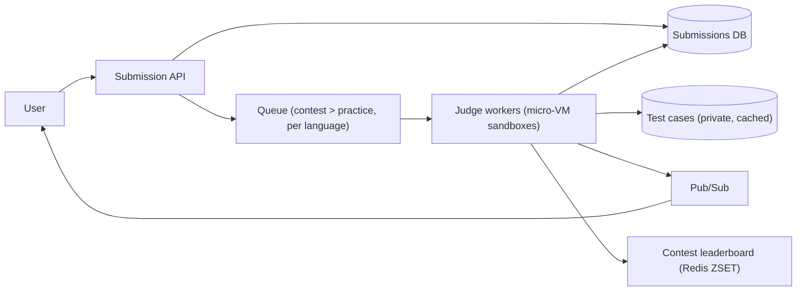
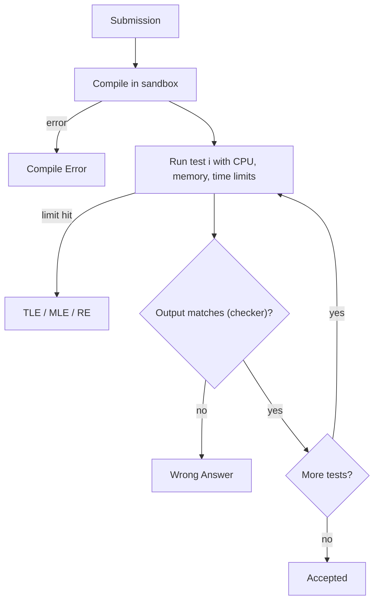

# 37 · Design Online Code Judge (LeetCode)

| Category | Difficulty | Key ideas |
|---|---|---|
| Job execution / security | Hard | sandboxing untrusted code, async queue, autoscaled judges, priority, leaderboard |

Core challenges: **securely running untrusted code**, handling **contest spikes**, fair & accurate verdicts, live leaderboards.
Related: [Real-Time Gaming Leaderboard](22-gaming-leaderboard.md), [Distributed Job Scheduler](32-distributed-job-scheduler.md), Fundamentals -> Message Queues, Security.

---

## Architecture at a glance



### Key flow



---

## Requirements

### Functional
1. Browse problems (description, examples, constraints).
2. Submit code in many languages -> verdict (Accepted, Wrong Answer, TLE, MLE, Runtime Error, Compile Error) with runtime/memory.
3. "Run" against custom input.
4. Contests with live leaderboard.
5. Submission history.

### Non-functional
- **Security & isolation**: user code must never escape the sandbox, access network, or other users' data.
- Fair, reproducible timing.
- Normal load ~100 submissions/s; contest peak 10-50K concurrent users, bursts of ~5K submissions/s in the last minutes.
- Verdict latency: a few seconds normally; queued (with progress) under peak.

---

## API
```
GET  /v1/problems?tag=&difficulty=      GET /v1/problems/{slug}
POST /v1/submissions  {problem_id, language, code, contest_id?}  → {submission_id, status: QUEUED}
GET  /v1/submissions/{id}               (or WebSocket/SSE push of verdict)
GET  /v1/contests/{id}/leaderboard?page=
```

---

## High-level design
```
Client ─► CDN (problem pages) 
Client ─► API GW (auth, rate limit) ─► Submission Service ─► Submissions DB (status, code ref)
                                              │                   code → S3
                                              └─► Queue (Kafka/SQS; priority: contest > practice; per-language)
                                                        ▼
                                       Judge Workers (autoscaled fleet)
                                         └─ pull job → fetch code + test cases (cached locally) →
                                            compile & run in SANDBOX per test → compare output → verdict
                                                        ▼
                                       Result ─► Submissions DB ─► Pub/Sub ─► client push
                                                └─► Contest Service ─► Leaderboard (Redis sorted set)
Problem Service ─► Problems DB + test cases in S3 (private, versioned)
```

---

## Deep dives

### Sandboxing untrusted code Easy
Layers of defence:
- Run each submission in an isolated **container / micro-VM** (gVisor, Firecracker, nsjail/isolate) - micro-VMs give stronger isolation than plain Docker.
- **No network** (network namespace), read-only filesystem except a tmp dir, non-root user.
- **seccomp** syscall allowlist (block `fork` bombs, `ptrace`, sockets).
- **cgroups** limits: CPU time, wall time, memory, process count, output size, disk.
- Kill on limit breach -> TLE/MLE verdict.
- Destroy the sandbox after each submission (no state leaks); pre-warm a pool of sandboxes per language to cut startup latency.
- Workers run in a separate network/VPC with no access to internal services or secrets.

### Judging logic
- Compile once, run against each test case (stop at first failure for speed, or run all for partial scoring).
- Compare output (exact, whitespace-insensitive, or special **checker** program for problems with multiple valid answers / floating point tolerance).
- Measure CPU time (not wall time) for fairness; run on dedicated, identical worker instances; avoid noisy neighbours (pin cores).
- Test cases are secret - stored encrypted/private, cached on workers, never returned to users.

### Handling contest spikes
- Queue absorbs bursts; status `QUEUED (position 120)` shown to user.
- **Autoscale** judge fleet on queue depth; pre-scale before scheduled contests.
- Priority queues: contest submissions before practice; "Run" (custom input) on a separate lighter pool.
- Rate limit submissions per user (e.g., 1 per 5 s).
- Idempotency: double-click submit -> same submission id (idempotency key).

### Leaderboard
- Score = problems solved, tie-break by penalty time -> encode into a single sortable score for **Redis ZSET** (`ZADD contest:{id} score user`), `ZREVRANK` for my rank, `ZREVRANGE` for pages ([Real-Time Gaming Leaderboard](22-gaming-leaderboard.md)).
- Update on accepted verdicts; leaderboard reads cached for ~1-5 s; freeze near the end if desired.

### Plagiarism detection (offline)
After contests, compare submissions with token-based similarity (MOSS-like winnowing / AST fingerprints).

---

## Data model
```
problems(problem_id, slug, title, difficulty, statement_ref, time_limit, memory_limit, checker_ref, test_set_version)
submissions(submission_id, user_id, problem_id, contest_id, language, code_ref, status, verdict, runtime_ms, memory_kb, created_at)
contests(contest_id, start, end, problems[])
```

---

## Points to mention in an interview
- Async pipeline: submit -> queue -> sandboxed workers -> verdict push.
- **Defence-in-depth sandboxing** (micro-VMs, seccomp, cgroups, no network).
- Autoscaling + priority queues for contest spikes.
- Redis sorted-set leaderboard.

---

## Interview Q&A

**Q: How do you run untrusted code safely?**
A: Micro-VMs (Firecracker/gVisor), no network, seccomp syscall allowlist, cgroups limits, read-only FS, destroy after each run.

**Q: Contest spike in the last 5 minutes?**
A: Queue absorbs it; autoscale on queue depth; pre-scale for scheduled contests.
