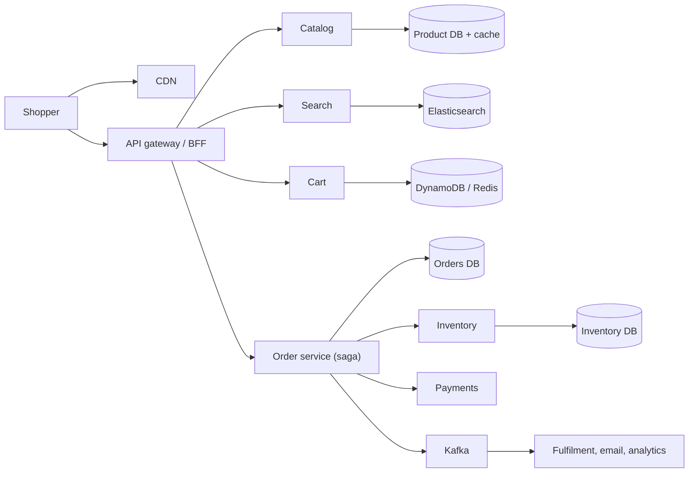
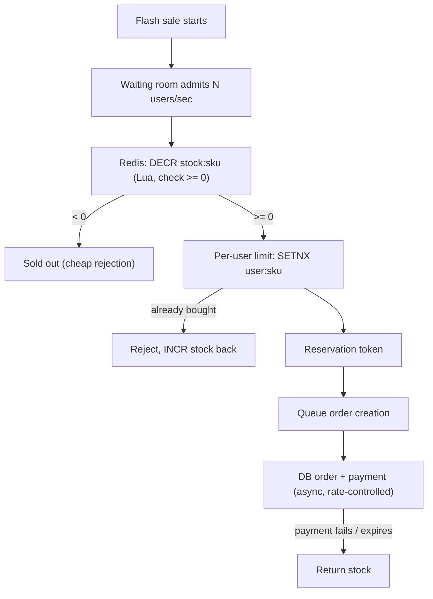

# 38 · Design E-commerce & Flash Sale (Amazon)

| Category | Difficulty | Key ideas |
|---|---|---|
| Inventory under contention | Hard | catalog caching, cart, inventory reservation, checkout saga, Redis stock counters, waiting room |

Core challenges: **catalog & search at scale**, **cart & checkout correctness**, **inventory without overselling**, and **flash sales** (100K+ users fighting for 1,000 units).
Related: [Payment System (e-commerce checkout)](23-payment-system.md), [Ticketmaster (Event Ticketing)](29-ticketmaster.md), Fundamentals -> Sagas & Outbox, Caching, Search.

---

## Architecture at a glance



### Key flow



---

## Requirements

### Functional
1. Browse & search products; product detail page (PDP) with price, availability, reviews.
2. Cart (add/remove, persists across devices).
3. Checkout: address, shipping options, payment -> order.
4. Order tracking, cancellation, returns.
5. Flash sales: limited quantity at a discount starting at a fixed time.

### Non-functional
- Browsing: highly available, very fast (< 100-200 ms), eventual consistency fine (price/stock shown may be seconds stale).
- Checkout: **correct** - never oversell, never double charge.
- Massive read:write ratio (~1000:1 for catalog).
- Peak events (Prime Day, Big Billion Days): 10-50× normal traffic.

---

## Service decomposition
```
Client ─► CDN (images, static, even cached PDP fragments)
       ─► API GW / BFF ─┬─► Catalog Service ─► Product DB (document store) + cache
                        ├─► Search Service ─► Elasticsearch (fed by CDC from catalog)
                        ├─► Pricing Service (base price, promotions)
                        ├─► Inventory Service ─► Inventory DB (strongly consistent) + Redis counters
                        ├─► Cart Service ─► DynamoDB/Redis (keyed by user_id)
                        ├─► Checkout/Order Service ─► Orders DB (Postgres, sharded by user/order id)
                        │        └─► Saga: reserve inventory → payment → confirm → fulfilment
                        ├─► Payment Service ─► PSP
                        ├─► Recommendation Service
                        └─► Review Service
Kafka: OrderPlaced, PaymentCaptured, InventoryChanged... → Fulfilment/Warehouse, Notifications, Analytics, Search index
```

---

## Deep dives

### Catalog & PDP
- Product data is read-mostly and heterogeneous (attributes vary by category) -> **document DB** (DynamoDB/MongoDB) or Postgres JSONB.
- PDP composed from several services (catalog, price, stock, reviews, recs) by a BFF in parallel with timeouts; non-critical parts (recs, reviews) degrade gracefully.
- Heavy caching: CDN for images & static; Redis for product docs; short TTL for price/stock.

### Cart
- Keyed by user (or anonymous session id) in DynamoDB/Redis; merge anonymous cart into user cart at login.
- Cart is **not** a reservation - stock and price re-validated at checkout. (Amazon's original Dynamo paper used the shopping cart as the AP example: always writable, merge conflicts by union.)

### Inventory - never oversell Easy
Inventory per `(sku, warehouse)`:
```sql
UPDATE inventory SET available = available - :qty, reserved = reserved + :qty
 WHERE sku = :sku AND warehouse = :w AND available >= :qty;     -- 0 rows → out of stock
```
- **Reserve at checkout** (with TTL, e.g., 15 min), **commit on payment success**, **release on failure/timeout** (saga compensation).
- Idempotency key per checkout so retries don't double-reserve.

### Checkout saga
```
1. Validate cart (prices, promotions, stock) → create order PENDING
2. Reserve inventory           (fail → order FAILED "out of stock")
3. Authorize payment           (fail → release inventory, order FAILED)
4. Confirm order, capture payment (often at shipment), emit OrderPlaced via outbox
5. Fulfilment picks/packs/ships → status updates
```

### Flash sale Easy (1,000 units, 1M users at 12:00:00)
Problems: DB row for that SKU becomes a hotspot; traffic spike crushes everything.
1. **Static pre-rendered sale page on CDN**; countdown on client; "Buy" button enabled at T via server time.
2. **Waiting room / token gate**: only N× stock users admitted to the checkout flow (others get "sold out / queued").
3. **Stock counter in Redis**: `DECR stock:{sku}` (or Lua script checking ≥ 0) - atomic, in-memory, ~100K ops/s per shard. If result < 0 -> sold out immediately (cheap rejection).
4. Winners get a **reservation token** -> async order creation via queue -> DB writes at a controlled rate.
5. **Per-user limit** (1 unit) enforced with `SETNX user:{id}:sale:{sku}`.
6. Reconcile Redis counter with DB; reservations expire if unpaid -> stock returned (to waitlist).
7. Anti-bot: CAPTCHA, device fingerprinting, rate limiting.
8. Isolate flash-sale infra (bulkhead) so normal shopping isn't affected.

### Search & discovery
Elasticsearch fed via CDC; facets (brand, price); ranking with relevance + sales + personalisation; autocomplete ([Search Autocomplete (Typeahead)](10-search-autocomplete.md)).

### Pricing & promotions
Rules engine; price snapshot stored on the order (price at purchase time); cache aggressively but verify at checkout.

---

## Scaling & reliability
- Read path: CDN + caches + replicas; write path: sharded orders DB.
- Event-driven integration via Kafka + outbox.
- Pre-scaling & load testing before sale events; feature flags to turn off expensive features (recommendations) under load.
- Cell-based architecture per region.

---

## Points to mention in an interview
- Read-heavy catalog -> cache/CDN/search index; write path is small but must be correct.
- Inventory reservation with conditional updates and TTL; checkout saga with compensation.
- Flash sale: CDN + waiting room + **Redis atomic stock decrement** + async order creation + per-user limits.

---

## Interview Q&A

**Q: How do you avoid overselling?**
A: Atomic conditional decrement (DB or Redis) + reservation with TTL + DB as final source of truth.

**Q: Why Redis for flash sales?**
A: Single hot SKU row in SQL can't handle 100K updates/s; Redis atomic ops can, with async DB writes.
