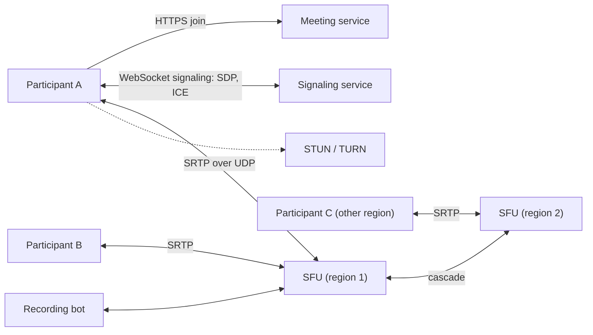
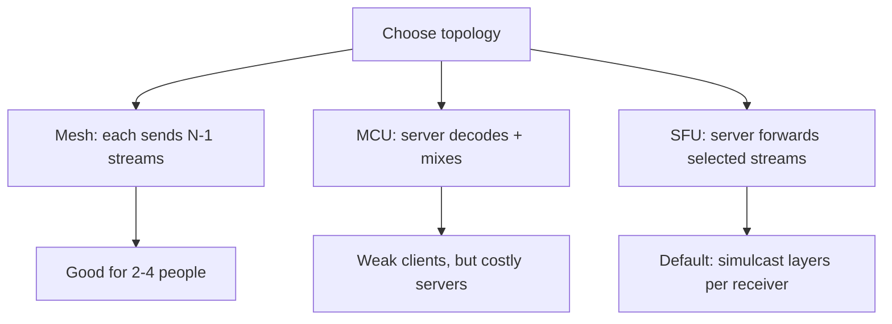

# 39 · Design Video Conferencing (Zoom / Meet)

> **Category:** Real-time media · **Difficulty:** ⭐⭐⭐⭐⭐ · **Patterns:** WebRTC, SFU with simulcast, signaling, STUN/TURN, congestion control

> Core challenges: **ultra-low latency real-time media** (< 150–300 ms mouth-to-ear), many participants, poor networks, NAT traversal.
> Related: Fundamentals → Networking (UDP, WebRTC), [Chat System (WhatsApp / Messenger / Slack)](09-chat-system.md), [Live Streaming (Twitch)](40-live-streaming.md).

---

## Architecture at a glance



### Key flow



---

## Step 1: Requirements
- **Functional:** create/join meetings, audio/video, screen share, chat, mute, recording, up to ~1,000 participants (large webinars separate).
- **Non-functional:** end-to-end latency < 200 ms, adapt to bandwidth (100 kbps → 10 Mbps), high availability, global users, secure (encrypted).

---

## Step 2: Why it's different from video streaming
| Video on demand / Live streaming | Video conferencing |
|---|---|
| Latency of seconds OK → buffer, TCP/HTTP (HLS/DASH) | Latency must be < ~200 ms → **no buffering**, **UDP (RTP/SRTP)** |
| One-to-many | Many-to-many |
| Re-transmit lost packets | Late packets useless → conceal loss (FEC, PLC) |

---

## Step 3: Media topologies

### Mesh (peer-to-peer)
Every participant sends its stream to every other participant.
- ✅ No media servers, lowest latency. ❌ Upload = (N−1) streams → breaks beyond ~4 people.

### MCU (Multipoint Control Unit)
Server decodes all streams, **mixes** into one composite video, re-encodes, sends one stream to each.
- ✅ Each client sends 1 & receives 1 stream (great for weak devices). ❌ Very CPU-expensive server, extra latency, fixed layout.

### ✅ SFU (Selective Forwarding Unit) — what Zoom/Meet/Teams use
Each client sends its stream **once** to the SFU; the SFU **forwards** (no decode) the relevant streams to each participant.
- Combined with **simulcast** (client sends 3 qualities: 180p/360p/720p) or **SVC** (scalable layers) → SFU picks the layer per receiver based on their bandwidth & layout (active speaker in HD, thumbnails in low-res).
- ✅ Cheap server (just routing packets), flexible layouts, scales to hundreds.
- For very large meetings: **cascade SFUs** across regions (each region's SFU forwards once to the other regions).

---

## Step 4: Architecture
```
Client ─HTTPS─► Meeting Service (create/join, auth, meeting metadata DB)
       ─WebSocket─► Signaling Service (SDP offer/answer, ICE candidates, participant events, chat, mute)
       ─UDP (SRTP)─► Media Server (SFU) in nearest region  ◄── cascade ──► SFU in other regions
                       ▲ STUN/TURN for NAT traversal
Recording Service: joins as a hidden participant, mixes, uploads to S3 → transcode → playback
Load/Allocation Service: picks SFU for a meeting based on region & load
```

### Signaling (WebRTC)
1. Join meeting via HTTPS → get SFU address & token.
2. Exchange **SDP** (codecs, resolutions) and **ICE candidates** over the WebSocket signaling channel.
3. ICE tries direct paths; uses **STUN** to discover public IP; falls back to **TURN** relay (TCP/443) behind strict firewalls.
4. Media flows over **SRTP** (encrypted RTP) via UDP.

---

## Step 5: Deep dives

### 5.1 Handling bad networks
- **Congestion control** (GCC / transport-cc): receivers report loss & delay; sender adjusts bitrate.
- **Simulcast/SVC** layer switching at the SFU per receiver.
- **Jitter buffer** (small, adaptive, ~20–60 ms) to smooth packet arrival.
- **FEC** (forward error correction) & **NACK**-based selective retransmission for important packets (keyframes).
- **Packet loss concealment** for audio; audio prioritised over video (drop video first).
- Opus audio codec (robust at low bitrates); VP8/VP9/H.264/AV1 video.

### 5.2 Choosing & scaling SFUs
- Place SFUs in many regions/edge PoPs; participant connects to the nearest; meeting's SFUs cascade.
- Allocation service tracks SFU load (CPU, bandwidth, participants) and assigns meetings; one large meeting may span multiple SFUs.
- SFU failure → clients reconnect (ICE restart) to another SFU in seconds; meeting state in signaling/Redis.

### 5.3 Large meetings & webinars
Only forward the top N active speakers' video; others audio-only/thumbnails on demand. Webinars with 10K+ viewers: panelists in SFU, audience via **live streaming** (HLS/LL-HLS, [Live Streaming (Twitch)](40-live-streaming.md).

### 5.4 Recording
A recording bot joins the SFU, receives streams, composites, encodes, uploads to object storage; transcode & make available via CDN.

### 5.5 Security
DTLS-SRTP encryption by default; **E2EE** option (insertable streams — SFU forwards encrypted frames it can't decrypt; disables server-side recording); meeting passwords, waiting rooms, host controls.

---

## Interview wrap-up
- UDP/WebRTC media, **SFU + simulcast** topology (compare mesh & MCU).
- Signaling over WebSocket; STUN/TURN for NAT traversal.
- Adaptive bitrate, jitter buffer, FEC, audio priority.
- Geo-distributed, cascaded SFUs; recording as a hidden participant.

---

## Interview Q&A

**Q: Why UDP instead of TCP?**
A: Retransmitted late frames are useless; low latency beats completeness — conceal loss instead.

**Q: How do you serve participants with different bandwidths?**
A: Simulcast/SVC — SFU forwards the right quality layer to each receiver.
