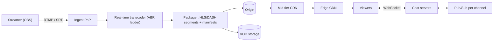
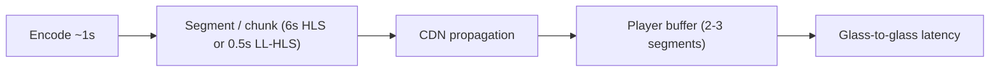

# 40 · Design Live Streaming (Twitch)

| Category | Difficulty | Key ideas |
|---|---|---|
| Media pipeline | Hard | RTMP/SRT ingest, real-time ABR transcoding, HLS/LL-HLS, multi-tier CDN, chat fan-out |

One broadcaster -> up to millions of viewers, latency of a few seconds, plus live chat.
Related: [YouTube (Video Upload & Streaming)](11-youtube.md), [Video Conferencing (Zoom / Meet)](39-video-conferencing.md), [Chat System (WhatsApp / Messenger / Slack)](09-chat-system.md).

---

## Architecture at a glance



### Key flow



---

## Requirements
- **Functional:** streamers broadcast live video; viewers watch with adaptive quality; live chat; follow/notifications; VOD of past broadcasts.
- **Non-functional:** glass-to-glass latency 2-10 s (low-latency mode ~2 s); smooth playback (no rebuffering); scale to millions of concurrent viewers per stream; global.

### Estimates
- 100K concurrent streams, 10M concurrent viewers.
- Avg viewer bitrate 3 Mbps -> 10M × 3 Mbps = **30 Tbps** egress -> must be served by CDN/edge.

---

## Pipeline
```
Streamer (OBS) ─RTMP/SRT/WebRTC─► Ingest servers (nearest PoP)
       ─► Transcoder cluster: decode → encode ladder (1080p60, 720p, 480p, 160p) → segment (2–6 s, or LL-HLS parts)
       ─► Origin (packager: HLS/DASH manifests + segments) ─► CDN edge caches ─► Viewers (HTTP)
                                   └─► Object storage (VOD archive)
Chat: WebSocket servers ◄─► Pub/Sub (per channel) ; Moderation service
Control plane: stream keys/auth, stream metadata, viewer counts, recommendations
```

---

## Deep dives

### Ingest
- Streamer connects to nearest ingest PoP (anycast/GeoDNS) with a **stream key** (auth).
- RTMP over TCP is the classic protocol; SRT/WebRTC (WHIP) for lower latency & resilience.
- Ingest forwards to the transcoding cluster in the region.

### Transcoding (real-time)
- Must keep up with real time: each stream transcoded into an **ABR ladder** in parallel (GPU/ASIC encoders).
- Assign each live stream to a transcoder worker (stateful for the duration); on failure, reassign quickly (brief glitch).
- Small/unpopular streams may get only "source quality" to save cost; transcode more renditions once viewership grows.

### Delivery with HLS/DASH via CDN
- Video split into short **segments**; a **manifest (playlist)** lists latest segments; players poll the manifest and fetch segments over HTTP -> CDN cacheable.
- **Adaptive bitrate (ABR)**: player picks rendition based on measured bandwidth & buffer level.
- Popular stream: one origin fetch per edge, then served to thousands from the edge cache (**request coalescing** at the edge is crucial so a new segment isn't fetched 1,000 times concurrently).
- Multi-tier CDN (edge -> regional mid-tier -> origin shield -> origin).

### Latency budget
`encoding + segment duration × (segments buffered) + CDN + player buffer`
- Traditional HLS (6 s segments, 3 buffered) -> 15-30 s.
- **LL-HLS / LL-DASH** (CMAF chunks of ~200-500 ms, preload hints, chunked transfer) -> 2-5 s.
- WebRTC delivery -> < 1 s but harder to scale (needs SFU-like fan-out trees).

### Live chat at scale
- Viewers connect via WebSocket to chat edge servers; each server subscribes to the channels its users are in (pub/sub: Redis/Kafka/custom).
- A message -> moderation (filters, rate limits, AutoMod) -> publish to channel -> every chat server with subscribers pushes to its users.
- Huge channels (1M viewers): fan-out tree, **sample/throttle** messages shown, slow mode, batch messages per 100-250 ms.

### Viewer counts & other metadata
Approximate concurrent viewers via heartbeat events aggregated in streaming jobs (HyperLogLog for unique viewers). Not strongly consistent.

### VOD
Segments are already in storage -> stitch into VOD playlist after stream ends; clip creation = select a segment range.

---

## Reliability
- Redundant ingest (streamer can send to backup), transcoder failover.
- CDN multi-provider for resilience.
- Graceful degradation: if transcoding capacity is exhausted, offer source-only.

---

## Points to mention in an interview
- RTMP/SRT ingest -> real-time ABR transcoding -> HLS/DASH segments -> multi-tier CDN.
- Latency vs scalability trade-off (HLS vs LL-HLS vs WebRTC).
- Edge request coalescing for hot streams.
- WebSocket chat with pub/sub fan-out and moderation.

---

## Interview Q&A

**Q: How do you serve 1M viewers of one stream?**
A: CDN edges with request coalescing - each edge fetches a segment once and serves thousands.

**Q: How do you cut latency to ~2 s?**
A: LL-HLS/CMAF chunks, smaller player buffers; WebRTC for sub-second at higher cost.
