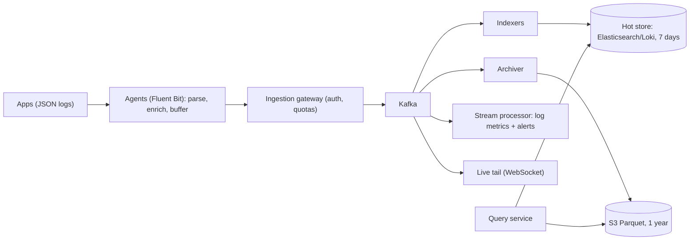
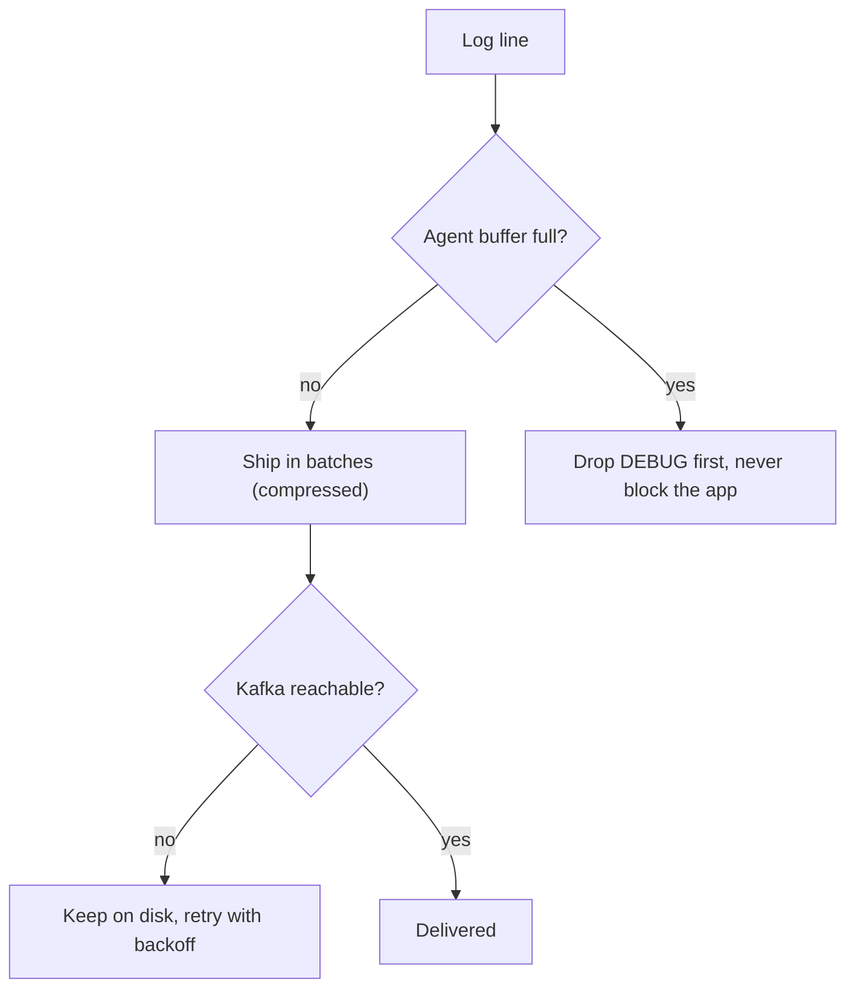

# 41 · Design Distributed Logging System

| Category | Difficulty | Key ideas |
|---|---|---|
| Observability infrastructure | Hard | agents with disk buffers, Kafka shock absorber, hot/cold tiers, indexing trade-offs |

Related: [Metrics Monitoring & Alerting System (Prometheus / Datadog)](17-metrics-monitoring-alerting.md), Fundamentals -> Observability, Message Queues, Search Systems, Storage Systems.

---

## Architecture at a glance



### Key flow



---

## Requirements
- **Functional:** collect logs from 100K+ hosts/containers; search by text, service, level, time range, trace id; live tail; dashboards & alerts on log patterns; retention policies.
- **Non-functional:** ingest **millions of lines/s** with bursts (incidents produce log storms); query recent logs in seconds; **don't lose logs**; logging must never take down applications; cost-efficient for petabytes.

### Estimates
- 100K hosts × 100 lines/s = 10M lines/s × 300 B ≈ **3 GB/s ≈ 250 TB/day** raw (compresses ~10×).
- Hot retention 7 days searchable, cold 1 year archived.

---

## Architecture
```
Apps (structured JSON logs to stdout/file)
  └─► Agent per host (Fluent Bit / Vector / Filebeat): tail, parse, enrich (host, pod, service), buffer on disk, batch & compress
        └─► Ingestion gateway (auth, rate limit per tenant)
              └─► Kafka (buffer, partitioned by service/tenant; retention 1–3 days)
                    ├─► Indexer workers ─► Hot store: Elasticsearch/OpenSearch (or Loki/ClickHouse) – 7 days
                    ├─► Archiver ─► S3 (Parquet/compressed, partitioned by date/service) – 1 year
                    ├─► Stream processor ─► log-based metrics & alerts (error rate per service)
                    └─► Live tail service (WebSocket)
Query service ─► hot store (recent) + S3 via Presto/Athena (historical)
```

---

## Deep dives

### Never block the application
- Apps write to stdout/local file; the agent ships asynchronously. If the pipeline is down, the agent buffers on disk (bounded) and drops oldest/lowest-priority (DEBUG) logs when full - **never** block app threads.

### Kafka as shock absorber
Log storms during incidents can be 10× normal. Kafka buffers so indexers catch up later; protects the search cluster; allows multiple consumers & replay (re-index after mapping changes).

### Indexing strategies (cost vs query power)
| Approach | Index | Query | Cost |
|---|---|---|---|
| **Full-text inverted index** (Elasticsearch) | Every token | Fast arbitrary text search | Expensive (index can be ≥ raw size) |
| **Label-only index** (Grafana Loki) | Only labels (service, level, pod) | Filter by labels, then brute-force grep chunks | Cheap |
| **Columnar** (ClickHouse) | Columns + skip indexes / bloom filters | Fast aggregations & filters on fields | Medium |

Time-based indices (`logs-2026.11.25`) -> easy retention (drop whole index), queries hit only relevant days. Hot-warm-cold tiers (SSD -> HDD -> S3 searchable snapshots).

### Schema & parsing
Prefer **structured logs** (JSON) with standard fields (`timestamp, level, service, trace_id, message`). Parse unstructured lines at agent (regex/grok). Avoid mapping explosions (too many dynamic field names).

### Multi-tenancy & cost control
Per-tenant quotas/rate limits, sampling of DEBUG/INFO logs, drop rules, separate indices per tenant/service, retention per tier.

### Querying
- Query API translates to ES DSL/LogQL/SQL; always require a time range.
- Correlate logs with traces via `trace_id`.
- Historical queries over S3 via Athena/Trino (slower, cheaper).

### Security & compliance
PII redaction at agent, encryption, RBAC per service/team, audit logs immutable (WORM storage).

---

## Points to mention in an interview
- Agents with disk buffering -> gateway -> **Kafka** -> indexers & archivers.
- Hot searchable tier (7 days) + cheap cold tier on S3.
- Indexing trade-off: full-text vs label-only vs columnar.
- Never block apps; quotas and sampling to control cost.

---

## Interview Q&A

**Q: Why Kafka in the middle?**
A: Log storms during incidents; Kafka buffers so the search cluster isn't overwhelmed and data isn't lost.

**Q: Full-text index or labels only?**
A: Full-text = powerful but expensive; label-only (Loki) = cheap, grep at query time.
