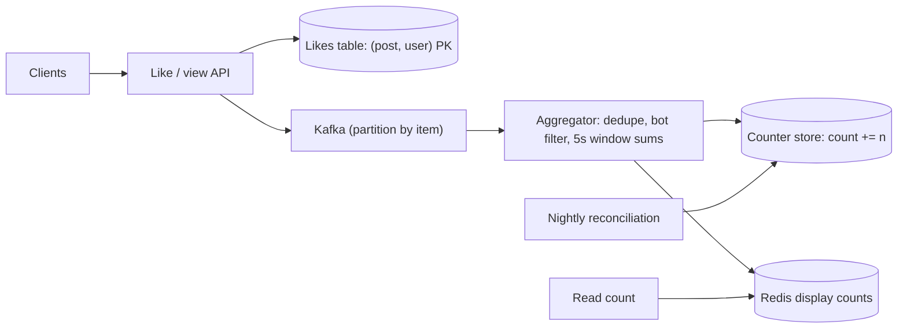
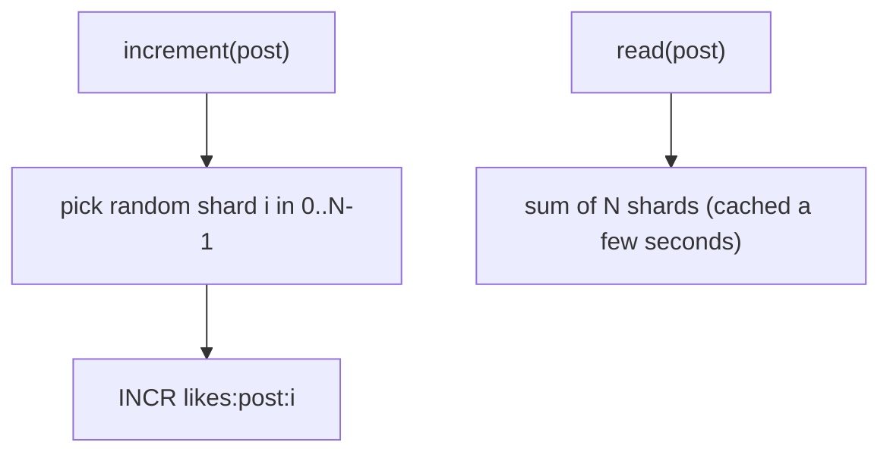

# 42 · Design Distributed Counter (Likes / Views)

> **Category:** Counting & aggregation · **Difficulty:** ⭐⭐⭐ · **Patterns:** row contention, Redis INCR, sharded counters, batched stream aggregation, CRDT counters

> "Just increment a number" becomes hard at **millions of increments per second**, often concentrated on a few viral items.
> Related: [Top-K Heavy Hitters (Trending)](34-top-k-heavy-hitters.md), [Ad Click Event Aggregation](18-ad-click-aggregation.md), Fundamentals → Caching, CAP, Stream Processing, Probabilistic DS.

---

## Architecture at a glance



### Key flow



---

## Step 1: Requirements
- Increment/decrement counts (views, likes, upvotes) and read them.
- **Likes/votes:** a user can like at most once (idempotent), can unlike; show "did I like this?".
- **Views:** count every view (dedupe repeated views from same user within a window, filter bots).
- Scale: 1M increments/s overall; single viral item 100K/s.
- Reads: very high; counts can be slightly stale (eventual consistency) — "1.2M" is fine.

---

## Step 2: Why the naive approach fails
`UPDATE posts SET likes = likes + 1 WHERE id = ?`
- Every increment locks the same row → **row contention**; a single DB row handles maybe ~1K updates/s.
- Read-modify-write races if not atomic.

---

## Step 3: Solutions (from simple to massive)

### A) Redis atomic counters
`INCR likes:{post_id}` — ~100K ops/s per shard. Persist periodically to DB (write-behind). Risk: lose a few seconds of counts on crash (acceptable for views).

### B) Sharded counters
Split one logical counter into N sub-counters: `likes:{post}:{0..N-1}`; increment a random shard; read = sum of shards (cache the sum). Spreads hot-key load (Google Cloud Firestore recommends this).

### C) Batching / local aggregation
App servers or stream processors aggregate in memory for 1–5 s and write `+n` once:
```
events → Kafka (partition by post_id) → Flink (tumbling 5s window, sum per post) → UPDATE counts SET c = c + :n
```
Reduces DB writes by orders of magnitude. Kafka gives durability & replay.

### D) CRDT counters for multi-region
**G-Counter / PN-Counter**: each region keeps its own increments; total = sum of all regions' values; merge = element-wise max. Writes are local and conflict-free (Redis Enterprise active-active, Riak).

---

## Step 4: Likes (with per-user uniqueness)
```
likes(post_id, user_id, created_at)  PRIMARY KEY (post_id, user_id)   ← Cassandra/DynamoDB/sharded SQL
```
1. `INSERT IF NOT EXISTS` (idempotent) → if inserted, emit `LikeAdded` event; unlike → delete → `LikeRemoved`.
2. Counter updated asynchronously from events (approach C), cached in Redis.
3. "Did I like this?" → point lookup `(post_id, user_id)`, or per-user Bloom filter/bitmap cache for feeds.
4. Display count from cache; slightly stale is OK. Periodic reconciliation job recomputes from the likes table to fix drift.

## Step 5: Views
- Client/edge sends view events → Kafka.
- **Dedupe**: same `(user/device, video)` within 30 min counted once (keyed state in Flink or Redis `SET NX EX`).
- **Bot/fraud filtering** before counts become public (YouTube famously freezes counts around 301 while validating).
- **Unique viewers**: HyperLogLog per video per day (mergeable).
- Store aggregates per time bucket for analytics (views per hour) in a time-series/OLAP store.

---

## Step 6: Architecture
```
Clients ─► API ─► (likes table write, idempotent) ─► Kafka: like/view events (partition by item_id)
                                                     │
                                       Stream aggregator (dedupe, filter, window sums)
                                                     ├─► Counter store (Cassandra counters / sharded SQL) — durable totals
                                                     ├─► Redis cache (display counts)
                                                     └─► OLAP (per-hour analytics)
Read: Redis → fallback DB
Nightly reconciliation: recompute from raw events/likes table
```

---

## Interview wrap-up
- Explain row contention; fix with **Redis INCR, sharded counters, and batched stream aggregation**.
- Per-user uniqueness via primary key on (item, user); counts derived asynchronously.
- Dedupe & bot filtering for views; HyperLogLog for unique counts.
- CRDT counters for multi-region; reconciliation for accuracy.

---

## Interview Q&A

**Q: Why not UPDATE count = count + 1?**
A: Every increment locks the same row; at thousands per second it serializes and times out.

**Q: How do you stop double likes?**
A: Primary key (post_id, user_id) makes the like idempotent; counts derive from events.
