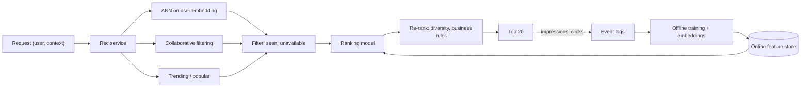
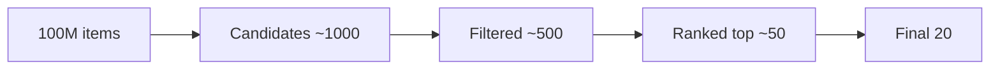

# 43 · Design Recommendation System

| Category | Difficulty | Key ideas |
|---|---|---|
| ML serving | Hard | candidate generation, ranking, feature store, ANN retrieval, A/B testing, cold start |

Related: [Twitter (X)](26-twitter.md), [Instagram](27-instagram.md), [Web Search Engine](36-web-search-engine.md), Fundamentals -> Batch & Stream Processing, Storage, Caching.

---

## Architecture at a glance



### Key flow



---

## Requirements
- **Functional:** personalised recommendations on home page ("Because you watched X"), similar items on item pages, refresh as user behaviour changes.
- **Non-functional:** serve in < 100-200 ms; millions of users & items; fresh within minutes for session behaviour; A/B testable; handle cold start.

---

## The standard architecture - multi-stage funnel
```
All items (100M) ─► Candidate generation (fast, recall) ─► ~1,000 candidates
                  ─► Filtering (already watched, unavailable, policy) ─► ~500
                  ─► Ranking (heavy ML model, precision) ─► top ~50 scored
                  ─► Re-ranking (diversity, freshness, business rules, ads) ─► final 20
```
You can't run an expensive model on 100M items per request -> narrow down in stages.

### Candidate generation sources (union of several)
- **Collaborative filtering**: users who liked X also liked Y (item-item similarity); matrix factorisation.
- **Two-tower embedding model**: user tower & item tower -> embeddings; **ANN search** (FAISS/ScaNN/HNSW in a vector DB) for nearest items to the user embedding.
- **Content-based**: similar genre/text/image embeddings.
- **Popular / trending** in user's region (cold start).
- **Social / graph-based**: what friends engaged with.

### Ranking
Gradient-boosted trees or deep models predicting P(click), P(watch > 30s), expected watch time, etc., using features: user features (history, demographics), item features (category, age, popularity), context (time, device), cross features. Combined into a final score with business weights.

---

## System components
```
            ┌───────── Offline (batch, daily) ─────────┐
Event logs ─► Data lake ─► Feature pipelines ─► Training (Spark/TF/PyTorch) ─► Model registry
            │                └► Item/user embeddings ─► ANN index build ─┐
            └────────────────────────────────────────────────────────────┤
            ┌───────── Nearline (streaming, minutes) ──────────┐         │
Events ─► Kafka ─► Flink ─► real-time features (last 10 watched,  │         │
                            session clicks) ─► Feature Store (online: Redis/Cassandra)
            └──────────────────────────────────────────────────┘         │
            ┌───────── Online (per request, < 200 ms) ─────────┐         ▼
Request ─► Rec Service ─► candidate generators (ANN index, CF tables, trending cache)
                       ─► fetch features (online feature store)
                       ─► Ranking model server (TF Serving / Triton)
                       ─► re-rank & business rules ─► response (+ log impressions)
```

### Feature store
Same feature definitions for training (offline store, historical, point-in-time correct) and serving (online store, low latency) -> avoids **training/serving skew**.

### Precompute vs real-time
- Precompute recommendations for all users nightly (cheap serving, stale).
- Real-time ranking with fresh session features (better, costlier).
- Hybrid: precompute candidates, rank at request time; cache results per user for minutes.

---

## Feedback loop & evaluation
- Log impressions, clicks, watch time -> training labels.
- **Offline metrics**: precision@K, recall@K, NDCG, AUC.
- **Online A/B tests**: CTR, watch time, retention - the real judge.
- Beware feedback loops/popularity bias -> exploration (bandits, inject diverse items).

---

## Cold start
- **New user**: popular/trending, onboarding questions, context (country, device), quickly adapt with session events.
- **New item**: content-based embeddings (metadata, text, thumbnail), boosted exploration slots.

---

## Scaling notes
- ANN indexes sharded & replicated, rebuilt periodically with incremental updates.
- Model servers on GPUs/CPUs autoscaled; batch requests.
- Timeouts per stage with fallbacks (if ranking times out -> return candidates ordered by popularity).

---

## Points to mention in an interview
- Multi-stage funnel: **candidate generation -> filtering -> ranking -> re-ranking**.
- Two-tower embeddings + ANN for retrieval; heavy model for ranking.
- Offline/nearline/online layers with a feature store.
- A/B testing, feedback loops, cold-start strategies.

---

## Interview Q&A

**Q: Why multiple stages?**
A: You can't run a heavy model over 100M items per request; each stage trades recall for precision at lower cost.

**Q: Cold-start users?**
A: Popular/trending, onboarding preferences, context, quick adaptation from session events.
