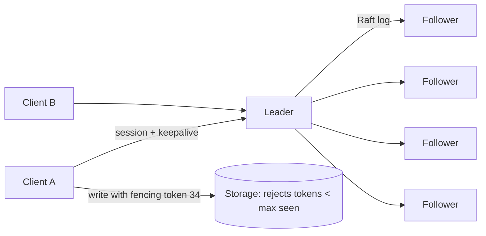
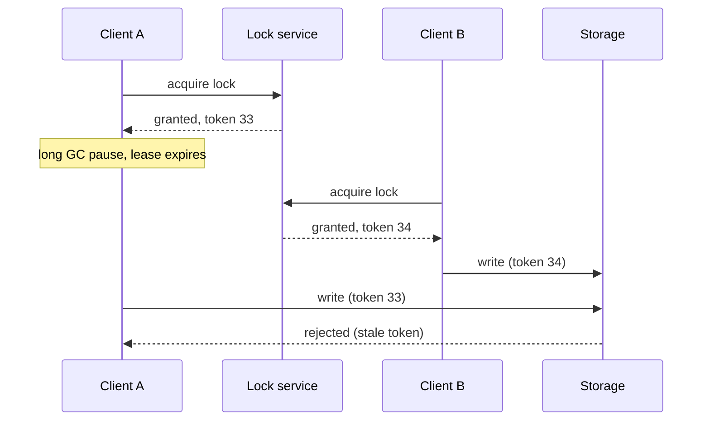

# 44 · Design Distributed Lock Service (Chubby / ZooKeeper)

> **Category:** Coordination infrastructure · **Difficulty:** ⭐⭐⭐⭐ · **Patterns:** Raft replication, sessions & leases, fencing tokens, ephemeral sequential nodes

> Related: Fundamentals → Consensus & Locks, Clocks; [Distributed Job Scheduler](32-distributed-job-scheduler.md).

---

## Architecture at a glance



### Key flow



---

## Step 1: Requirements
- **Functional:** `acquire(lock_name, ttl)`, `release`, `renew`; blocking & try-lock; watch for changes; small key-value store for config & leader election; ephemeral entries tied to client sessions.
- **Non-functional:** **correctness first** — never two holders of an exclusive lock (safety) — then availability; tolerate node failures; moderate throughput (thousands of ops/s, not millions); low-latency reads.

---

## Step 2: Core design — replicated state machine via consensus
```
Clients ──(session, keepalives)──► Leader ──Raft log──► Followers (5 nodes across 3 AZs)
```
- 5 replicas run **Raft** (or Paxos/ZAB). All writes (acquire/release/set) go through the leader and are committed once a **majority** persists them.
- Tolerates 2 failures; minority partition can't commit → no split brain.
- Reads: linearizable reads go through the leader (with a read-index/lease check); follower reads possible if stale reads are acceptable.

## Step 3: Sessions & leases
- Client opens a **session** with a TTL (e.g., 10 s) and sends keepalives.
- Locks/ephemeral nodes are attached to the session. If keepalives stop (client crashed or partitioned), the session expires → its locks are released automatically.
- Client side: if it can't reach the service before its local session timeout, it must **assume it lost the lock** and stop acting.

## Step 4: Fencing tokens ⭐
Because a client may pause (GC, VM freeze) and resume after its lease expired, the service returns a **monotonically increasing token** (e.g., Raft log index / lock version) on acquire. Downstream resources (DB, storage) reject operations with a token lower than the highest seen. This is what makes the lock *safe*, not just the lock service.

## Step 5: Data model
Hierarchical namespace (like a file system): `/locks/orders/42`, `/config/feature_x`, `/election/scheduler/n_0000012`. Each node: data (small, ≤ 1 MB), version, ephemeral flag, sequence flag, ACL.

## Step 6: Recipes built on top
- **Exclusive lock**: create ephemeral node; if exists → watch it and wait.
- **Fair lock / queue**: ephemeral sequential nodes; lowest sequence holds lock; each waiter watches only its predecessor (avoids herd effect).
- **Leader election**: same as fair lock; the holder is leader.
- **Service discovery & config**: services register ephemeral nodes; clients watch for changes.
- **Barriers / group membership.**

## Step 7: Watches & notifications
Clients register watches on nodes; the server pushes a one-time event on change. Clients cache data and invalidate on watch events (Chubby: cache with invalidation — strongly consistent caching).

## Step 8: Scaling
- Not designed for high write throughput (every write = consensus round). Keep data small; use for coordination, not as a general DB.
- Scale reads with follower/observer nodes & client caching.
- Separate cells per region/purpose to limit blast radius.

## Step 9: Alternatives & trade-offs
| Option | Safety | Notes |
|---|---|---|
| Single Redis `SET NX PX` | Weak (failover can lose lock) | Fine for efficiency locks |
| Redlock (5 Redis masters) | Debated (clock assumptions) | |
| ZooKeeper / etcd / Chubby | Strong (consensus) + fencing | Standard for correctness |
| DB row lock / unique constraint | Strong within one DB | Often simplest |

---

## Interview wrap-up
- Raft-replicated state machine with majority quorum (5 nodes, 3 AZs).
- Sessions + keepalives → ephemeral locks auto-release on failure.
- **Fencing tokens** to handle paused clients.
- Recipes: locks, leader election, service discovery via ephemeral sequential nodes & watches.

---

## Interview Q&A

**Q: Why isn't a lease alone enough?**
A: A paused client may wake up after expiry and still act; fencing tokens let the storage reject it.

**Q: Why 5 nodes?**
A: Majority of 3 survives 2 failures; even sizes add cost without extra tolerance.
