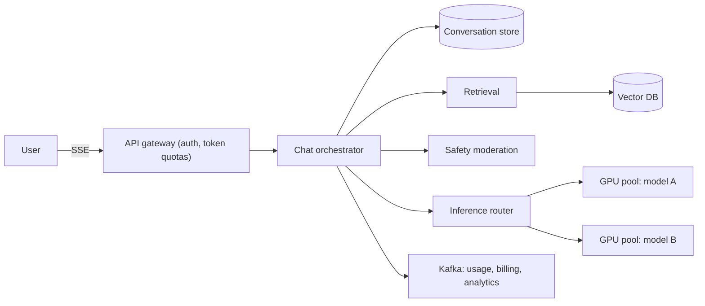
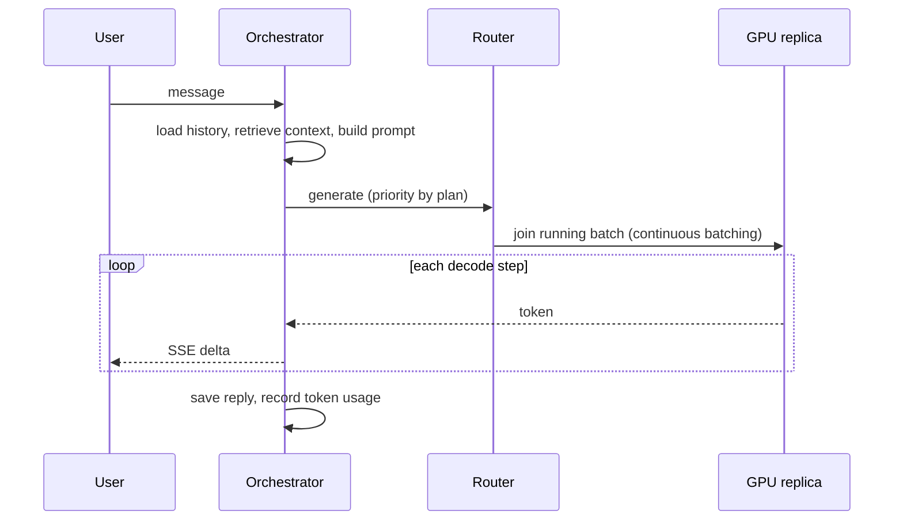

# 45 · Design LLM Chat Service (ChatGPT-like)

> **Category:** GPU-bound serving · **Difficulty:** ⭐⭐⭐⭐⭐ · **Patterns:** continuous batching, KV cache, prefix caching, SSE streaming, token rate limits, RAG

> A modern interview favourite: serving large language models is GPU-bound, latency-sensitive (streaming tokens), and expensive.
> Related: [Chat System (WhatsApp / Messenger / Slack)](09-chat-system.md), [Rate Limiter](01-rate-limiter.md), Fundamentals → Networking (SSE), Caching, Message Queues, Search (vector/RAG).

---

## Architecture at a glance



### Key flow



---

## Step 1: Requirements
- **Functional:** users chat with a model; responses **stream token by token**; conversation history; file upload & retrieval-augmented answers (RAG); multiple model tiers; usage limits per plan.
- **Non-functional:** time-to-first-token (TTFT) < 1 s, smooth token streaming; high availability; fairness across users; cost efficiency (GPUs are the bottleneck); safety filtering.

### Estimates
- 10M DAU × 10 messages = 100M requests/day ≈ 1.2K req/s avg, ~5K peak.
- Avg 1K input tokens (history + prompt) + 500 output tokens.
- If one GPU replica generates ~2K tokens/s aggregate with batching → output demand 5K × 500 = 2.5M tokens/s → ~1,250 replicas (each replica may span several GPUs). **GPU capacity planning dominates the design.**

---

## Step 2: API
```
POST /v1/conversations                         → {conversation_id}
POST /v1/conversations/{id}/messages  {content, model, attachments[]}
     → text/event-stream (SSE): data: {"delta":"Hel"} ... data: [DONE]
GET  /v1/conversations?cursor=        GET /v1/conversations/{id}/messages
```
SSE (or WebSocket) for streaming; client can cancel (close stream → stop generation to save GPU).

---

## Step 3: High-level design
```
Client ─► CDN/Edge (static) 
       ─► API Gateway (auth, plan-based rate limits/token quotas)
             ─► Chat Orchestrator (stateless)
                  ├─ load conversation history (Conversation Store: Cassandra/DynamoDB, keyed by conversation_id)
                  ├─ build prompt: system prompt + truncated/summarised history + retrieved context
                  ├─ RAG: embed query → Vector DB (user's docs) → top-k chunks
                  ├─ safety check (input moderation)
                  ├─► Inference Router ─► Model server pools (GPU clusters per model, per region)
                  │        └ stream tokens back
                  ├─ output moderation (streaming)
                  └─ persist assistant message + usage (async via Kafka → billing/analytics)
```

---

## Step 4: Deep dives

### 4.1 Inference serving (the core)
- Model weights sharded across GPUs (**tensor parallelism**, pipeline parallelism) for large models.
- **Continuous batching** (vLLM, TensorRT-LLM, TGI): new requests join the running batch at every decoding step instead of waiting → much higher throughput.
- **KV cache** stores attention keys/values of processed tokens; memory managed in pages (PagedAttention) → more concurrent sequences.
- **Prefill** (process prompt, compute-bound) vs **decode** (generate token by token, memory-bandwidth-bound) — some systems disaggregate them onto different GPU pools.
- **Prompt/prefix caching**: reuse KV cache for shared prefixes (system prompt, long documents) → lower TTFT & cost.
- Speculative decoding, quantisation (FP8/INT4) for speed.

### 4.2 Routing & load management
- Router picks a replica by queue depth/KV-cache memory, model version, region; **session affinity** to reuse cached prefixes.
- Admission control: if all replicas saturated → queue with priority (paid tiers first) or return 429/"at capacity".
- Rate limits in **tokens per minute** per user/org, not just requests.
- Autoscaling is slow (GPU nodes + loading 100s of GB of weights takes minutes) → keep headroom, scale on predicted demand, warm pools.

### 4.3 Streaming
Model server streams tokens → orchestrator → SSE to client. Handle client disconnects (cancel generation). Buffer a little for output moderation if required.

### 4.4 Conversation storage & context management
- Messages stored per conversation (partition key `conversation_id`, sort by message seq).
- Context window limit → truncate oldest turns, or summarise older history, or retrieve relevant past turns via embeddings.

### 4.5 RAG (files & knowledge)
Upload → parse → chunk → embed → store in vector DB with ACL metadata (only the user's own docs!) → at query time retrieve top-k chunks, add to prompt with citations.

### 4.6 Safety & abuse
Input/output classifiers, jailbreak detection, PII handling, rate limiting, audit logs.

### 4.7 Reliability & cost
Multi-region GPU pools with failover; graceful degradation to a smaller model under load; usage metering via events → billing; caching identical requests is rarely useful (non-deterministic, personalised) except for prefix caching.

---

## Interview wrap-up
- Stateless orchestrator + conversation store + GPU inference pools.
- **Continuous batching, KV cache, prefix caching, tensor parallelism**.
- SSE token streaming with cancellation; token-based rate limits & priority admission control.
- RAG via vector DB; moderation; capacity planning in GPUs.

---

## Interview Q&A

**Q: What limits throughput?**
A: GPU memory for the KV cache and memory bandwidth during decoding; continuous batching and paged KV cache raise concurrency.

**Q: How do you rate-limit fairly?**
A: By tokens per minute per user/org, with priority admission for paid tiers when saturated.
