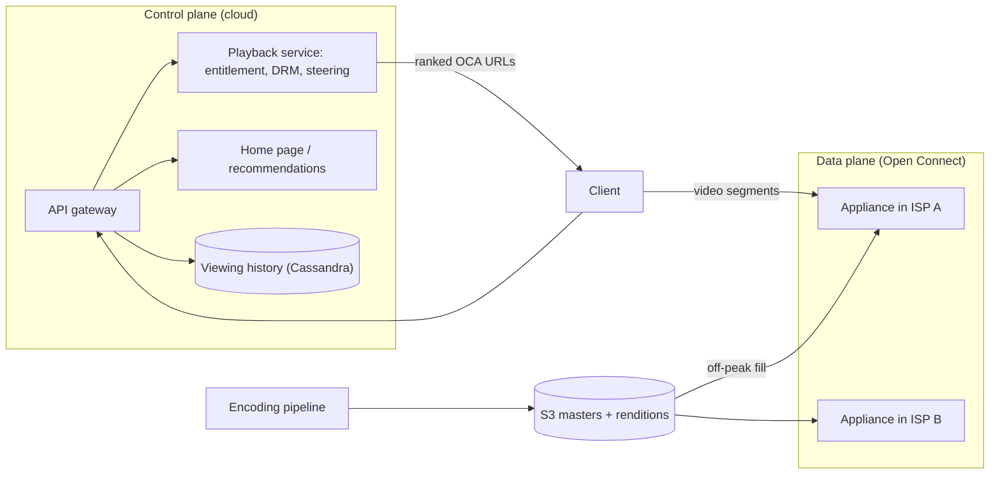
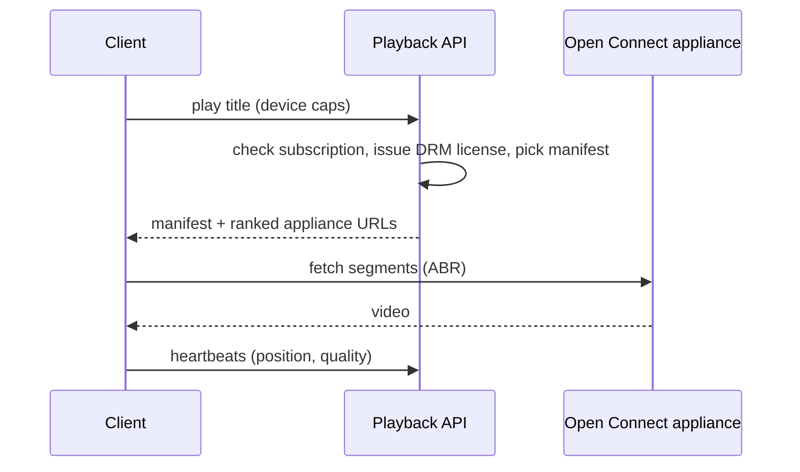

# 46 · Design Netflix (Subscription Video Streaming)

| Category | Difficulty | Key ideas |
|---|---|---|
| Media delivery | Hard | control plane vs data plane, own CDN inside ISPs, per-title encoding, proactive caching |

[YouTube (Video Upload & Streaming)](11-youtube.md) covers YouTube (user uploads at massive scale). Netflix differs: a **curated catalog** (tens of thousands of titles), **very high quality**, **predictable peak hours**, and its own CDN.
Related: [YouTube (Video Upload & Streaming)](11-youtube.md), [Live Streaming (Twitch)](40-live-streaming.md), [Recommendation System](43-recommendation-system.md), Fundamentals -> Storage, Reliability.

---

## Architecture at a glance



### Key flow



---

## Requirements
- **Functional:** browse personalised home page; play titles with adaptive quality; resume across devices ("continue watching"); profiles; downloads for offline; subtitles/audio tracks.
- **Non-functional:** start playback < 2 s; no rebuffering; 200M+ subscribers, peak evening traffic (Netflix ≈ a large share of global internet downstream); highly available (multi-region); DRM.

---

## Two planes
```
CONTROL PLANE (AWS, multi-region): sign-in, catalog, home page, recommendations, playback authorization,
                                   steering (which CDN server to use), billing, viewing history
DATA PLANE (Open Connect CDN): video bytes from appliances inside ISPs / IXPs
```

---

## Content ingestion & encoding (offline)
1. Studio delivers high-quality master (mezzanine) files.
2. Split into chunks -> parallel encoding on thousands of instances.
3. **Per-title / per-shot encoding**: choose bitrate ladder per title (cartoons need fewer bits than action movies) and per scene -> better quality at lower bandwidth.
4. Many codecs (H.264, HEVC, VP9, AV1) × resolutions × bitrates × audio tracks × subtitles -> each title = **thousands of files**.
5. Package for DASH/HLS, encrypt (DRM: Widevine, FairPlay, PlayReady).
6. Store in S3, then **proactively push to Open Connect Appliances (OCAs)** during off-peak hours based on predicted popularity per region.

---

## Playback flow
1. User presses play -> client calls **Playback API** with device capabilities.
2. Control plane checks entitlement & DRM license, picks a **manifest** (available streams for this device), and **steers** to the best OCAs (health, load, proximity, which ones have the file) - returns a ranked list of URLs.
3. Client fetches segments from the OCA over HTTPS; **ABR algorithm** adapts quality based on throughput & buffer.
4. If an OCA fails or is slow, client switches to the next URL.
5. Client sends heartbeats (position, quality, rebuffers) -> viewing history ("continue watching") + QoE analytics.

---

## Open Connect (own CDN) - why?
- Massive, predictable traffic -> cheaper & better to put storage appliances **inside ISP networks** (free to ISPs, saves their transit costs).
- **Proactive caching**: content pre-positioned overnight; ~95%+ of traffic served from within the ISP.
- Fill hierarchy: OCAs fill from other OCAs / regional fills instead of origin.

---

## Control plane architecture
- Hundreds of **microservices** on AWS behind an API gateway (Zuul) with client-specific adapters (BFF).
- Data: Cassandra (viewing history, multi-region active-active), EVCache (Memcached-based) for caching, MySQL for billing, Kafka for events, S3 data lake + Spark/Flink for analytics.
- **Resilience**: circuit breakers & fallbacks (if personalisation fails, show popular rows), chaos engineering (Chaos Monkey/Kong), multi-region active-active with ability to evacuate a region within minutes.

---

## Home page personalisation
Rows ("Trending", "Because you watched...") and their ordering, plus **personalised artwork** per user - computed by recommendation pipelines ([Recommendation System](43-recommendation-system.md)), precomputed & cached, assembled per request.

---

## Points to mention in an interview
- Separate control plane (cloud microservices) from data plane (own CDN inside ISPs).
- Per-title/per-shot encoding, many renditions, DRM.
- Proactive off-peak content placement; client-side ABR with fallback URLs.
- Resilience via fallbacks, chaos engineering, multi-region active-active.

---

## Interview Q&A

**Q: Why build an own CDN?**
A: Massive predictable traffic: appliances inside ISPs are cheaper and faster, filled proactively during off-peak hours.

**Q: Per-title encoding?**
A: Choose bitrate ladders per title/scene complexity - same quality at fewer bits.
